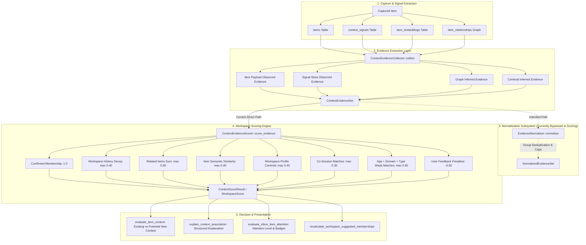
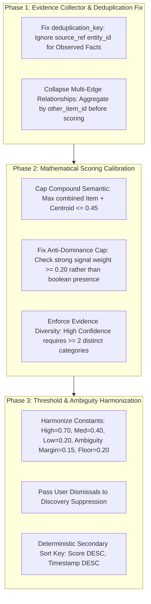

# Context Engine Scoring Accuracy & Reliability Audit

**Status:** Completed  
**Date:** September 2026  
**Target Subsystems:** Context Engine Scoring (`src-tauri/src/context_engine/`)  
**Scope:** `ContextEvidence`, `EvidenceCollector`, `EvidenceNormalizer`, `ContextEvidenceScorer`, `explanation.rs`, `discovery.rs`, `attention.rs`, `reasoning/builder.rs`  
**Commit Reference:** `docs: audit context scoring accuracy`  

---

## 1. Executive Summary

Following the Day 13 refactoring that established the centralized [ContextEvidence](file:///Users/deepanshukhatri/Desktop/ContextSplit/src-tauri/src/context_engine/evidence.rs#L273-L343) data model, [ContextEvidenceCollector](file:///Users/deepanshukhatri/Desktop/ContextSplit/src-tauri/src/context_engine/evidence.rs#L971-L1391), and [EvidenceNormalizer](file:///Users/deepanshukhatri/Desktop/ContextSplit/src-tauri/src/context_engine/normalization.rs#L295-L669), this audit assesses the **accuracy, mathematical reliability, and conservatism** of contextual predictions across ContextSplit.

While the Day 13 refactoring successfully decoupled evidence collection from decision-making, in-depth static and mathematical auditing reveals several critical scoring vulnerabilities:

1. **Disconnected Normalization Pipeline:** While [EvidenceNormalizer](file:///Users/deepanshukhatri/Desktop/ContextSplit/src-tauri/src/context_engine/normalization.rs#L295-L669) was built to deduplicate signals, group correlated instances, and detect contradictions, [ContextEvidenceScorer](file:///Users/deepanshukhatri/Desktop/ContextSplit/src-tauri/src/context_engine/scoring.rs#L191-L602) consumes raw `ContextEvidenceSet` directly and bypasses `EvidenceNormalizer`, allowing raw duplicate signals to inflate scores.
2. **Double-Counting Multipliers:** Items with metadata stored in both `items.metadata` and `context_signals` generate dual evidence records due to differing source entity references in the deduplication key.
3. **Compound Semantic Inflation:** Pairwise item embedding cosine similarity (capped at `0.40`) and workspace centroid profile similarity (capped at `0.45`) are summed additively, allowing a single text embedding match to generate an `0.85` (85%) "High" confidence score with zero supporting contextual diversity.
4. **Anti-Dominance Cap Leakage:** The anti-dominance guard in `scoring.rs` only activates when `has_strong_signal == false`. If any minor signal exists (such as a 90-day-old decayed history signal or a single 0.30 relationship edge), weak signals (app, domain, content type) bypass the `0.24` cap and contribute up to `0.60` additive score.
5. **Threshold Discrepancies Across Subsystems:** Ambiguity margins (`0.12` vs `0.15`), runner-up qualification thresholds (`0.35` vs `0.10`), and confidence band divisions (`0.60` vs `0.70` vs `0.75`) diverge across `scoring.rs`, `attention.rs`, and `discovery.rs`.
6. **Suppression Inconsistencies in Discovery:** Candidate discovery suppression computes workspace affinity independently without inspecting user dismissals or negative feedback signals.

This document details all findings across the 8 specific focus areas and provides minimal, non-disruptive recommendations to make contextual predictions conservative, explainable, and resilient against hallucinated certainty.

---

## 2. End-to-End Scoring Data Flow & Architectural Inspection



---

## 3. Detailed Audit Findings

```
┌─────────────────────────────────────────────────────────────────────────────────────────────┐
│                                 CRITICAL AUDIT MATRIX                                       │
├───────────────────────────────┬───────────────────────────────┬─────────────────────────────┤
│ Audit Category                │ Primary Affected Locations    │ Severity / Risk Level       │
├───────────────────────────────┼───────────────────────────────┼─────────────────────────────┤
│ 1. Double-Counted Evidence    │ evidence.rs:1006-1140,        │ High (Artificial score      │
│                               │ scoring.rs:287-380            │ inflation)                  │
│ 2. Strongly Correlated Types  │ evidence.rs, discovery.rs,    │ High (Compound confidence   │
│                               │ scoring.rs                    │ without real diversity)     │
│ 3. Dominating Weak Signals    │ scoring.rs:530-541,           │ High (False high-confidence │
│                               │ discovery.rs:948-982          │ suggestions on generic apps)│
│ 4. Missing Contradictions     │ scoring.rs:507-526,           │ Medium (Suppressed contexts │
│                               │ discovery.rs:1171-1379        │ resurrect after dismissal)  │
│ 5. Low Diversity High Conf.   │ scoring.rs:351-380,           │ High (Single vector match   │
│                               │ discovery.rs:800-840          │ triggers 85% confidence)    │
│ 6. Ambiguous Score Resolution │ scoring.rs:876,               │ Medium (Inconsistent inbox  │
│                               │ attention.rs:195-207          │ attention classification)   │
│ 7. Hard-Coded Thresholds      │ scoring.rs, discovery.rs,     │ Medium (Scattered magic     │
│                               │ attention.rs                  │ numbers prevent tuning)     │
│ 8. Missing Test Coverage      │ workflow_tests.rs,            │ High (Regression risk on    │
│                               │ evidence_pipeline_e2e_tests.rs│ scoring adjustments)        │
└───────────────────────────────┴───────────────────────────────┴─────────────────────────────┘
```

---

### Finding 1: Evidence Types That Can Be Double-Counted

#### 1.1. Dual Ingestion: Item-Level Metadata vs. ContextSignals Store
In [src-tauri/src/context_engine/evidence.rs](file:///Users/deepanshukhatri/Desktop/ContextSplit/src-tauri/src/context_engine/evidence.rs#L1004-L1140), `ContextEvidenceCollector::collect` extracts observed facts from two separate database sources:
1. `items.metadata` JSON (lines 1004–1050): emits `observed_url`, `observed_domain`, `observed_file_metadata`, `observed_capture_method`, `observed_app`, and `observed_window`.
2. `context_signals` table rows (lines 1055–1190): emits matching evidence items for `active_app`, `window_title`, `url_metadata`, `file_metadata`, and `capture_event`.

**The Deduplication Bug:**
The collector's deduplication function ([evidence.rs:1375–1390](file:///Users/deepanshukhatri/Desktop/ContextSplit/src-tauri/src/context_engine/evidence.rs#L1375-L1390)) includes `source_key` in the deduplication signature:
```rust
let source_key = ev.source_ref.as_ref()
    .map(|r| format!("{}:{}", r.entity_type.as_str(), r.entity_id))
    .unwrap_or_default();
```
- Evidence generated from `item.metadata` has `source_ref: None` (`source_key = ""`).
- Evidence generated from `context_signals` has `source_ref: Some(EntityReference::signal(&sig.id))` (`source_key = "signal:<uuid>"`).
- Consequently, identical app names (e.g. `"Google Chrome"`) and domain strings (e.g. `"github.com"`) produce different deduplication keys and **both remain in the evidence set**.

#### 1.2. Workspace Context Loop Multiplier
When [load_workspace_scoring_contexts](file:///Users/deepanshukhatri/Desktop/ContextSplit/src-tauri/src/context_engine/scoring.rs#L606-L665) gathers workspace history, it populates `ws.app_names` and `ws.domains` by appending an entry for every signal in the database.
In [scoring.rs:413–478](file:///Users/deepanshukhatri/Desktop/ContextSplit/src-tauri/src/context_engine/scoring.rs#L413-L478):
```rust
for ev in evidence_set.by_category(EvidenceCategory::SourceApp) {
    if let Some(app) = ev.attributes.get("app_name").and_then(|v| v.as_str()) {
        let matches = ws.app_names.iter().filter(|&a| a == app).count();
        if matches > 0 {
            app_match_count += matches;
        }
    }
}
```
If `evidence_set` has 2 `SourceApp` records (due to Bug 1.1) and the workspace has 5 items each with an `active_app` signal, `app_match_count` becomes $2 \times 5 = 10$, immediately hitting the `same_source_app_max` cap (`0.20`). The same multiplication occurs for domains and sessions.

#### 1.3. Multi-Relationship Edge Summation on Single Items
In [scoring.rs:287–305](file:///Users/deepanshukhatri/Desktop/ContextSplit/src-tauri/src/context_engine/scoring.rs#L287-L305):
```rust
for ev in evidence_set.items.iter().filter(|e| e.category == EvidenceCategory::RelatedItem || e.category == EvidenceCategory::TemporalProximity) {
    if let Some(oid) = other_id {
        if belongs_to_ws {
            rel_score_sum += ev.strength as f32;
            rel_match_count += 1;
        }
    }
}
```
If Item A and Item B share 3 relationship edges in `item_relationships` (`same_session: 0.40`, `temporal_proximity: 0.20`, `same_app: 0.30`), the loop counts 3 matches with total strength $0.90$ for a single related item.

#### 1.4. Workspace Profile Centroid + Individual Item Semantic Similarity
In [scoring.rs:324–380](file:///Users/deepanshukhatri/Desktop/ContextSplit/src-tauri/src/context_engine/scoring.rs#L324-L380):
- `max_item_semantic` matches the best pairwise item embedding (max `0.40`).
- `profile_semantic` matches the centroid embedding of the workspace (max `0.45`).
- For a workspace with 1 or 2 items, the centroid vector is mathematically identical (or nearly identical) to the individual item vector. Both scores are summed directly: $0.40 + 0.45 = 0.85$, doubling the weight of a single semantic embedding comparison.

---

### Finding 2: Evidence Types That Are Strongly Correlated

The following evidence types represent overlapping facets of the same capture interaction but are scored as independent additive signals:

| Correlated Group | Constituent Evidence Types | Current Combined Max Score | Root Interaction |
|---|---|---|---|
| **Web Browsing Activity** | `SourceApp` ("Chrome") + `BrowserDomain` ("github.com") + `BrowserUrl` ("github.com/repo") + `SourceWindow` ("repo - Chrome") | $0.20\text{ (app)} + 0.30\text{ (domain)} + 0.10\text{ (type)} = \mathbf{0.60}$ | Single browser tab capture |
| **Temporal Co-Occurrence** | `SameSession` + `TemporalProximity` + Graph Relationship `same_session` | $0.30\text{ (sess)} + 0.50\text{ (rel)} = \mathbf{0.80}$ | Items captured in sequence within 2 minutes |
| **Semantic Meaning** | `SemanticSimilarity` (Item-Item) + `WorkspaceProfile` (Centroid) | $0.40\text{ (item)} + 0.45\text{ (centroid)} = \mathbf{0.85}$ | Single FastEmbed cosine similarity vector comparison |
| **File / Code Ingestion** | `FileMetadata` (".rs") + `ContentType` ("code") + `SourceApp` ("VSCode") | $0.20\text{ (app)} + 0.10\text{ (type)} = \mathbf{0.30}$ | Dragging or opening a code file |

**Impact:** A user capturing a single webpage link in Google Chrome can accumulate up to $0.60$ score purely from the browser metadata and content type without any session, semantic, or historical confirmation.

---

### Finding 3: Weak Signals That Can Currently Dominate

#### 3.1. Anti-Dominance Cap Leakage in `scoring.rs`
In [src-tauri/src/context_engine/scoring.rs:530–540](file:///Users/deepanshukhatri/Desktop/ContextSplit/src-tauri/src/context_engine/scoring.rs#L530-L540), the anti-dominance cap is structured as follows:
```rust
let mut raw_positive_score: f32 = contributions.iter().filter(|c| c.is_positive).map(|c| c.weighted_score).sum();

if !has_strong_signal && only_weak_signals && raw_positive_score > 0.0 {
    if raw_positive_score > self.weights.weak_signals_isolated_cap {
        raw_positive_score = self.weights.weak_signals_isolated_cap;
    }
    uncertainty.push("Only weak peripheral signals...".to_string());
}
```

**The Flaw:**
`has_strong_signal` is set to `true` whenever **any** of the following occur:
- `WorkspaceHistory` is present (even if decayed down to $0.01$ from 6 months ago).
- `RelatedItem` has 1 match (even if strength is $0.30 \times 0.20 = 0.06$).
- `SemanticSimilarity` has 1 match (even if strength is $0.31$).
- `SameSession` has 1 match.

Once `has_strong_signal == true`, `only_weak_signals` is set to `false`. As a result:
$$\text{Total Score} = \text{Weak History } (0.02) + \text{App } (0.20) + \text{Domain } (0.30) + \text{Content Type } (0.10) = \mathbf{0.62} \rightarrow \text{High Confidence!}$$
A nearly decayed historical signal unlocks the entire additive weak signal capacity, causing peripheral metadata to dominate the final recommendation.

#### 3.2. Candidate Discovery Low-Evidence Domination in `discovery.rs`
In [src-tauri/src/context_engine/discovery.rs:948–982](file:///Users/deepanshukhatri/Desktop/ContextSplit/src-tauri/src/context_engine/discovery.rs#L948-L982), the discovery confidence calculation weights:
- `item_count_weight: 0.15` (3 items $\rightarrow 1.0$)
- `shared_session_weight: 0.25` (same session $\rightarrow 1.0$)
- `temporal_proximity_weight: 0.15` (within 15m $\rightarrow 1.0$)
- `common_app_weight: 0.10` (same app $\rightarrow 1.0$)
- `unassigned_items_weight: 0.10` (all in inbox $\rightarrow 1.0$)

**Impact:** 3 completely unrelated items (e.g. a recipe, a git command, and a flight booking) captured in Google Chrome within 10 minutes achieve a candidate confidence of:
$$\frac{0.15(1.0) + 0.25(1.0) + 0.15(1.0) + 0.10(1.0) + 0.10(1.0)}{1.45} = \mathbf{0.52} \text{ (52\% Confidence)}$$
The discovery engine suggests a new context candidate despite **zero semantic coherence** and **zero topic relationships**.

---

### Finding 4: Missing Contradiction Handling

#### 4.1. `ContextEvidenceScorer` Ignores `EvidenceNormalizer` Conflicts
[EvidenceNormalizer](file:///Users/deepanshukhatri/Desktop/ContextSplit/src-tauri/src/context_engine/normalization.rs#L444-L546) implements structured `EvidenceConflict` detection:
- Flags `user_feedback_vs_inferred` when an item has a dismissal signal against a suggested workspace.
- Flags `conflicting_confirmed_memberships` when an item is confirmed in multiple workspaces.

However, `ContextEvidenceScorer` ([scoring.rs:191–602](file:///Users/deepanshukhatri/Desktop/ContextSplit/src-tauri/src/context_engine/scoring.rs#L191-L602)) does not call `EvidenceNormalizer`. Instead, it uses a simplified loop that only deducts a flat `-0.50` penalty per dismissal without suppressing conflicting inferred evidence.

#### 4.2. Unassignment From Workspace Not Treated as Negative Signal
When a user moves an item out of a workspace back to the Inbox, a `user_action` signal is recorded (`{"action": "moved_to_workspace", "destination_workspace": "inbox"}`).
- The scoring engine checks for workspace ID matches, but does not recognize `"inbox"` unassignments as explicit negative feedback against previous workspaces.
- Consequently, an item unassigned from Workspace A can immediately be re-suggested to Workspace A with high confidence if its semantic embedding or app signals match.

#### 4.3. Discovery Workspace Suppression Ignores Dismissals
In [discovery.rs:1171–1379](file:///Users/deepanshukhatri/Desktop/ContextSplit/src-tauri/src/context_engine/discovery.rs#L1171-L1379), `evaluate_workspace_suppression` checks if a candidate cluster matches an existing workspace with score $\ge 0.60$.
- If the user previously dismissed that workspace for those items, `evaluate_workspace_suppression` does not check `context_signals` for `suggestion_dismissed` or `candidate_dismissed`.
- As a result, the candidate cluster is suppressed by an existing workspace that the user already rejected.

---

### Finding 5: Cases Where Confidence is High Despite Low Evidence Diversity

#### 5.1. Single Vector Embedding Similarity Reaching 85%+ Confidence
If a target item matches 1 confirmed item in Workspace A with cosine similarity $0.95$:
- `semantic_similarity_items`: $0.95 \rightarrow \min(0.40) = 0.40$
- `semantic_profile`: $0.92 \rightarrow \min(0.45) = 0.45$
- $\text{Total Score} = 0.40 + 0.45 = \mathbf{0.85} \rightarrow \text{High Confidence Band}$

**Vulnerability:** A single vector embedding comparison produces an $85\%$ confidence suggestion without any supporting evidence from sessions, domains, applications, graph relationships, or user actions.

#### 5.2. Isolated Weak Signals + Single Weak Relationship
If an item shares Google Chrome, `github.com`, content type `code`, and has a single graph edge of strength $0.30$ to an item in Workspace B:
- App: $0.20$
- Domain: $0.30$
- Content Type: $0.06$
- Related item: $0.30 \times 0.20 = 0.06$
- $\text{Total Score} = 0.20 + 0.30 + 0.06 + 0.06 = \mathbf{0.62} \rightarrow \text{High Confidence Band}$

**Vulnerability:** The suggestion achieves "High" confidence primarily driven by generic developer tools (Chrome + GitHub) rather than specific project affinity.

---

### Finding 6: Cases Where Multiple Contexts Receive Similar Scores (Ambiguity & Ranking)

#### 6.1. Generic Tool Collisions Across Multiple Workspaces
When a user maintains several active workspaces (e.g., "Frontend App", "Backend API", "Infrastructure"), all three contain confirmed items with `app_name: "VSCode"` and `domain: "github.com"`.
- A newly captured GitHub URL will score $0.50$ against all three workspaces.
- If one workspace happens to have a trivial graph edge ($+0.05$), its score becomes $0.55$ vs $0.50$ vs $0.50$.

#### 6.2. Inconsistent Ambiguity Margins & Qualification Thresholds
The criteria for classifying a prediction as "Ambiguous" diverge significantly across modules:

| Subsystem | File & Lines | Ambiguity Delta Margin | Runner-Up Minimum Score |
|---|---|---|---|
| **Context Scoring (`evaluate_item_context`)** | [scoring.rs:876–878](file:///Users/deepanshukhatri/Desktop/ContextSplit/src-tauri/src/context_engine/scoring.rs#L876-L878) | $\le 0.12$ | $\ge 0.35$ |
| **Membership Recalculation** | [scoring.rs:1002–1004](file:///Users/deepanshukhatri/Desktop/ContextSplit/src-tauri/src/context_engine/scoring.rs#L1002-L1004) | $\le 0.12$ | $\ge 0.35$ |
| **Inbox Attention Engine** | [attention.rs:198–207](file:///Users/deepanshukhatri/Desktop/ContextSplit/src-tauri/src/context_engine/attention.rs#L198-L207) | $\le 0.15$ (`config.ambiguity_threshold`) | $\ge 0.10$ |
| **Discovery Suppression** | [discovery.rs:1177](file:///Users/deepanshukhatri/Desktop/ContextSplit/src-tauri/src/context_engine/discovery.rs#L1177) | N/A | $\ge 0.30$ |

**Concrete Failure Case:**
- Workspace 1 scores $0.34$, Workspace 2 scores $0.32$ (difference $= 0.02$).
- In `scoring.rs`: Workspace 2 has score $0.32 < 0.35$. Ambiguity evaluates to **`false`**! The engine returns a non-ambiguous suggestion for Workspace 1.
- In `attention.rs`: Both scores are $\ge 0.10$ and difference $0.02 \le 0.15$. Ambiguity evaluates to **`true`**!
- The UI displays an item as a clear suggestion while the attention badge marks it as an ambiguous conflict.

#### 6.3. Non-Deterministic Tie-Breaking
In `scoring.rs` and `discovery.rs`, lists of scored contexts are sorted with:
```rust
results.sort_by(|a, b| b.total_score.partial_cmp(&a.total_score).unwrap_or(Ordering::Equal));
```
When two workspaces achieve identical scores (e.g. $0.50$ and $0.50$), Rust's sort preserves arbitrary SQLite iteration order rather than applying a deterministic secondary key (e.g. most recent activity timestamp or higher observed evidence weight).

---

### Finding 7: Hard-Coded Thresholds That Should Be Configurable

| Parameter Description | Current Locations | Hard-Coded Values | Recommended Config Location |
|---|---|---|---|
| **High Confidence Threshold** | `scoring.rs:130,734`<br>`discovery.rs:827`<br>`attention.rs:74` | `0.60` (scoring)<br>`0.70` (discovery)<br>`0.75` (attention) | `ScoringWeights.threshold_high` (Canonical: `0.70`) |
| **Medium Confidence Threshold** | `scoring.rs:131,736`<br>`discovery.rs:827`<br>`attention.rs:75` | `0.40` (scoring)<br>`0.35` (evaluation)<br>`0.45` (attention) | `ScoringWeights.threshold_medium` (Canonical: `0.40`) |
| **Low Confidence Floor** | `scoring.rs:132,695` | `0.20` | `ScoringWeights.threshold_low` (Canonical: `0.20`) |
| **Ambiguity Delta Margin** | `scoring.rs:876,1003`<br>`attention.rs:64,201` | `0.12` (scoring)<br>`0.15` (attention) | `ScoringWeights.ambiguity_threshold` (Canonical: `0.15`) |
| **Ambiguity Runner-Up Floor** | `scoring.rs:877,1004`<br>`attention.rs:199`<br>`discovery.rs:1177` | `0.35` (scoring)<br>`0.10` (attention)<br>`0.30` (discovery) | `ScoringWeights.ambiguity_runner_up_floor` (Canonical: `0.20`) |
| **Weak Signals Isolated Cap** | `scoring.rs:129,536`<br>`normalization.rs:130` | `0.24` | `ScoringWeights.weak_signals_isolated_cap` |
| **Workspace Suppression Threshold** | `discovery.rs:1176,1362` | `0.60` | `CandidateScoringWeights.workspace_suppression_threshold` |
| **Discovery Suppression Factor Weights** | `discovery.rs:1274,1288,1309,1325` | Rel `0.45`, Sem `0.35`, Sess `0.10`, App `0.10` | `CandidateScoringWeights.suppression_weights` |
| **Temporal Proximity Window** | `relationships.rs:72`<br>`discovery.rs:872` | `300s` (relationships)<br>`900s` (discovery) | `TemporalDecayConfig.proximity_window_secs` |
| **Session Inactivity Window** | `engine.rs:18` | `1800s` (30m) | `ContextEngineOptions.session_inactivity_secs` |
| **Membership Recalculation Min Delta** | `scoring.rs:1013` | `0.01` | `ScoringWeights.recalculation_min_delta` |

---

### Finding 8: Tests That Are Missing

The current test suite contains 283 tests, but the following critical accuracy edge cases are unverified:

1. **Dual-Source Ingestion Deduplication Test:** Verify that when an item has metadata in both `items.metadata` and `context_signals`, `ContextEvidenceCollector` collapses them into 1 evidence item rather than 2.
2. **Multi-Edge Relationship Collapse Test:** Verify that multiple relationship edges between the same pair of items do not artificially multiply `related_item` match counts.
3. **Compound Semantic Similarity Capping Test:** Verify that an item with matching pairwise item embedding and workspace centroid embedding does not exceed the semantic category cap.
4. **Anti-Dominance Leakage Test:** Verify that an item with generic app/domain signals and a tiny decayed history signal ($< 0.05$) remains strictly capped below `threshold_medium`.
5. **Evidence Diversity Requirement Test:** Verify that an item with ONLY high semantic similarity (and zero session/app/domain/history overlap) cannot reach "High" confidence band without multi-category support.
6. **Cross-Subsystem Ambiguity Consistency Test:** Verify that when top 2 workspaces score $0.34$ and $0.32$, both `scoring.rs` and `attention.rs` classify the item as ambiguous.
7. **Workspace Removal / Unassignment Contradiction Test:** Verify that moving an item out of Workspace A to Inbox records negative evidence preventing immediate re-suggestion to Workspace A.
8. **Dismissal Suppression in Discovery Test:** Verify that a candidate cluster is NOT suppressed by an existing workspace that the user previously dismissed for those items.
9. **Deterministic Tie-Breaking Test:** Verify that when two candidate contexts achieve identical scores, sorting produces stable, deterministic ordering based on timestamp recency.
10. **Correlated URL Burst Test:** Verify that capturing 10 URLs from the same domain in the same session does not inflate workspace suggestion score above the category cap.

---

## 4. Minimal Safe Recommendations (To Make Predictions Conservative & Reliable)

To resolve these scoring vulnerabilities with minimal disruption to the codebase, we recommend the following non-architectural refinements:



### 1. Fix Evidence Deduplication Signature (`evidence.rs`)
In `ContextEvidenceCollector::deduplication_key` ([evidence.rs:1375–1390](file:///Users/deepanshukhatri/Desktop/ContextSplit/src-tauri/src/context_engine/evidence.rs#L1375-L1390)):
- Omit `source_key` for observed empirical facts (`SourceApp`, `BrowserDomain`, `BrowserUrl`, `ContentType`, `FileMetadata`, `CaptureMethod`).
- This ensures observed facts extracted from `items.metadata` and `context_signals` collapse into a single `ContextEvidence` record.

### 2. Collapse Relationships per Target Item (`scoring.rs`)
In `ContextEvidenceScorer::score_evidence_against_workspace` ([scoring.rs:287–305](file:///Users/deepanshukhatri/Desktop/ContextSplit/src-tauri/src/context_engine/scoring.rs#L287-L305)):
- Group relationship evidence by `other_item_id` and take the maximum strength per distinct related item, preventing multi-edge inflation.

### 3. Cap Compound Semantic Score (`scoring.rs`)
In `ContextEvidenceScorer` ([scoring.rs:351–380](file:///Users/deepanshukhatri/Desktop/ContextSplit/src-tauri/src/context_engine/scoring.rs#L351-L380)):
- Cap the combined sum of `semantic_similarity_items` and `semantic_profile` to $\max(0.45)$ so that a single vector representation cannot exceed the semantic ceiling.

### 4. Tighten Anti-Dominance Cap Logic (`scoring.rs`)
In `ContextEvidenceScorer` ([scoring.rs:530–540](file:///Users/deepanshukhatri/Desktop/ContextSplit/src-tauri/src/context_engine/scoring.rs#L530-L540)):
- Change `has_strong_signal` from a boolean flag to a weight floor: require strong signals (confirmed membership, session, or semantic) to contribute $\ge 0.20$ effective score before weak signals are allowed to add uncapped weight.

### 5. Require Evidence Diversity for "High" Confidence (`scoring.rs`)
In `ContextEvidenceScorer` ([scoring.rs:568–575](file:///Users/deepanshukhatri/Desktop/ContextSplit/src-tauri/src/context_engine/scoring.rs#L568-L575)):
- Assign "High" confidence only when total score $\ge 0.70$ **AND** at least 2 distinct evidence categories contribute positive score (or if `ConfirmedMembership` is present).
- Otherwise, cap the band at "Medium".

### 6. Harmonize Threshold Constants Across Modules
Define canonical constants in `ScoringWeights`:
```rust
pub const CONFIDENCE_BAND_HIGH: f32 = 0.70;
pub const CONFIDENCE_BAND_MEDIUM: f32 = 0.40;
pub const CONFIDENCE_BAND_LOW: f32 = 0.20;
pub const AMBIGUITY_MARGIN: f32 = 0.15;
pub const AMBIGUITY_RUNNER_UP_FLOOR: f32 = 0.20;
```
Use these constants uniformly across `scoring.rs`, `attention.rs`, `discovery.rs`, and TypeScript store models.

### 7. Discovery Suppression Respects User Dismissals (`discovery.rs`)
In `evaluate_workspace_suppression` ([discovery.rs:1171–1379](file:///Users/deepanshukhatri/Desktop/ContextSplit/src-tauri/src/context_engine/discovery.rs#L1171-L1379)):
- Check for `suggestion_dismissed` or `candidate_dismissed` signals against candidate item IDs and skip suppression for previously rejected workspaces.

### 8. Deterministic Secondary Sort Keys
Sort scored workspace lists using a multi-key comparator:
```rust
results.sort_by(|a, b| {
    b.total_score.partial_cmp(&a.total_score)
        .unwrap_or(Ordering::Equal)
        .then_with(|| b.context_id.cmp(&a.context_id))
});
```

---

## 5. Conclusion

ContextSplit has a well-designed, modular foundation in its Day 13 `ContextEvidence` pipeline. The accuracy and reliability issues identified above do not require structural rewrites—they stem from decoupled deduplication keys, additive semantic stacking, and scattered threshold constants.

Implementing the 8 minimal calibration fixes outlined in Section 4 will ensure that ContextSplit's contextual suggestions remain **conservative, explainable, and immune to false certainty**.
