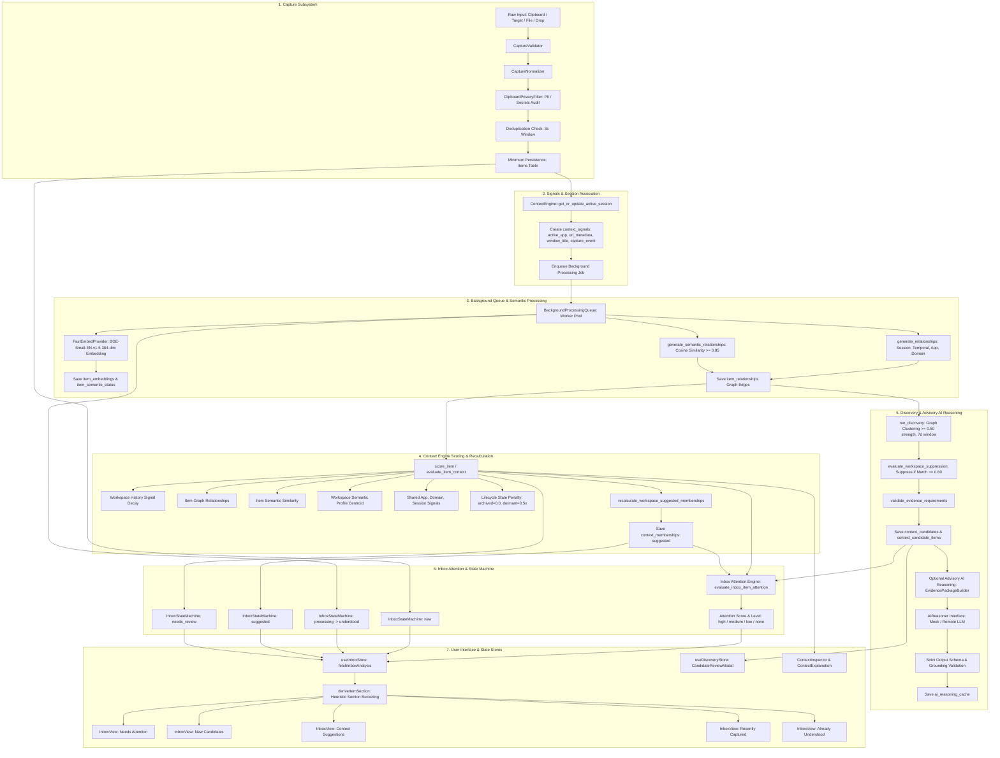
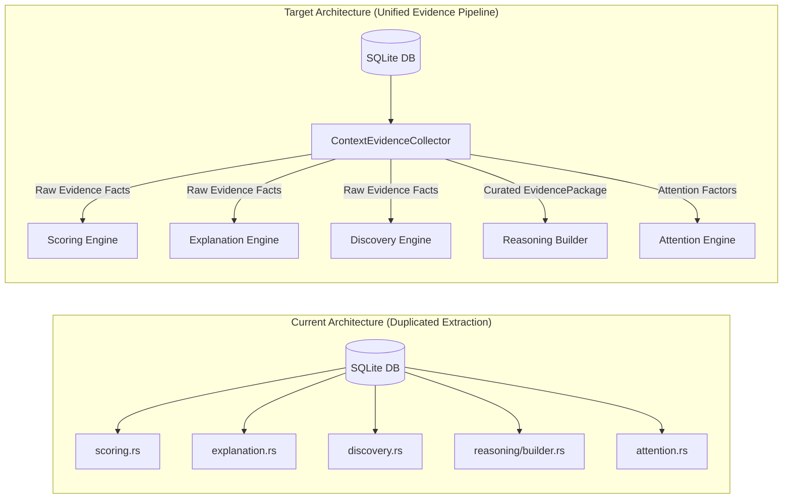

# Context Engine Architecture Audit & Analysis

**Status:** Completed  
**Date:** September 2026  
**Target Repository:** ContextSplit (`src-tauri/src/context_engine`, `src-tauri/src/capture`, `src-tauri/src/semantic`, `src/`)  
**Commit Reference:** `docs: audit context engine architecture`  

---

## 1. Executive Summary

This document presents a comprehensive architectural audit of ContextSplit's **Context Engine** and related subsystems (`capture`, `semantic`, `discovery`, `reasoning`, `inbox_state`, and frontend `store`).

ContextSplit implements a hybrid contextual intelligence system that captures user activity (clipboard, text, files, URLs, images), extracts deterministic and semantic signals, maintains temporal and session relationships, computes workspace affinity scores, discovers new context clusters, and provides explainable contextual suggestions to the user without silent automated mutations.

### Key Audit Findings Overview
1. **Scoring Logic Fragmentation:** Core workspace scoring logic is duplicated between `score_item` and `evaluate_item_context`, while workspace suppression in `discovery.rs` and attention evaluation in `attention.rs` independently re-implement separate scoring algorithms with slightly differing weights and thresholds.
2. **Evidence Construction Redundancy:** Four separate subsystems (`explanation.rs`, `scoring.rs`, `discovery.rs`, and `reasoning/builder.rs`) independently query the database for the same graph relationships, sessions, domains, applications, embeddings, and user action signals to construct human-readable explanations or evidence packages.
3. **Inconsistent Confidence Scales & Thresholds:** Ambiguity margins, high/medium/low confidence bands, and suppression thresholds vary across modules (e.g., ambiguity margin is `0.12` in `scoring.rs` vs `0.15` in `attention.rs`; high confidence is `0.60` in `scoring.rs`, `0.70` in `discovery.rs` / `discoveryStore.ts`, and `0.75` in `attention.rs`).
4. **Context Engine Bypasses:** Direct database operations (such as individual `move_item` commands in `workspaceStore.ts`) update workspace pointers and emit user action signals but bypass `InboxItemState` transitions to `organized`.
5. **Client-Side Context Logic:** `src/store/inboxStore.ts` contains client-side heuristic classification (`deriveItemSection`) that evaluates raw flags and timestamps rather than consuming a unified server-side inbox status.
6. **Automatic Persistence Boundaries:** Clear inventory of where background signals, candidate clusters, embeddings, cached AI packages, and suggested memberships are automatically persisted.
7. **Comprehensive Test Suite:** 283 active Rust tests currently define and guard existing behavior across all engine modules.

---

## 2. End-to-End Information Flow Mapping



---

## 3. Subsystem & Model Breakdown

### 3.1. ContextSignal Models
- **Database Table:** `context_signals` (`id`, `workspace_id`, `item_id`, `signal_type`, `session_id`, `payload`, `created_at`, `updated_at`).
- **Core Signal Types:**
  - `capture_event`: Metadata of original capture (content type, size, source).
  - `active_app`: Frontmost application name (`{"app_name": "..."}`).
  - `window_title`: Active window title.
  - `url_metadata`: Hostname and original URL (`{"domain": "...", "original_url": "..."}`).
  - `file_metadata`: Filename, MIME type, byte size.
  - `user_action`: Explicit user interactions (e.g., `{"action": "moved_to_workspace", "destination_workspace": "..."}`).
  - `membership_confidence_recalculated`: Audit trail when workspace changes trigger re-scoring.
  - `suggestion_dismissed` / `membership_dismissed`: Feedback recorded when user rejects suggestions.
- **Providers:** Registered via `ContextProvider` trait in `context_engine/engine.rs`:
  - `CaptureContextProvider`, `UserActionContextProvider`, `WorkspaceContextProvider`, `ActiveAppProvider`, `UrlContextProvider`.

### 3.2. ContextSession
- **Database Table:** `sessions` (`id`, `started_at`, `last_activity_at`, `ended_at`, `status`).
- **Inactivity Threshold:** Default 1,800 seconds (30 minutes). Configurable on `ContextEngine`.
- **Association:** Items and signals reference `session_id` to establish temporal batching and same-session contextual clustering.

### 3.3. ItemRelationship
- **Database Table:** `item_relationships` (`id`, `item_a_id`, `item_b_id`, `relationship_type`, `strength`, `metadata`, `created_at`).
- **Types & Strengths:**
  - `same_session`: `+0.40`
  - `temporal_proximity` ($\le 300\text{s}$): `+0.20`
  - `same_workspace`: `+0.20`
  - `same_source_app`: `+0.30`
  - `same_domain`: `+0.30`
  - `semantic_similarity`: Cosine similarity score ($\ge 0.85$ threshold for explicit edge generation).
- **Time Window:** Evaluated against items captured within the preceding 24 hours.

### 3.4. ContextMembership
- **Database Table:** `context_memberships` (`id`, `item_id`, `workspace_id`, `membership_type`, `confidence`, `source`, `created_at`, `updated_at`).
- **Types:**
  - `confirmed`: User-assigned or explicitly approved membership. **Authoritative; never modified automatically by background engines.**
  - `suggested`: Inferred membership calculated by Context Engine with confidence $0.0 - 1.0$.
  - `dismissed`: User-rejected suggestions to suppress repetitive recommendations.

### 3.5. Workspace Scoring
- **Implementation:** `context_engine/scoring.rs` (`score_item`, `evaluate_item_context`).
- **Score Components & Weights (`ScoringWeights`):**
  - Workspace history (`0.40` base $\times$ temporal decay).
  - Item relationships (`0.20` per match, max `0.50` $\times$ temporal decay).
  - Item semantic similarity (max `0.40`).
  - Workspace semantic profile cosine similarity (max `0.45`).
  - Common application (`0.05` per match, max `0.20`).
  - Common domain (`0.10` per match, max `0.30`).
  - Common session (`0.10` per match, max `0.30`).
  - Common content type (`0.02` per match, max `0.10`).
  - Lifecycle state dampening (`archived` = $0.0$, `dormant` = $0.50\times$).

### 3.6. Workspace Semantic Profiles
- **Database Table:** `workspace_embeddings` (`workspace_id`, `embedding`, `provider`, `model`, `updated_at`).
- **Computation:** Centroid vector of all confirmed item embeddings in the workspace.
- **Usage:** Provides global thematic comparison for unassigned items without requiring pairwise item comparisons against entire workspace histories.

### 3.7. Context Discovery
- **Implementation:** `context_engine/discovery.rs` (`run_discovery`).
- **Clustering:** Graph traversal on unassigned items with edge strength $\ge 0.50$ over a 7-day window; minimum cluster size $\ge 3$.
- **Suppression:** Candidates matching existing workspaces with score $\ge 0.60$ are suppressed.
- **Evidence Verification:** Minimum 2 items, average relationship strength $\ge 0.50$, semantic coherence $\ge 0.40$, $\ge 2$ independent signals, confidence $\ge 0.45$.
- **Naming:** Deterministic TF-IDF keyword extraction with stopword filtering; optional AI enhancement.

### 3.8. ContextExplanation
- **Implementation:** `context_engine/explanation.rs` (`explain_context_association`).
- **Output:** Human-readable explanations across categories (`semantic_similarity`, `session_relationship`, `domain_relationship`, `strongest_relationships`, `user_history`, `workspace_profile`).
- **Invariant:** Strictly template-based; raw floats (e.g. `0.8492`) and vector representations are never exposed in user-facing explanation strings.

### 3.9. AI EvidencePackage & Advisory Reasoning
- **Implementation:** `context_engine/reasoning/models.rs`, `builder.rs`, `validator.rs`, `gating.rs`.
- **Privacy Guarantees:** 
  - Whitelist-only payload; credentials/tokens/secrets scrubbed (`scrub_private_data`).
  - Raw embedding vectors are omitted (`Vec<f32>` stripped; thematic summaries used instead).
  - Bounded top-K items and truncated snippets.
- **Advisory Role:** Strictly read-only and decoupled; cannot mutate database state or auto-confirm memberships.

### 3.10. Inbox State Machine & Attention Engine
- **Implementation:** `context_engine/inbox_state.rs`, `context_engine/attention.rs`.
- **States:** `New` $\rightarrow$ `Processing` $\rightarrow$ `Understood` $\rightarrow$ `Suggested` / `NeedsReview` $\rightarrow$ `Organized` / `Dismissed`.
- **Attention Engine:** Computes attention level (`High`, `Medium`, `Low`, `None`) based on contextual confidence, ambiguity margin, new candidate presence, suggested memberships, dismissal dampening, and item age.

---

## 4. Detailed Audit Findings

```
┌─────────────────────────────────────────────────────────────────────────────────────────────┐
│                                 CRITICAL FINDINGS MATRIX                                    │
├───────────────────────────────┬───────────────────────────────┬─────────────────────────────┤
│ Issue Category                │ Affected Components           │ Severity / Impact           │
├───────────────────────────────┼───────────────────────────────┼─────────────────────────────┤
│ 1. Duplicated Scoring Logic   │ scoring.rs, discovery.rs,     │ High (Maintenance burden,  │
│                               │ attention.rs                  │ divergence risk)            │
│ 2. Duplicated Evidence Build  │ explanation.rs, scoring.rs,   │ High (4x redundant DB       │
│                               │ discovery.rs, builder.rs      │ queries per item)           │
│ 3. Inconsistent Confidences   │ scoring.rs, discovery.rs,     │ Medium (Inconsistent UI     │
│                               │ attention.rs, discoveryStore  │ percentage badges)          │
│ 4. Engine Bypasses            │ lib.rs (move_item),           │ Medium (State machine       │
│                               │ workspaceStore.ts             │ desynchronization)          │
│ 5. UI Context Heuristics      │ inboxStore.ts                 │ Medium (Business logic      │
│                               │                               │ leaking into frontend)      │
│ 6. Automatic Persistence      │ scoring.rs, discovery.rs,     │ Low (Documented & audited   │
│                               │ capture/pipeline.rs           │ invariants)                 │
│ 7. Test Suite Coverage        │ workflow_tests.rs + modules   │ Low (283 passing tests)     │
└───────────────────────────────┴───────────────────────────────┴─────────────────────────────┘
```

### Finding 1: Duplicated Scoring Logic
- **`scoring.rs` (`score_item` vs `evaluate_item_context`):**
  - Lines `86–288` (`score_item`) and lines `353–542` (`evaluate_item_context`) implement nearly identical loops over workspaces. Both separately fetch target signals, query relationship aggregates, inspect `moved_to_workspace` user actions, compute cosine similarities with workspace centroid embeddings, query database signals for app/domain/session matches, and apply lifecycle decay.
- **`discovery.rs` (`evaluate_workspace_suppression`):**
  - Lines `1171–1379` re-implement workspace affinity comparison with separate cross-relationship calculations, embedding queries, and custom weights (`0.45` relationships, `0.35` semantic, `0.10` session, `0.10` app/domain) that are not aligned with `ScoringWeights`.
- **`attention.rs` (`evaluate_inbox_item_attention`):**
  - Lines `187–208` call `score_item` and then calculate ambiguity margins using `config.ambiguity_threshold = 0.15`, whereas `evaluate_item_context` uses `0.12`.

### Finding 2: Duplicated Evidence Construction
Four separate modules query identical contextual data and construct overlapping evidence structures:
1. `explanation.rs` (`explain_context_association`): Queries relationships, sessions, domains, apps, and workspace embeddings to produce `ContextEvidenceItem` records and human-readable strings.
2. `scoring.rs` (`evaluate_item_context`): Constructs raw string reasons during scoring, but then calls `explanation::get_concise_explanations` (lines `552–555`), discarding its own reasons in favor of the explanation service.
3. `discovery.rs` (`score_candidate_group`): Queries item metadata and context signals to construct `evidence` string vectors (lines `796–1050`).
4. `reasoning/builder.rs` (`EvidencePackageBuilder`): Calls `evaluate_item_context`, then re-queries relationships, sessions, and embeddings to produce `SemanticSimilaritySummary`, `WorkspaceProfileSummary`, `CuratedContextSignal`, and `DeterministicEvidenceAssessment`.

### Finding 3: Inconsistent Confidence Calculations & Thresholds
- **Confidence Bands:**
  - `scoring.rs` (`score_item`): High $\ge 0.60$, Medium $\ge 0.40$, Low $\ge 0.20$.
  - `scoring.rs` (`evaluate_item_context` for workspaces): High $\ge 0.60$, Medium $\ge 0.35$, Low $< 0.35$.
  - `scoring.rs` (`evaluate_item_context` for new candidates): High $\ge 0.70$, Medium $\ge 0.40$, Low $< 0.40$.
  - `discovery.rs` / `discoveryStore.ts`: High Confidence $\ge 0.70$.
  - `attention.rs`: High $\ge 0.75$, Medium $\ge 0.45$, Low $\ge 0.20$.
  - `reasoning/models.rs` (`CandidateReviewModal.tsx`): High $\ge 0.75$, Moderate $\ge 0.50$, Uncertain $\ge 0.25$, Low $< 0.25$.
- **Ambiguity Margins:**
  - `scoring.rs`: $\le 0.12$ difference between top 2 workspaces when runner-up score $\ge 0.35$.
  - `attention.rs`: $\le 0.15$ difference between top 2 workspaces when runner-up score $\ge 0.10$.

### Finding 4: Services That Bypass the Context Engine
- **`move_item` Command (`src-tauri/src/lib.rs:147–168`):**
  - When an item is moved via `db.moveItem` in `workspaceStore.ts`, the backend updates `items.workspace_id` and emits a `ContextEvent::UserAction`.
  - **Bypass:** It does **not** call `InboxStateMachine::organize_item` (`transition_inbox_item_state`), leaving `inbox_item_states.state` unchanged unless the multi-select bulk command `bulk_assign_inbox_items_to_workspace` is invoked.
- **Direct Workspace Queries:**
  - `search::search_inbox_items` queries SQLite and the semantic provider directly without notifying `ContextEngine` or updating session activity timestamps.

### Finding 5: UI Code Performing Context Logic
- **`src/store/inboxStore.ts` (`deriveItemSection`):**
  - Lines `156–209` contain frontend heuristic business logic that checks:
    - `state === 'needs_review'` $\rightarrow$ `needs_attention`
    - `attention?.factors?.has_new_candidate` $\rightarrow$ `new_candidates`
    - `state === 'suggested'` or `attention?.factors?.has_suggested_membership` $\rightarrow$ `context_suggestions`
    - `state === 'new'` / `'processing'` or item age $< 24\text{h}$ $\rightarrow$ `recently_captured`
    - Fallback $\rightarrow$ `already_understood`
  - This splits decision-making between Rust backend engines and TypeScript Zustand stores.

### Finding 6: Places Where Context Decisions Are Persisted Automatically
The codebase maintains clear separation between automated background persistence and user-authoritative state:
1. **Context Signals:** Automatically saved during capture and user actions (`context_signals`).
2. **Context Sessions:** Automatically created/extended during capture (`sessions`).
3. **Embeddings & Semantic Status:** Automatically generated in background workers (`item_embeddings`, `item_semantic_status`).
4. **Item Relationships:** Automatically generated in background workers (`item_relationships`).
5. **Context Candidates:** Automatically recorded as `detected` status by `run_discovery` (`context_candidates`, `context_candidate_items`).
6. **Suggested Memberships:** Automatically recorded as `suggested` type with calculated confidence by `recalculate_workspace_suggested_memberships` (`context_memberships`).
7. **AI Reasoning Cache:** Automatically cached for 7 days (`ai_reasoning_cache`).
8. **Invariant Enforced:** `confirmed` memberships and `organized` inbox states are **never** created automatically.

### Finding 7: Existing Test Suites Defining Current Behavior
The repository has extensive test coverage (283 passing unit and integration tests):

| Test File | Test Focus & Responsibilities |
|---|---|
| `context_engine/workflow_tests.rs` | End-to-end multi-day workflows (Discovery, Reasoning, Capture, Intelligent Inbox) |
| `context_engine/scoring.rs` | Workspace scoring, confidence bands, app/domain matches, lifecycle penalties, membership recalculation |
| `context_engine/discovery.rs` | Graph clustering, suppression checks, evidence requirements, candidate naming |
| `context_engine/explanation.rs` | Clean explanation templates, invariant checks (no raw vectors/floats exposed) |
| `context_engine/relationships.rs` | Deterministic and semantic relationship edge creation |
| `context_engine/temporal.rs` | Exponential half-life decay, grace period, floor thresholds |
| `context_engine/attention.rs` | Attention scoring, dismissal penalties, recency bonuses |
| `context_engine/inbox_state.rs` | State machine transitions, invalid transition rejections, cascade deletions |
| `context_engine/reasoning/tests.rs`| Privacy boundary enforcement, secret scrubbing, schema validation, LLM grounding |
| `capture/tests.rs` | Validation, normalization, privacy filters, deduplication, background queue |
| `semantic/tests.rs`, `similarity.rs`, `builder.rs` | FastEmbed cosine similarity, text extraction, secret scrubbing |
| `search/mod.rs` | Hybrid text and vector search filtering |

---

## 5. Recommended Minimal Safe Refactoring

To resolve duplication and inconsistencies **without rewriting working systems**, we recommend introducing a single, centralized **Unified Evidence Pipeline**.



### Proposed Refactoring Steps (Phase 1: Safe & Non-Breaking)

1. **Extract `ContextEvidenceCollector` in `src-tauri/src/context_engine/evidence.rs`:**
   - Create a unified struct `ContextEvidenceFactSet` that loads all raw signals, graph relationships, session overlaps, embeddings, domain/app counts, and user actions for a target item or item group in a single pass.
2. **Refactor `score_item` and `evaluate_item_context` to Share Core Math:**
   - Delegate data fetching in both functions to `ContextEvidenceCollector`.
   - Ensure `evaluate_item_context` reuses the score vector from `score_item` rather than duplicating the loop.
3. **Standardize Confidence Scales & Constants:**
   - Define canonical constants in `context_engine/scoring.rs`:
     - `CONFIDENCE_BAND_HIGH = 0.70`
     - `CONFIDENCE_BAND_MEDIUM = 0.40`
     - `CONFIDENCE_BAND_LOW = 0.20`
     - `AMBIGUITY_THRESHOLD = 0.12`
   - Share these constants across `attention.rs`, `discovery.rs`, and frontend types.
4. **Synchronize `move_item` with `InboxItemState`:**
   - In `src-tauri/src/lib.rs:move_item`, when `workspace_id` is non-null and not `'inbox'`, automatically invoke `InboxStateMachine::organize_item` to keep state machine records synchronized.
5. **Preserve All External APIs and Structs:**
   - Maintain full backwards compatibility for all Tauri commands, Zustand store interfaces, and existing tests.

---

## 6. Conclusion

ContextSplit has a well-structured, privacy-conscious contextual intelligence engine with excellent test coverage and robust invariants. The identified duplications in scoring and evidence generation can be resolved cleanly through an internal `ContextEvidenceCollector` refactoring without altering public APIs or disrupting UI behavior.
