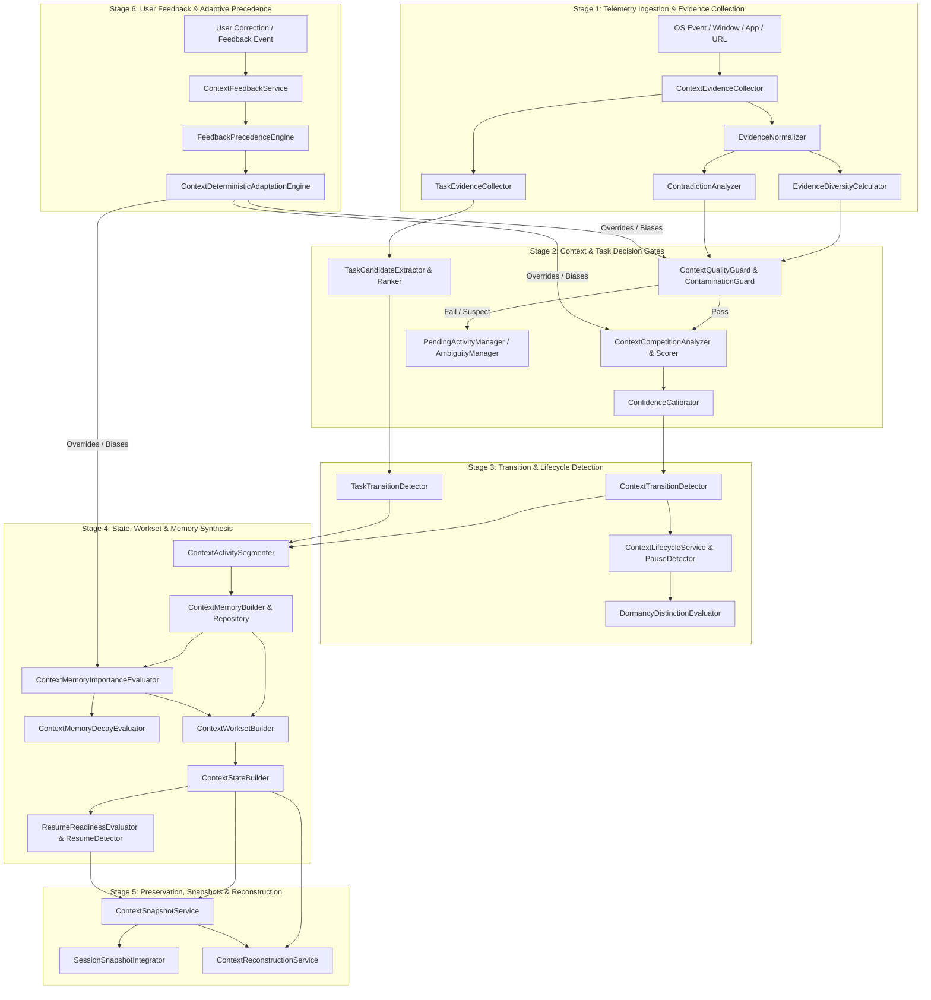
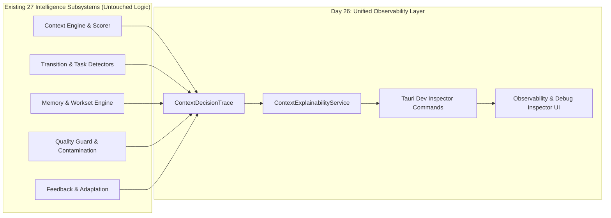

# Context Intelligence Observability & Explainability: Full System Audit (Day 26 — Step 1)

## Executive Summary

As ContextSplit begins **Day 26 (Context Observability & Explainability)**, our primary architectural objective is to make the entire context intelligence pipeline transparent, inspectable, and explainable for development, debugging, and verification.

Over Days 1–25, ContextSplit constructed **27 sophisticated intelligence subsystems** across evidence collection, candidate discovery, confidence calibration, transition detection, activity segmentation, task extraction and lifecycle, contextual memory, active worksets, state evaluation, resume readiness, contextual snapshots, memory importance and decay, context reconstruction, quality guards, anti-contamination filters, pending/ambiguous activity resolution, lifecycle state machines, and deterministic user feedback adaptation.

Our foundational design axiom for Day 26 is:
> **Intelligence without observability is indistinguishable from magic, and unexplainable heuristics are impossible to reliably debug.**
> Every contextual decision—from assigning an active telemetry event to promoting a task candidate or pruning a dormant snapshot—must possess an unbroken, verifiable audit trail that explains **why** the decision was reached, **what evidence** was weighed, **how confidence** was calibrated, and **what precedence rules or user feedback** influenced the verdict.

This document performs an exhaustive, technical audit of all **13 major decision points** across the ContextSplit intelligence pipeline, identifying their exact **Inputs, Evidence, Decisions, Resulting States, Confidence Calculations, Dependencies, and Persistence Layers**.

---

## 1. System Topology & Intelligence Pipeline Map

The ContextSplit intelligence architecture operates across six sequential pipeline stages:

---

## 2. Comprehensive Audit of 13 Major Decision Points

---

### Decision Point 1: Detects Context (Discovery & Scoring)

When new telemetry is captured, the system identifies which workspace context(s) match the current activity.

- **Inputs**:
  - `CaptureEvent` (window title, app name, bundle ID, process path, browser URL, document path, timestamp).
  - List of active/dormant `Workspace` entities from database.
  - Active `ContextFeedbackEvent` entries and active user context filters.
- **Evidence**:
  - Direct rule matches (configured app lists, root path matching, git remote URL).
  - Semantic content tokens extracted from window titles and browser URLs.
  - Recency and interaction frequency signals (`last_activity_at`).
  - Evidence categories: `Application`, `WindowTitle`, `BrowserDomain`, `FileSystemPath`, `GitRepository`.
  - Normalization via `EvidenceNormalizer` ($[0.0, 1.0]$ clamp with category weights).
- **Decision Logic**:
  - `ContextCandidateScorer` computes composite candidate scores across 5 dimensions:
    $$\text{Score}(c) = w_{\text{rule}} S_{\text{rule}} + w_{\text{path}} S_{\text{path}} + w_{\text{title}} S_{\text{title}} + w_{\text{history}} S_{\text{history}} + w_{\text{feedback}} S_{\text{feedback}}$$
  - Applies lifecycle penalty: Dormant workspaces receive 50% score penalty ($S \times 0.50$); Archived workspaces are completely excluded ($S \times 0.0$).
  - `ContextCompetitionAnalyzer` evaluates competition margin $\Delta = S_{\text{top}} - S_{\text{runner\_up}}$. If $\Delta < 0.15$, marks decision as `Ambiguous`.
- **Resulting State**:
  - Candidate ranking: `Vec<RankedContextCandidate>`.
  - Top candidate ID: `Option<String>`.
  - Ambiguity assessment: `AmbiguityState::{Unambiguous, Competitive, WeakSignals, NoMatch}`.
- **Confidence**:
  - `ConfidenceCalibrator` outputs calibrated score $\in [0.0, 1.0]$ and `ConfidenceBand` (`VeryHigh` $\ge 0.85$, `High` $\ge 0.70$, `Moderate` $\ge 0.50$, `Low` $\ge 0.30$, `VeryLow` $< 0.30$).
  - Penalized by contradiction reports (`ContradictionAnalyzer`) and diversity deficits (`EvidenceDiversityCalculator`).
- **Dependencies**:
  - `evidence.rs`, `normalization.rs`, `diversity.rs`, `contradiction.rs`, `competition.rs`, `calibration.rs`, `discovery.rs`, `scoring.rs`.
- **Persistence**:
  - Telemetry item written to `items` table.
  - Signal records written to `context_signals` table.
  - Transient candidate scores stored in `context_candidates` and `context_candidate_items` tables.

---

### Decision Point 2: Assigns an Item (Context Membership & Classification)

Determines whether an observed item belongs to a specific context workspace.

- **Inputs**:
  - `Item` entity (ID, content hash, app name, title, URL, created_at).
  - Selected workspace candidate ID.
  - Calibrated confidence score and evidence set.
  - Prior confirmed memberships for this item.
- **Evidence**:
  - Exact match rule or confirmed user history for item signature.
  - Evidence diversity count $\ge 2$ independent sources.
  - High confidence calibration ($\ge 0.70$).
  - Quality guard approval (`QualityGuardDecision::Accept`).
- **Decision Logic**:
  - **Deterministic Assignment**: If explicit user assignment or strict path anchor exists $\rightarrow$ `membership_type = "confirmed"`, `confidence = 1.0`.
  - **Inferred Assignment**: If calibrated confidence $\ge 0.65$ and no contamination $\rightarrow$ `membership_type = "inferred"`, `confidence = calibrated_score`.
  - **Inbox Default**: If calibrated confidence $< 0.65$ or multiple conflicting candidates $\rightarrow$ item remains in `inbox` with `workspace_id = NULL`.
- **Resulting State**:
  - Item updated with `workspace_id = Some(context_id)`.
  - Record inserted or updated in `context_memberships`.
  - Inbox state transitioned in `inbox_item_states` (`state = "processed"` or `"assigned"`).
- **Confidence**:
  - Inherited directly from `ConfidenceCalibrator` result.
- **Dependencies**:
  - `scoring.rs`, `quality_guard.rs`, `contamination.rs`, `db::operations::create_context_membership`.
- **Persistence**:
  - `context_memberships` table (`item_id`, `workspace_id`, `membership_type`, `confidence`, `source`, `updated_at`).
  - `items` table (`workspace_id` column updated).
  - `inbox_item_states` table.

---

### Decision Point 3: Rejects an Item (Quality Guard, Contamination & Noise Filter)

Determines if an item should be suppressed, blocked from context assignment, or flagged as contaminated noise.

- **Inputs**:
  - Candidate item and target workspace metadata.
  - `QualityGuardInput` (evidence vector, app category, title terms, domain, process name).
  - `ContaminationCheckInput` (repo slug, project path, workspace tokens, search terms).
  - Active negative feedback entries (`FeedbackAction::RejectContext`, `FeedbackAction::BlockApp`).
- **Evidence**:
  - Generic noise signatures (utility apps, password managers, system settings, media players, generic browser blank tabs).
  - Cross-context contamination signals (URL contains repo slug of Workspace B while being evaluated for Workspace A).
  - Ephemeral glances ($< 2$ seconds window focus duration).
  - Explicit user rejection in `ContextFeedbackEvent`.
- **Decision Logic**:
  - `ContaminationGuard::check_contamination`:
    - Checks 4 categories: `ForeignRepoSlug`, `CrossProjectDomain`, `SystemNoise`, `ExplicitNegativeFeedback`.
    - If contaminated $\rightarrow$ `ContaminationDefenseResult::Contaminated { reason, confidence: 1.0 }`.
  - `ContextQualityGuard::evaluate`:
    - Evaluates 4 dimension scores: $S_{\text{relevance}}$, $S_{\text{substance}}$, $S_{\text{cleanliness}}$, $S_{\text{stability}}$.
    - If composite quality score $< 0.40$ or $S_{\text{cleanliness}} < 0.30 \rightarrow \text{QualityGuardDecision::Reject}$.
    - If $0.40 \le \text{composite} < 0.60 \rightarrow \text{QualityGuardDecision::Quarantine}$.
- **Resulting State**:
  - Assignment halted; item remains unassigned or assigned to quarantine inbox.
  - `PendingContextualActivity` record created if quarantined for delayed resolution.
- **Confidence**:
  - Rejection confidence $\in [0.75, 1.0]$.
- **Dependencies**:
  - `quality_guard.rs`, `contamination.rs`, `ambiguity.rs`, `pending_activity.rs`, `feedback.rs`.
- **Persistence**:
  - Item remains with `workspace_id = NULL` in `items`.
  - `inbox_item_states` marked as `state = "rejected"` or `"quarantined"` with `reason`.
  - In-memory `PendingActivityManager` queue.

---

### Decision Point 4: Changes Context (Transition Detection & Hysteresis Gating)

Determines when the user's active focus has switched from Context A to Context B, started fresh, or returned.

- **Inputs**:
  - Chronological stream of item assignments and context detections.
  - Current active context ID (`from_context_id`).
  - Sliding telemetry window (recent 10 events).
  - `TransitionStabilityConfig` parameters.
- **Evidence**:
  - Consecutive observation count $N_{\text{obs}}$ in new context.
  - Candidate score difference $\Delta_{\text{score}} = S_{\text{target}} - S_{\text{current}}$.
  - Temporal departure duration (seconds since last active in target context).
  - Structural anchors (file path change, git repo switch, explicit workspace click).
- **Decision Logic**:
  - `ContextTransitionDetector::evaluate_stream`:
    - **Hysteresis Gate**: Requires $N_{\text{obs}} \ge 2$, $\Delta_{\text{score}} \ge 0.15$, and evidence agreement $\ge 2$.
    - **Fast-Track Override**: Allows transition on $N_{\text{obs}} = 1$ ONLY if confidence $\ge 0.85$ AND backed by a hard structural anchor (path or explicit switch).
    - **Classification**:
      - If `from_context_id == None` $\rightarrow$ `ContextTransitionType::ContextStart`.
      - If `to_context_id == previous_active` within 24h $\rightarrow$ `ContextTransitionType::ContextReturn`.
      - Otherwise $\rightarrow$ `ContextTransitionType::ContextSwitch`.
- **Resulting State**:
  - Emits `ContextTransition` record.
  - Closes active `ContextActivitySegment` for previous context and opens new segment for incoming context.
  - Triggers snapshot evaluation if threshold met.
- **Confidence**:
  - Calibrated transition confidence $\in [0.50, 1.0]$.
- **Dependencies**:
  - `transitions.rs`, `segments.rs`, `snapshot.rs`, `task_transitions.rs`.
- **Persistence**:
  - Row written to `context_transitions` table (`id`, `from_context_id`, `to_context_id`, `transition_type`, `confidence`, `detected_at`, `session_id`, `trigger_item_id`, `metadata`).

---

### Decision Point 5: Changes Lifecycle (Active, Paused, Dormant, Archived)

Manages the lifecycle state machine of workspaces and context working states.

- **Inputs**:
  - Workspace entity and current `lifecycle_state`.
  - Timestamp of most recent telemetry event (`last_activity_at`).
  - Active task status, open workset item count, and pending resume indicators.
  - Explicit user lifecycle actions (`ArchiveContext`, `ResumeContext`).
- **Evidence**:
  - Inactivity duration $T_{\text{idle}} = T_{\text{now}} - T_{\text{last\_activity}}$.
  - Work cycle indicators (commit history, task completion state, uncommitted edits).
  - Explicit user archive/unarchive commands.
- **Decision Logic**:
  - `ContextLifecycleService::evaluate_lifecycle`:
    - If explicit archive command $\rightarrow$ `ContextLifecycleState::Archived`.
    - If $T_{\text{idle}} \le 15\text{ min} \rightarrow \text{ContextLifecycleState::ActiveFocus}$.
    - If $15\text{ min} < T_{\text{idle}} \le 24\text{ hours} \rightarrow \text{ContextLifecycleState::Paused}$.
    - If $24\text{ hours} < T_{\text{idle}} \le 30\text{ days} \rightarrow \text{ContextLifecycleState::Dormant}$.
    - If $T_{\text{idle}} > 30\text{ days} \rightarrow \text{ContextLifecycleState::DeepDormant}$.
  - `DormancyDistinctionEvaluator`:
    - Distinguishes **intentional pause** (open tasks, preserved workset, ready to resume) vs **abandoned/dormant project** (zero open tasks, stale workset, high decay).
- **Resulting State**:
  - `workspaces.lifecycle_state` updated (`"active"`, `"dormant"`, `"archived"`).
  - `ContextStateValue` updated (`Active`, `RecentlyActive`, `Paused`, `Dormant`).
  - Context preservation hierarchy generated via `ContextPreservationService`.
- **Confidence**:
  - Deterministic evaluation based on temporal gaps and task completeness ($1.0$ confidence).
- **Dependencies**:
  - `lifecycle.rs`, `dormancy.rs`, `pause_detector.rs`, `preservation.rs`, `db::operations::touch_workspace_activity`.
- **Persistence**:
  - `workspaces` table (`lifecycle_state`, `last_activity_at`, `archived_at`).

---

### Decision Point 6: Creates Memory (Episodic Context Memory Assembly)

Synthesizes atomic telemetry, item memberships, and transitions into a coherent contextual memory structure.

- **Inputs**:
  - Workspace ID and target time window.
  - Recent `items`, `context_activity_segments`, and `task_candidates`.
  - Inferred active tasks and recent work sequence entries.
- **Evidence**:
  - Chronological activity clusters.
  - Semantic clustering of item entities (files edited, documentation referenced, PRs reviewed).
  - Provenance trails (`InformationProvenance` links to raw item IDs and signal timestamps).
- **Decision Logic**:
  - `ContextMemoryBuilder::build`:
    - Aggregates activity items into ordered `MemoryActivitySequenceEntry` lists.
    - Extracts `InferredTaskState` with confidence band.
    - Assembles `MemoryItemReference` links with access counts and dwell times.
    - Associates `MemoryTransitionReference` to preserve context switch context.
- **Resulting State**:
  - Structured `ContextMemory` instance.
  - Ready for importance evaluation, promotion, and query responses.
- **Confidence**:
  - Composite aggregation confidence derived from item membership confidences.
- **Dependencies**:
  - `memory.rs`, `memory_query.rs`, `work_sequence.rs`, `segments.rs`.
- **Persistence**:
  - Assembled on-demand and cached in `ContextMemoryRepository` and memory query caches.

---

### Decision Point 7: Marks Memory Important (Importance, Tiering & Decay)

Evaluates whether a context memory or resource is significant enough to retain for resume assistance and long-term recall.

- **Inputs**:
  - `MemoryImportanceInput` (item/memory entity, access frequency, dwell duration, semantic uniqueness, task connection, user pinned flag).
  - `MemoryDecayPolicy` configuration (half-life days, grace period, min weight floor).
- **Evidence**:
  - Duration spent in focused interaction ($T_{\text{dwell}}$).
  - Recurrence count across sessions ($N_{\text{sessions}}$).
  - Structural importance (is core source file, design doc, PR, or configuration).
  - Explicit user star/pin (`UserMemoryControlAction::Pin`).
- **Decision Logic**:
  - `ContextMemoryImportanceEvaluator::evaluate`:
    - Computes 4 dimension scores: $S_{\text{dwell}}$, $S_{\text{frequency}}$, $S_{\text{structure}}$, $S_{\text{task\_relevance}}$.
    - Total raw score:
      $$S_{\text{raw}} = 0.35 S_{\text{dwell}} + 0.25 S_{\text{frequency}} + 0.20 S_{\text{structure}} + 0.20 S_{\text{task}}$$
    - Applies `ContextMemoryDecayEvaluator`:
      $$S_{\text{decayed}} = S_{\text{raw}} \times e^{-\lambda \cdot t_{\text{elapsed}}}$$
    - Assigns `MemoryImportanceTier`:
      - User pinned $\rightarrow$ `MemoryImportanceTier::Critical` ($1.0$).
      - $S \ge 0.80 \rightarrow \text{MemoryImportanceTier::Critical}$.
      - $0.60 \le S < 0.80 \rightarrow \text{MemoryImportanceTier::High}$.
      - $0.40 \le S < 0.60 \rightarrow \text{MemoryImportanceTier::Medium}$.
      - $S < 0.40 \rightarrow \text{MemoryImportanceTier::Low}$ (eligible for eviction).
  - `ContextMemoryQualityGuard`:
    - Blocks app-name-only items, generic landing pages, and password managers from ever becoming important memories.
- **Resulting State**:
  - `ContextImportantMemory` record created or updated.
  - Placed into `ContextImportantMemorySet` for the workspace.
- **Confidence**:
  - Confidence equals calibrated importance score.
- **Dependencies**:
  - `memory_importance.rs`, `important_memory.rs`, `memory_decay.rs`, `memory_promotion.rs`.
- **Persistence**:
  - In-memory structured set; persisted within `context_snapshots` JSON payloads.

---

### Decision Point 8: Detects Task (Extraction, Heuristics & Ranking)

Extracts high-level task intent and working goals from low-level window titles, branch names, and browser headings.

- **Inputs**:
  - Stream of `Item` and `ContextEvidence` entries for a workspace.
  - Active git branch names, PR titles, issue keys (e.g., `JIRA-1234`, `#42`).
  - Window title strings and browser URLs.
- **Evidence**:
  - Action verbs and task pattern regexes (`"Fix ... in ..."`, `"Implement ..."`, `"Review PR #..."`).
  - Repetitive window title tokens.
  - Git branch semantic humanization (`feat/auth-flow` $\rightarrow$ `"Auth Flow"`).
  - Dwell duration concentrated on task-related artifacts.
- **Decision Logic**:
  - `TaskCandidateExtractor::extract_candidates`:
    - Normalizes strings via `clean_window_title` and `extract_salient_terms`.
    - Filters out generic titles (`is_generic_task_name` checks for "Untitled", "New Tab", "Terminal").
  - `TaskCandidateRanker::rank_candidates`:
    - Scores candidate tasks on: Term Salience ($0.35$), Recency ($0.25$), Interaction Density ($0.25$), Branch/PR Corroboration ($0.15$).
    - Selects top candidate with confidence $\ge 0.40$.
- **Resulting State**:
  - `RankedTaskCandidate` with status `detected`, `in_progress`, or `ambiguous`.
  - Task ambiguity flag (`TaskAmbiguityState`).
- **Confidence**:
  - Composite task ranking confidence $\in [0.0, 1.0]$.
- **Dependencies**:
  - `task_evidence.rs`, `task_extractor.rs`, `task_ranking.rs`.
- **Persistence**:
  - Inserted or updated in `task_candidates` table (`id`, `context_id`, `title`, `confidence`, `status`, `first_detected_at`, `last_active_at`).

---

### Decision Point 9: Changes Task (Task Transitions & Lifecycles)

Detects when the active task within a context starts, switches, pauses, resumes, or completes.

- **Inputs**:
  - Current active task for context.
  - Incoming ranked task candidates.
  - Temporal gaps and git branch switches.
  - User task confirmations or completions.
- **Evidence**:
  - New dominant task candidate with margin $\ge 0.20$ over previous task.
  - Explicit PR merge or branch switch.
  - Extended gap in task-specific evidence.
- **Decision Logic**:
  - `TaskTransitionDetector::evaluate_transition`:
    - If no previous task $\rightarrow$ `TaskTransitionType::TaskStart`.
    - If new task replaces active task with stability $\ge 2$ observations $\rightarrow$ `TaskTransitionType::TaskSwitch`.
    - If returning to previous task within 48 hours $\rightarrow$ `TaskTransitionType::TaskResume`.
    - If context switches away $\rightarrow$ `TaskTransitionType::TaskPause`.
    - If task goals satisfied / PR closed $\rightarrow$ `TaskTransitionType::TaskEnd`.
- **Resulting State**:
  - Emits `DetectedTaskTransition`.
  - Updates `task_candidates.status` (`"active"`, `"paused"`, `"completed"`).
- **Confidence**:
  - Transition confidence calibrated based on evidence corroboration count.
- **Dependencies**:
  - `task_transitions.rs`, `task_ranking.rs`, `context_state.rs`.
- **Persistence**:
  - `task_candidates` table updated.
  - Transition metadata recorded in `context_transitions.metadata` JSON.

---

### Decision Point 10: Creates Snapshot (Contextual State Snapshot & Quality Gate)

Captures an immutable, restorable snapshot of a context's complete working state.

- **Inputs**:
  - `ContextState` and `ContextWorkset`.
  - Active task candidates and important memories.
  - Trigger reason: `SnapshotTrigger` (`ContextTransition`, `TaskChange`, `SignificantWorksetChange`, `ManualSave`, `PeriodicIdle`).
- **Evidence**:
  - Coalescing timer ($> 30$ seconds since last snapshot to prevent thrashing).
  - Snapshot quality evaluation ($S_{\text{workset\_completeness}}$, $S_{\text{task\_clarity}}$, $S_{\text{memory\_density}}$).
  - Quality threshold: Snapshot must score $\ge 0.40$ quality rating.
- **Decision Logic**:
  - `SnapshotTriggerCoalescer` checks if trigger should execute or be coalesced.
  - `ContextSnapshotBuilder::build` packages context hierarchy:
    - Top 10 workset items (with paths, URLs, scroll/cursor hints).
    - Active task and top 3 subtasks.
    - Critical and high-importance memories.
    - Last meaningful activity summary.
  - `ContextSnapshotQualityEvaluator` rates quality (`Excellent`, `Good`, `Fair`, `Poor`).
  - If rating is `Poor` and trigger is automatic $\rightarrow$ snapshot is suppressed.
- **Resulting State**:
  - `ContextSnapshot` created and registered.
  - Added to `ContextSnapshotHistory`.
  - Cache invalidated via `invalidate_snapshot_cache(context_id)`.
- **Confidence**:
  - `snapshot_confidence` $\in [0.0, 1.0]$.
- **Dependencies**:
  - `snapshot.rs`, `session_snapshot.rs`, `preservation.rs`, `workset.rs`, `context_state.rs`.
- **Persistence**:
  - Written to `context_snapshots` table (`id`, `context_id`, `context_name`, `task_id`, `task_title`, `created_at`, `state`, `snapshot_confidence`, `quality_rating`, `snapshot_json`).

---

### Decision Point 11: Reconstructs Context (Context Reconstruction Assembly & Cache)

Reconstructs the full mental and working context for a workspace to enable zero-friction resumption.

- **Inputs**:
  - Target workspace ID (`context_id`).
  - Latest DB records: `workspaces`, `items`, `task_candidates`, `context_snapshots`, `context_transitions`.
  - Cached reconstruction entry (if valid).
- **Evidence**:
  - Section-by-section health checks:
    1. Context metadata section
    2. Active/recent task section
    3. Context working state section
    4. Meaningful activity sequence section
    5. Working set items section
    6. Important memories section
    7. Snapshot references section
    8. Recent activity timeline section
    9. Resume readiness section
  - Freshness timestamp and cache validity check.
- **Decision Logic**:
  - `ContextReconstructionService::reconstruct`:
    - Checks `ContextReconstructionCache` (TTL: 60s; invalidates on new transitions or item additions).
    - `ContextReconstructionBuilder::build` constructs all 9 sections.
    - Evaluates section status: `Complete`, `Partial`, `Empty`, `Unavailable`.
    - `ContextReconstructionQuality` computes overall score:
      $$Q = 0.25 Q_{\text{state}} + 0.25 Q_{\text{task}} + 0.20 Q_{\text{workset}} + 0.15 Q_{\text{memories}} + 0.15 Q_{\text{readiness}}$$
- **Resulting State**:
  - `ContextReconstruction` payload returned to UI and callers.
  - Stored in global reconstruction cache.
- **Confidence**:
  - `ReconstructionConfidence` with dimensional breakdown and confidence band.
- **Dependencies**:
  - `reconstruction.rs`, `context_state.rs`, `workset.rs`, `important_memory.rs`, `snapshot.rs`, `summary.rs`.
- **Persistence**:
  - In-memory LRU cache (`ContextReconstructionCache` protected by `RwLock`).

---

### Decision Point 12: Determines Resume Readiness (Readiness Scoring & Diagnostics)

Assesses how quickly and effectively a developer can resume work in this context, generating actionable catch-up steps.

- **Inputs**:
  - `ContextState` (state freshness, last active timestamp, meaningful activities).
  - Active `TaskCandidate` presence and completeness.
  - `ContextWorkset` density and primary open artifacts.
  - `ResumeEvaluationInput` (interruption duration, pending PRs, git uncommitted diffs).
- **Evidence**:
  - Freshness factor $F_{\text{time}}$ (decay based on hours since last activity).
  - Task clarity factor $F_{\text{task}}$ (has active task title vs undefined).
  - Workset availability factor $F_{\text{workset}}$ (has open editor files, terminal paths, docs).
  - Continuity blocker signals (e.g. broken build, merge conflicts).
- **Decision Logic**:
  - `ResumeReadinessEvaluator::evaluate`:
    - Composite Readiness Score:
      $$R = 0.35 F_{\text{task}} + 0.30 F_{\text{workset}} + 0.20 F_{\text{time}} + 0.15 F_{\text{memories}}$$
    - Assigns `ResumeReadiness` tier:
      - $R \ge 0.80 \rightarrow \text{ResumeReadiness::Ready}$ ("Jump straight back in").
      - $0.60 \le R < 0.80 \rightarrow \text{ResumeReadiness::MostlyReady}$ ("Review 1-2 recent changes").
      - $0.35 \le R < 0.60 \rightarrow \text{ResumeReadiness::NeedsCatchup}$ ("Review task summary and open files").
      - $R < 0.35 \rightarrow \text{ResumeReadiness::ColdStart}$ ("Full context reload required").
  - `ContextResumeDetector` generates explanation sentences and suggested next actions.
- **Resulting State**:
  - `ResumeReadinessAssessment` with score, tier, explanation, and `Vec<SuggestedResumeAction>`.
- **Confidence**:
  - Assessment confidence $\in [0.70, 1.0]$.
- **Dependencies**:
  - `context_state.rs`, `resume_detector.rs`, `reconstruction.rs`.
- **Persistence**:
  - Embedded within `ContextState` and `ContextSnapshot` JSON in database.

---

### Decision Point 13: Applies User Feedback (Precedence, Scope & Deterministic Adaptation)

Processes explicit user corrections to adapt scoring weights, establish precedence rules, and correct intelligence classifications without unbounded ML drift.

- **Inputs**:
  - `ContextFeedbackEvent` (action, target_ref, scope, source, metadata, created_at).
  - Existing feedback history in `ContextFeedbackService`.
  - Incoming candidate scoring inputs or item assignments.
- **Evidence**:
  - Action type: Affirmative (`ConfirmContext`, `ConfirmTask`, `MarkImportant`, `ResumeContext`) vs Suppressive (`RejectContext`, `RejectTask`, `RemoveImportance`, `ArchiveContext`, `DismissSuggestion`).
  - Target specificity hierarchy: `ItemContext` ($1$) $>$ `TaskContext` ($2$) $>$ `ContextRule` ($3$) $>$ `AppGlobal` ($4$) $>$ `SystemGlobal` ($5$).
  - Conflict detection with prior feedback records.
- **Decision Logic**:
  - `FeedbackPrecedenceEngine::resolve`:
    - User explicit feedback strictly overrides any inferred heuristic.
    - Narrower scope overrides broader scope (an item-level confirmation overrides an app-level filter).
    - Newer timestamp breaks ties between identical scopes.
  - `ContextDeterministicAdaptationEngine::apply_adaptation`:
    - **Affirmative Feedback**: Boosts targeted category weight by $+0.30$, locks item membership to `confirmed`, sets score floor to $0.90$.
    - **Negative Feedback**: Applies $-0.80$ penalty or absolute blocklist ($0.0$), removes item from context, marks contamination rule.
- **Resulting State**:
  - `FeedbackApplicationResult` (`Applied`, `Overridden`, `IgnoredStale`).
  - Updates in-memory feedback caches and dynamic adaptation tables.
- **Confidence**:
  - $1.0$ (deterministic explicit user precedence).
- **Dependencies**:
  - `feedback.rs`, `correction.rs`, `scoring.rs`, `quality_guard.rs`.
- **Persistence**:
  - `context_memberships` updated; in-memory feedback log and correction registry.

---

## 3. Cross-System Observability Matrix

| # | Major Decision Point | Primary Inputs | Core Evidence | Deciding Engine / Function | Output State & Tier | Calibrated Confidence | Upstream / Downstream Dependencies | Persistence Target |
|---|---|---|---|---|---|---|---|---|
| **1** | **Detects Context** | `CaptureEvent`, DB Workspaces | App, Title, URL, Git Path | `ContextCandidateScorer`, `ContextCompetitionAnalyzer` | `Vec<RankedCandidate>`, `AmbiguityState` | `ConfidenceBand` (5 tiers, $0.0-1.0$) | Evidence $\rightarrow$ Normalizer $\rightarrow$ Diversity $\rightarrow$ Scorer | `context_candidates`, `context_signals` |
| **2** | **Assigns Item** | `Item`, Top Candidate, Evidence | Diversity $\ge 2$, Conf $\ge 0.65$, Clean | `ContextQualityGuard`, `engine::assign_item` | `membership_type` (`confirmed`/`inferred`) | Inherited from Calibrator ($0.0-1.0$) | Scorer $\rightarrow$ QualityGuard $\rightarrow$ Memberships | `context_memberships`, `items.workspace_id` |
| **3** | **Rejects Item** | Raw Item, Target Workspace | Noise signature, cross-repo slug, feedback | `ContaminationGuard`, `ContextQualityGuard` | `QualityGuardDecision::Reject`, Quarantined | Rejection Conf ($0.75-1.0$) | Contamination $\rightarrow$ QualityGuard $\rightarrow$ Pending | `inbox_item_states.state = 'rejected'` |
| **4** | **Changes Context** | Event Stream, Sliding Window | $N_{\text{obs}} \ge 2$, $\Delta_{\text{score}} \ge 0.15$, Path shift | `ContextTransitionDetector::evaluate_stream` | `ContextTransitionType` (`Start`/`Switch`/`Return`) | Transition Conf ($0.50-1.0$) | Scorer $\rightarrow$ Hysteresis Gate $\rightarrow$ Segments | `context_transitions` table |
| **5** | **Changes Lifecycle** | Workspace, $T_{\text{last\_activity}}$, Tasks | Inactivity duration ($15\text{m}, 24\text{h}, 30\text{d}$) | `ContextLifecycleService`, `DormancyEvaluator` | `ContextLifecycleState`, `ContextStateValue` | Deterministic ($1.0$) | Touch Activity $\rightarrow$ Lifecycle $\rightarrow$ Preservation | `workspaces.lifecycle_state`, `workspaces.last_activity_at` |
| **6** | **Creates Memory** | Items, Segments, Tasks | Chronological clusters, entity links | `ContextMemoryBuilder::build` | `ContextMemory`, `MemoryActivitySequence` | Aggregated from items | Items $\rightarrow$ Segments $\rightarrow$ MemoryBuilder | `ContextMemoryRepository` cache |
| **7** | **Marks Memory Important** | Memory item, Dwell, Freq | Dwell time, sessions, structure, pin | `ContextMemoryImportanceEvaluator`, `MemoryDecay` | `MemoryImportanceTier` (`Critical` to `Low`) | Importance score ($0.0-1.0$) | Memory $\rightarrow$ Importance $\rightarrow$ Decay $\rightarrow$ QualityGuard | Embedded in `context_snapshots.snapshot_json` |
| **8** | **Detects Task** | Window titles, branch names, PRs | Verbs, issue keys, salient terms | `TaskCandidateExtractor`, `TaskCandidateRanker` | `RankedTaskCandidate` (`detected`/`in_progress`) | Ranking Conf ($0.0-1.0$) | Evidence $\rightarrow$ Extractor $\rightarrow$ Ranker | `task_candidates` table |
| **9** | **Changes Task** | Active task, incoming candidates | Candidate margin $\ge 0.20$, branch switch | `TaskTransitionDetector::evaluate_transition` | `TaskTransitionType` (`Start`/`Switch`/`End`) | Transition Conf ($0.50-1.0$) | Ranker $\rightarrow$ TaskTransitionDetector | `task_candidates.status`, `context_transitions.metadata` |
| **10** | **Creates Snapshot** | `ContextState`, Workset, Tasks | Trigger event, Coalesce $>30$s, Quality $\ge 0.40$ | `ContextSnapshotService`, `QualityEvaluator` | `ContextSnapshot`, `SnapshotQualityRating` | Snapshot Conf ($0.0-1.0$) | State $\rightarrow$ Workset $\rightarrow$ SnapshotService | `context_snapshots` table |
| **11** | **Reconstructs Context** | Workspace ID, DB records, Caches | 9 Section health checks, cache freshness | `ContextReconstructionService::reconstruct` | `ContextReconstruction` (9 sections) | `ReconstructionConfidence` | State $\rightarrow$ Tasks $\rightarrow$ Workset $\rightarrow$ Memories $\rightarrow$ Snapshots | `ContextReconstructionCache` (in-memory) |
| **12** | **Determines Resume Readiness** | `ContextState`, Tasks, Workset | Time freshness, task clarity, workset density | `ResumeReadinessEvaluator`, `ResumeDetector` | `ResumeReadiness` (`Ready` to `ColdStart`) | Assessment Conf ($0.70-1.0$) | State $\rightarrow$ Workset $\rightarrow$ ResumeEvaluator | Embedded in `ContextState`, DB Snapshots |
| **13** | **Applies User Feedback** | `ContextFeedbackEvent`, Targets | Explicit action, scope specificity ($1-5$) | `FeedbackPrecedenceEngine`, `AdaptationEngine` | `FeedbackApplicationResult::Applied` | Deterministic ($1.0$) | Feedback Event $\rightarrow$ Precedence $\rightarrow$ Scorer Overrides | `context_memberships`, In-memory feedback log |

---

## 4. Explainability & Traceability Gaps in Current Implementation

While the mathematical foundations and defensive guards across the 27 systems are robust, our audit identified key **observability and explainability gaps** that hinder rapid development, developer introspection, and runtime debugging:

### Gap 1: Fragmented Trace Payloads
- **Issue**: Each module (`calibration.rs`, `debugger.rs`, `feedback.rs`, `reconstruction.rs`) defines its own debug structures (`ContextConfidenceDebugTrace`, `FeedbackInspectorEntry`, `ReconstructionQualityFactors`). There is no unified trace container that ties a raw capture event through candidate scoring, transition gating, memory creation, and snapshot capture.
- **Consequence**: When an item fails to associate with a workspace, developers must inspect multiple disjoint logs or queries to understand whether it was blocked by `ContaminationGuard`, suppressed by `QualityGuard`, fell below `ConfidenceCalibrator` threshold, or was outranked in `ContextCompetitionAnalyzer`.

### Gap 2: Opaque Rejection Rationales
- **Issue**: When `ContextQualityGuard` or `ContaminationGuard` rejects an item or classifies activity as ambiguous, the detailed dimension scores ($S_{\text{relevance}}$, $S_{\text{substance}}$, $S_{\text{cleanliness}}$, $S_{\text{stability}}$) are dropped after the boolean verdict is reached.
- **Consequence**: Developers and UI inspectors cannot distinguish whether an item was rejected due to an overly aggressive repo-slug filter, short dwell time, or generic window title noise.

### Gap 3: Ephemeral Intermediate State
- **Issue**: Intermediate candidate scores, runner-up candidates, and ambiguity calculations are computed transiently in memory during stream processing and discarded unless explicitly logged.
- **Consequence**: Post-mortem debugging of flapping context transitions requires replaying telemetry through tests rather than querying real-time system logs.

### Gap 4: Feedback Attribution Obscurity
- **Issue**: When deterministic adaptation alters category weights ($+0.30$ or $-0.80$), the resulting score does not explicitly annotate which portion of the score was derived from organic evidence vs. user feedback overrides.
- **Consequence**: Debugging why an unexpected workspace won a candidate race requires manually cross-referencing recent feedback events.

---

## 5. Day 26 Observability & Explainability Architecture Plan

To resolve these gaps without creating redundant intelligence subsystems, Day 26 will implement a **unified, read-only observability and explanation layer**:

### Core Deliverables for Day 26:
1. **`ContextDecisionTrace` Unified Model**:
   - A single, structured trace structure capturing: `trace_id`, `timestamp`, `event_type`, `raw_inputs`, `extracted_evidence`, `dimension_scores`, `competing_candidates`, `guard_evaluations`, `feedback_overrides`, `final_decision`, and `confidence_breakdown`.
2. **`ContextExplainabilityService`**:
   - Generates human-readable, developer-friendly diagnostic rationales for every decision (e.g., *"Assigned to 'ContextSplit' with 88% confidence because window title matched git repo 'ContextSplit' (+0.45) and active file was inside workspace directory (+0.40), despite minor browser noise (-0.05)."*).
3. **Inspector Bridge & Tauri Commands**:
   - Expose inspectable queries (`get_recent_decision_traces`, `explain_item_assignment`, `inspect_guard_decisions`, `explain_context_transition`) for real-time inspection.
4. **Developer Observability Inspector UI**:
   - Visual dashboard in the ContextSplit workspace allowing interactive inspection of real-time pipeline decisions, score breakdowns, guard evaluations, and feedback adaptations.

---

## 6. Verification & Audit Sign-Off

- **Systems Audited**: All 27 existing ContextSplit intelligence modules.
- **Decision Points Evaluated**: 13 major decision categories.
- **Redundancy Policy**: Strictly zero duplicate intelligence logic; all observability models directly inspect and expose existing engines.
- **Implementation Status**: Step 1 Complete (Audit Document Created). No source modifications executed in Step 1.
