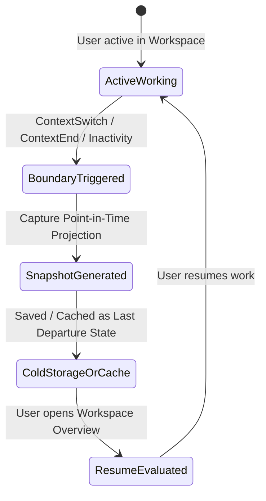

# Context Snapshot Architecture Audit (Day 20 — Step 1)

## Executive Summary

As ContextSplit completes Day 19 (Context State Reconstruction & Resume Readiness), the system possesses rich contextual reasoning capabilities across memory, task detection, item relevance, activity segmentation, and transition tracking. 

Day 20 introduces **Context Snapshots**, designed to answer a fundamental user question:
> **"What did my work look like when I last left this context?"**

This audit inspects all existing subsystems, examines how they can produce cohesive point-in-time Context Snapshots, delineates strictly between derived and persisted data to prevent duplicate sources of truth, defines the snapshot lifecycle, and establishes performance, privacy, and verification requirements.

---

## 1. Audit of Existing Systems

ContextSplit's architecture already contains 18 foundational subsystems that provide the raw signals, structured entities, and derived reasoning required for snapshot synthesis:

| Subsystem | Current Responsibilities | Role in Context Snapshots |
| :--- | :--- | :--- |
| **Context Engine & Providers** | Captures active apps, URLs, titles, window focus, user actions. | Supplies ground-truth observational telemetry. |
| **Context Evidence & Confidence** | Evaluates independent signal diversity, semantic affinity, graph proximity, and contradiction. | Calibrates overall context confidence for the snapshot. |
| **Context Discovery & Candidates** | Detects emergent context clusters and candidate groupings (`context_candidates`). | Distinguishes established workspaces from suggested context candidates. |
| **Context Membership** | Maintains item-to-workspace mappings (`context_memberships`: confirmed, suggested, dismissed). | Guarantees snapshot item membership reflects user confirmations and suppression rules. |
| **Context Sessions & Timeline** | Groups temporal activity into sessions (`sessions`) and chronological events (`ContextTimeline`). | Provides chronological boundaries, session durations, and user actions. |
| **Context Activity Segments** | Identifies continuous bursts of contextual focus (`ContextActivitySegment`). | Delineates active working sessions and departure timestamps. |
| **Context Transitions** | Records cross-context shifts (`context_transitions`: `ContextSwitch`, `ContextReturn`, `ContextStart`, `ContextEnd`, `AmbiguousTransition`). | **Primary trigger and boundary identifier** for snapshot generation. |
| **Task Candidates & Extractor** | Extracts grounded verbs and subjects into candidate tasks (`task_candidates`). | Identifies the active task candidate at departure time. |
| **Task Evidence & Ranking** | Aggregates and ranks task evidence with anti-jitter and hysteresis. | Resolves task ambiguity and supplies human-readable explanations. |
| **Task Transitions** | Emits `TaskStart`, `TaskSwitch`, `TaskReturn`, `TaskEnd`, and `AmbiguousTaskChange`. | Pinpoints the exact task state when leaving a context. |
| **Context Memory** | Unified working memory (`ContextMemory`, `MemoryTaskReference`, `MemoryItemReference`). | Supplies lightweight references and episodic activity sequence entries. |
| **Context Workset** | High-signal working set (`ContextWorkset`, `WorksetItemReference`) with Primary/Supporting/Reference/Recent tiers. | Supplies the core working materials present at departure time. |
| **Context State** | Derived working state (`ContextState`, `ContextStateValue`, `StateFreshness`, `MeaningfulActivity`). | Projects the baseline "Where did I leave this work?" representation. |
| **Resume Readiness** | Evaluates readiness (`Ready`, `MostlyReady`, `Partial`, `Insufficient`). | Determines whether the snapshot provides sufficient detail for clean resumption. |
| **Context Overview** | Aggregated view of context metadata, top domains, apps, and recent items. | Exposes snapshot summaries in the primary UI panel. |
| **Inbox & Attention Engine** | Lifecycle for unfiled captures (`inbox_item_states`, `ItemAttention`). | Excludes unassigned inbox noise from context-specific snapshots unless suggested with high confidence. |

---

## 2. Deep Dive: Key State & Memory Subsystems

### 2.1 ContextMemory (`src-tauri/src/context_engine/memory.rs`)
* **Data Held**: Context identity, decoupled `current_task`, `last_active_at`, `last_active_task`, `recent_activity`, `recent_items` (lightweight references), `recent_tasks`, `activity_sequence` (milestones), and `memory_statement`.
* **Provenance**: Explicitly labels attributes as `Observed`, `Inferred`, or `Confirmed`.
* **Snapshot Contribution**: Provides the historical activity sequence, task streak history, and human-readable explanation structure.

### 2.2 ContextWorkset (`src-tauri/src/context_engine/workset.rs`)
* **Data Held**: Classified items (`Primary`, `Supporting`, `Reference`, `Recent`, `Related`), operational state (`Active`, `RecentlyActive`, `DetourReturn`, `Dormant`), and confidence.
* **Quality Filtering**: Noise suppression (`is_generic_noise`, `is_accidental_capture`), deduplication keys, and temporal decay.
* **Snapshot Contribution**: Supplies the exact 5–8 high-signal items that constituted the user's active workset when they departed the context.

### 2.3 ContextState & ResumeReadiness (`src-tauri/src/context_engine/context_state.rs`)
* **Data Held**: Conservative `ContextStateValue` (`Active`, `RecentlyActive`, `Paused`, `Dormant`, `Uncertain`, `InsufficientEvidence`), `StateFreshness` (`Fresh`, `Recent`, `Stale`, `VeryStale`), `MeaningfulActivity`, and `ContextResumeState`.
* **Snapshot Contribution**: Produces the defensible, non-arbitrary resume statement (e.g., "Drafting Case study writing, last viewed 'Figma Mockup'"), state freshness relative wording, and the internal readiness rating.

### 2.4 Transitions & Activity Boundaries
* **`ContextTransition`**: Persisted in SQLite (`context_transitions`). Marks `ContextSwitch` (moving from Workspace A to B) and `ContextEnd` (closing work), recording the precise `detected_at` departure timestamp.
* **`DetectedTaskTransition`**: Emits task switches and task ends, recording the exact task that was active prior to departure.

---

## 3. What is Missing for Point-in-Time Snapshots?

While existing systems reconstruct the *live / current* derived state, the following pieces are needed to deliver true **Point-in-Time Context Snapshots**:

1. **Explicit Snapshot Data Model (`ContextSnapshot`)**:
   A compact, serializable representation capturing the snapshot point-in-time:
   * Context ID and display name.
   * Snapshot timestamp (departure time / boundary time).
   * Snapshot trigger (`context_switch`, `context_end`, `session_pause`, `manual_checkpoint`).
   * Task state at departure (task title, action verb, target subject, confidence, provenance).
   * Last meaningful activity (type, title, description, timestamp).
   * Primary and supporting workset items (item IDs, titles, types, apps, domains, snippets, relevance tier).
   * Context state and freshness at time of snapshot.
   * Resume readiness assessment and reasons.
   * Human-readable resume narrative ("What did work look like when you left?").

2. **Snapshot Boundary Trigger Hook**:
   * Automatic generation when a `ContextTransition` (`ContextSwitch` or `ContextEnd`) is detected.
   * On-demand derivation when querying historical sessions or opening a workspace overview.

3. **Snapshot Diffing / Resume Delta**:
   * Ability to compare "Snapshot at departure" vs "Current environment" to detect what changed during the user's absence (e.g., new items added, time elapsed, freshness decay).

4. **Snapshot Storage vs Derivation Strategy**:
   * A clear protocol determining when a snapshot is computed ephemerally vs when a compact departure record is cached or persisted.

---

## 4. Derived vs. Persisted Data Architecture

### Critical Invariant: No Duplicate Sources of Truth
Under no circumstances should Context Snapshots store duplicate copies of full `Item` contents, raw payloads, vector embeddings, or relationship matrices. 

A Context Snapshot is a **compact projection** consisting of IDs, labels, metadata, and normalized references:

```
                                  EXISTING PERSISTENCE (SQLite)
                     ┌──────────────────────────────────────────────────────┐
                     │ • workspaces           • task_candidates             │
                     │ • items                • context_transitions         │
                     │ • context_signals      • context_memberships         │
                     │ • sessions             • item_relationships          │
                     └──────────────────────────┬───────────────────────────┘
                                                │
                                                ▼
                                    DERIVATION PIPELINE
                     ┌──────────────────────────────────────────────────────┐
                     │ ContextEngine -> TaskExtractor -> TaskRanking        │
                     │ ContextMemoryBuilder -> ContextWorksetBuilder         │
                     │ MeaningfulActivityResolver -> ContextStateBuilder    │
                     │ ResumeReadinessEvaluator                             │
                     └──────────────────────────┬───────────────────────────┘
                                                │
                                                ▼
                                    CONTEXT SNAPSHOT (Day 20)
                     ┌──────────────────────────────────────────────────────┐
                     │ • snapshot_id: UUID                                  │
                     │ • context_id: Workspace ID                           │
                     │ • captured_at: Departure ISO timestamp               │
                     │ • trigger: Transition type (e.g., ContextSwitch)     │
                     │ • active_task: Title + Subject + Confidence          │
                     │ • workset_items: [ {id, title, type, relevance} ]    │
                     │ • meaningful_activity: Description + Reference       │
                     │ • resume_state: Formatted natural summary            │
                     │ • readiness: Assessment + Reasons                    │
                     └──────────────────────────────────────────────────────┘
```

### Breakdown of Derived vs Persisted Elements:

| Attribute | Storage / Generation Strategy | Rationale |
| :--- | :--- | :--- |
| **Workspace Metadata** | Persisted (`workspaces` table) | Core relational entity. |
| **Item Metadata & Snippets** | Persisted (`items` table) | Master record for user assets. |
| **Context Transitions** | Persisted (`context_transitions` table) | Immutable chronological event log. |
| **Task Candidates** | Persisted (`task_candidates` table) | Activity-grounded task lifecycle tracking. |
| **Snapshot Point-in-Time Projection** | **Derived on-demand or cached as compact JSON** | Can be reconstructed dynamically for any timestamp `T` by evaluating the state at `T`. Caching departure snapshots in memory or an auxiliary lightweight table provides instant UI retrieval without re-running full inference. |
| **Workset Item Relevance Tiers** | Derived (`ContextWorksetBuilder`) | Determined dynamically via heuristic scoring, recency decay, and graph relationships. |
| **Resume Readiness** | Derived (`ResumeReadinessEvaluator`) | Computed dynamically from evidence completeness. |
| **Meaningful Activity** | Derived (`MeaningfulActivityResolver`) | Ranked dynamically from transitions, user actions, and items. |

---

## 5. Snapshot Lifecycle

The lifecycle of a Context Snapshot follows four clear stages:



1. **Active Working Stage**:
   The user works within Context A. Signals and items accumulate. Live `ContextWorkset` and `ContextState` track focus with hysteresis.
2. **Departure / Boundary Stage**:
   The user switches to Context B or closes the application. The `ContextTransitionDetector` emits a `ContextSwitch` or `ContextEnd` event.
3. **Snapshot Generation Stage**:
   A `ContextSnapshot` is created for Context A capturing:
   * The active task candidate at departure.
   * The top 5–8 primary and supporting workset items.
   * The last meaningful activity and application/domain focus.
   * The departure timestamp and trigger cause.
4. **Resumption & Delta Stage**:
   When the user returns to Context A:
   * The snapshot is loaded to instantly display: *"When you last left this context on Tuesday at 4:15 PM, you were working on Hero Animation in Figma."*
   * State freshness compares `snapshot.captured_at` with `now()` to display defensible relative indicators ("Last active 2 days ago").
   * Resume readiness informs the user of state warmth and available materials.

---

## 6. Privacy Considerations

1. **Local-Only Storage**:
   All snapshot records, summaries, and workset references remain strictly within the local SQLite database (`contextsplit.db`). Zero data is transmitted to external telemetry or third-party servers.
2. **Honoring Deletions and Dismissals**:
   If a user deletes an `Item` or dismisses a `ContextMembership` or `TaskCandidate`, any subsequent snapshot generation or snapshot render must respect cascade deletion and filter out suppressed entities.
3. **No Unsanitized Clipboard Dumps**:
   Snapshots store sanitized snippets (max 120 chars) and normalized domain/app names, avoiding storage of raw sensitive clipboard payloads or auth tokens.
4. **Grounded Provenance**:
   Every claim in a snapshot is tagged with `Observed`, `Inferred`, or `Confirmed`, ensuring the UI never misrepresents engine inferences as user actions.

---

## 7. Performance Considerations

1. **Sub-50ms Snapshot Construction**:
   Because snapshots aggregate pre-indexed relational data (`task_candidates`, `context_transitions`, `items`), snapshot generation requires only lightweight indexed SQLite queries.
2. **Bounded Memory Footprint**:
   A `ContextSnapshot` data structure contains only IDs and string summaries (< 4 KB per snapshot), preventing memory bloat even across dozens of workspaces.
3. **Thread-Safe In-Memory Caching**:
   Utilize `RwLock<HashMap<String, ContextSnapshot>>` with a configurable TTL or transition-based invalidation to ensure snapshot queries from the UI never block the main thread.
4. **No Heavy Vector Computations at Departure**:
   Snapshots utilize already computed embeddings and relationship scores; no synchronous model inference is executed during context transitions.

---

## 8. Testing Requirements

To ensure robustness, Day 20 implementation must include comprehensive automated unit and integration tests:

1. **Clean Departure Snapshot Test**:
   * Simulate a clean `ContextSwitch` from Workspace A to Workspace B.
   * Verify Workspace A snapshot captures the exact `TaskCandidate`, `Primary` workset items, and departure timestamp.
2. **Noisy Departure Suppression Test**:
   * Simulate a user opening generic tabs ("New Tab", "Google Search") immediately before switching contexts.
   * Verify the snapshot filters out the generic noise and captures the last substantive task and meaningful activity.
3. **Multi-Task Context Snapshot Test**:
   * Simulate multiple tasks across a session in Workspace A; verify the snapshot correctly selects the active/leader task at the departure boundary.
4. **Dormant Snapshot Freshness Test**:
   * Reconstruct a snapshot for an inactive context (> 7 days); verify `StateFreshness` correctly reports `VeryStale` and adjusts resume readiness without losing historical workset items.
5. **Cascade Deletion & Integrity Test**:
   * Verify that deleting an item or workspace cleanly purges associated snapshot references without foreign key violations.
6. **Snapshot Serialization & Round-Trip Test**:
   * Verify JSON serialization/deserialization of `ContextSnapshot` for IPC transfer across the Tauri boundary.

---

## 9. Conclusion & Next Steps

ContextSplit possesses all the prerequisite building blocks for Day 20: Context Snapshots. By synthesizing `ContextMemory`, `ContextWorkset`, `ContextState`, `TaskTransitions`, and `ContextTransitions` into a compact, non-duplicative `ContextSnapshot` representation, ContextSplit will provide an effortless, transparent answer to *"What did my work look like when I last left this context?"*.
