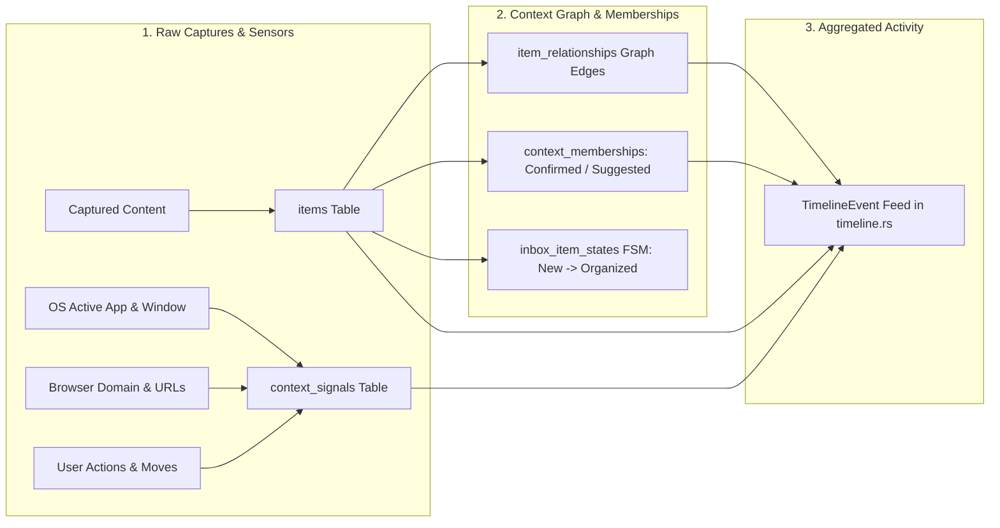
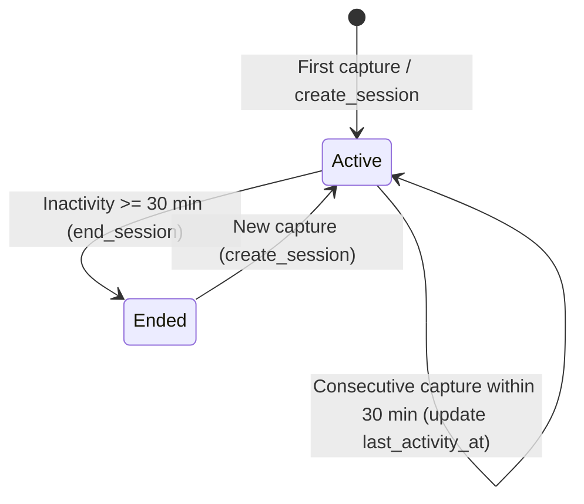
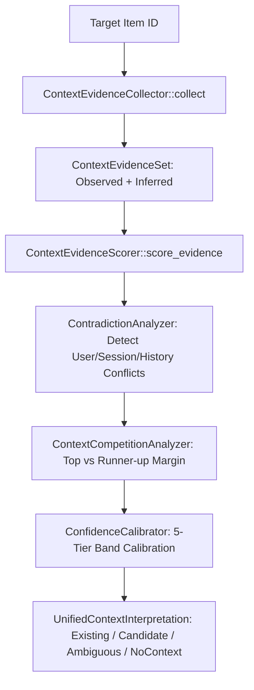
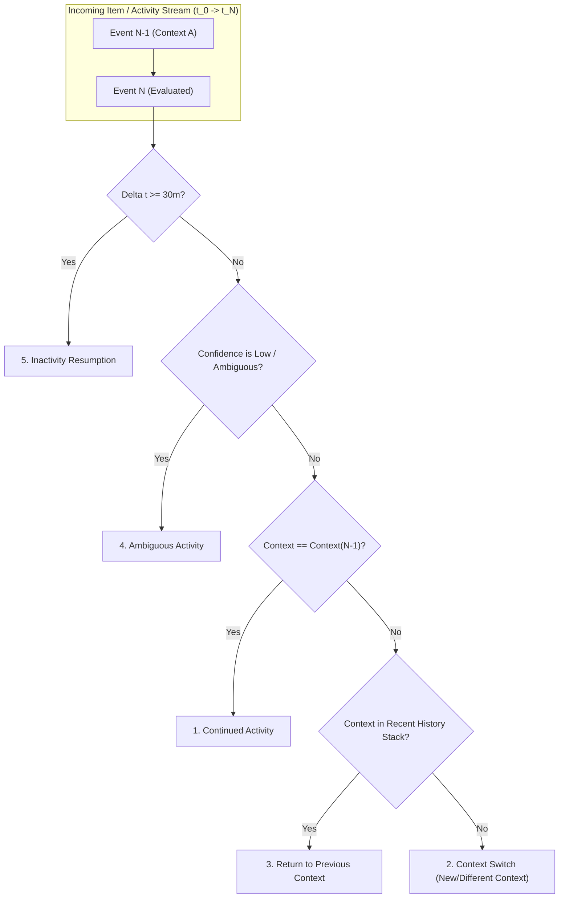

# Contextual Transition Architecture Audit

**Status:** Completed  
**Date:** September 2026  
**Target Subsystems:** `context_engine` (`engine.rs`, `timeline.rs`, `scoring.rs`, `competition.rs`, `contradiction.rs`, `calibration.rs`, `attention.rs`, `providers.rs`), `capture` (`pipeline.rs`), `db` (`mod.rs`, `models.rs`, `operations.rs`)  
**Purpose:** Pre-implementation architectural audit for **Contextual Transition Detection**.  
**Commit Reference:** `docs: audit contextual transition architecture`  

---

## 1. Executive Summary

ContextSplit is preparing to implement **Contextual Transition Detection** to recognize when a user:
1. **Continues activity** in the current context,
2. **Switches context** to another workspace or candidate topic,
3. **Returns to a previous context** after an interruption or task detour,
4. **Engages in ambiguous activity** that cannot yet be assigned with certainty, or
5. **Resumes after inactivity** (session pause or idle time).

This audit evaluates the current representations of activity, sessions, context evaluation, timelines, signals, and working memory. It identifies where timestamps and sequence information exist, analyzes gaps in the current system, and **recommends the smallest architectural change needed** to represent transitions cleanly without duplicating existing session or activity data.

---

## 2. Detailed Findings Against the 6 Core Questions

```
┌────────────────────────────────────────────────────────────────────────────────────────────────────────┐
│                                ARCHITECTURAL CAPABILITY MATRIX                                         │
├───────────────────────────────────┬───────────────────────────────┬────────────────────────────────────┤
│ Dimension                         │ Current Representation        │ Transition Detection Capability    │
├───────────────────────────────────┼───────────────────────────────┼────────────────────────────────────┤
│ 1. Activity Representation        │ Items + Signals + Graph Edges │ Rich, multi-modal, event-driven    │
│ 2. Session Representation         │ Temporal 30m idle windows     │ Temporal only (not context-bound)  │
│ 3. Current Context Determination  │ On-demand per item evaluation │ Stateless (no persistent memory)   │
│ 4. Implicit Context Changes       │ Present in item sequence      │ Unaggregated / fragmented          │
│ 5. Timestamp Availability         │ ISO-8601 UTC across all tables│ Complete & high-precision          │
│ 6. Transition Distinguishability: │                               │                                    │
│    - Continued Activity           │ Same session + same top score │ Supported                          │
│    - Context Switch               │ Sequential context delta      │ Supported (needs transition model) │
│    - Return to Previous           │ Historical pattern A -> B -> A│ Supported (needs context stack)    │
│    - Ambiguous Activity           │ AmbiguityState & Calibrated   │ Fully supported                    │
│    - Inactivity                   │ Session last_activity delta   │ Fully supported                    │
└───────────────────────────────────┴───────────────────────────────┴────────────────────────────────────┘
```

---

### 1. How Activity Is Currently Represented

Activity in ContextSplit is modeled across five distinct, complementary layers:



1. **`items` Table** ([`db/models.rs:10-23`](file:///Users/deepanshukhatri/Desktop/ContextSplit/src-tauri/src/db/models.rs#L10-L23)):
   - Primary atomic record of user capture.
   - Fields: `id`, `workspace_id` (nullable or `'inbox'`), `session_id` (nullable), `item_type` (`text`, `url`, `file`, `image`), `content`, `title`, `metadata` (JSON with `app_name`, `domain`, `window_title`, `process_name`), `created_at`, `updated_at`.
2. **`context_signals` Table** ([`db/models.rs:25-37`](file:///Users/deepanshukhatri/Desktop/ContextSplit/src-tauri/src/db/models.rs#L25-L37)):
   - Append-only telemetry of environmental facts and user interactions.
   - Signal types: `capture_event`, `active_app`, `window_title`, `url_metadata`, `file_metadata`, `user_action`, `workspace_selected`, `suggestion_dismissed`, `membership_dismissed`.
3. **`item_relationships` Table** ([`db/models.rs:163-176`](file:///Users/deepanshukhatri/Desktop/ContextSplit/src-tauri/src/db/models.rs#L163-L176)):
   - Undirected graph edges linking items with explicit strength $0.0 - 1.0$.
   - Relationship types: `same_session` ($+0.40$), `temporal_proximity` ($+0.20$ within 300s), `same_workspace` ($+0.20$), `same_source_app` ($+0.30$), `same_domain` ($+0.30$), `semantic_similarity` (cosine $\ge 0.85$).
4. **`context_memberships` Table** ([`db/models.rs:271-285`](file:///Users/deepanshukhatri/Desktop/ContextSplit/src-tauri/src/db/models.rs#L271-L285)):
   - Multi-tenant contextual affinity: `confirmed` (authoritative user placement), `suggested` (algorithmically inferred), `dismissed` (user suppression).
5. **`inbox_item_states` Table** ([`db/models.rs:548-560`](file:///Users/deepanshukhatri/Desktop/ContextSplit/src-tauri/src/db/models.rs#L548-L560)):
   - FSM state progression: `new` $\to$ `processing` $\to$ `understood` $\to$ `suggested` / `needs_review` $\to$ `organized` / `dismissed`.
6. **`TimelineEvent` Feed** ([`context_engine/timeline.rs:211-336`](file:///Users/deepanshukhatri/Desktop/ContextSplit/src-tauri/src/context_engine/timeline.rs#L211-L336)):
   - On-demand chronological reconstruction: `item_captured`, `session_started`, `session_ended`, `user_action`, `relationship_formed`.

---

### 2. How Sessions Are Currently Represented

Sessions are currently implemented as **temporal activity containers**, not contextual containers:



1. **`sessions` Table** ([`db/models.rs:39-48`](file:///Users/deepanshukhatri/Desktop/ContextSplit/src-tauri/src/db/models.rs#L39-L48)):
   - `id`: UUID string.
   - `started_at`: ISO-8601 UTC timestamp of first capture in session.
   - `last_activity_at`: ISO-8601 UTC timestamp of most recent activity.
   - `ended_at`: Nullable ISO-8601 UTC timestamp when session was concluded.
   - `status`: `"active"` or `"ended"`.
2. **Session Lifecycle Management** ([`context_engine/engine.rs:132-176`](file:///Users/deepanshukhatri/Desktop/ContextSplit/src-tauri/src/context_engine/engine.rs#L132-L176)):
   - `ContextEngine::get_or_update_active_session` is called whenever a capture event or signal is processed.
   - Inactivity threshold: `inactivity_threshold_secs = 1800` (30 minutes default).
   - If `now - last_activity_at < 1800s`: Updates `last_activity_at = now` and returns existing `session.id`.
   - If `now - last_activity_at >= 1800s`: Concludes old session (`status = 'ended'`, `ended_at = now`), creates a new session (`status = 'active'`), and returns new `session.id`.
3. **Key Finding / Limitation**:
   - A single `Session` represents continuous **human presence at the computer**, regardless of topic.
   - If a user spends 20 minutes coding in Rust, switches to booking a flight for 5 minutes, and then edits a Figma design for 5 minutes, **all three items share the exact same `session_id`**.
   - Current sessions provide temporal co-occurrence, but do **not** represent contextual continuity.

---

### 3. How Current Context Is Currently Determined

Currently, ContextSplit **does not maintain an active, stateful "Current Context" entity**. Instead, context is evaluated **on-demand per item**:



1. **On-Demand Item Evaluation** ([`context_engine/scoring.rs:884-904`](file:///Users/deepanshukhatri/Desktop/ContextSplit/src-tauri/src/context_engine/scoring.rs#L884-L904)):
   - `evaluate_item_context(conn, item_id)` or `debug_item_context_confidence(conn, item_id)` extracts evidence and scores the item against all existing workspaces and candidates.
   - The result is classified into one of 4 first-class outcomes:
     - `existing_context` (high/medium affinity for an established Workspace),
     - `new_context_candidate` (affinity for an unassigned cluster),
     - `ambiguous` (two or more competing contexts with close scores, margin $< 0.15$),
     - `no_context` (insufficient evidence, low semantic similarity, or isolated weak signals).
2. **Real-time Environmental Sensors** ([`context_engine/providers.rs`](file:///Users/deepanshukhatri/Desktop/ContextSplit/src-tauri/src/context_engine/providers.rs)):
   - `ActiveAppProvider` and `UrlContextProvider` poll the native OS (`get_active_app()`) at capture time to record frontmost process name, window title, and active browser domain.
3. **User Workspace Focus** ([`context_engine/engine.rs:21-23`](file:///Users/deepanshukhatri/Desktop/ContextSplit/src-tauri/src/context_engine/engine.rs#L21-L23)):
   - When the user selects a workspace in the UI, `ContextEvent::WorkspaceSelected` emits a `workspace_selected` signal.
4. **Workspace Activity Touchpoint** ([`db/operations.rs:395`](file:///Users/deepanshukhatri/Desktop/ContextSplit/src-tauri/src/db/operations.rs#L395)):
   - When an item is moved to or confirmed in a workspace, `touch_workspace_activity` updates `workspaces.last_activity_at`.

---

### 4. Whether Context Changes Are Already Implicitly Represented

**Yes, context changes are implicitly recorded throughout the system's event streams**, but are not synthesized into discrete transition records:

1. **Chronological Item Affinity Sequence**:
   - Querying items ordered by `created_at ASC` yields a sequence of evaluated contexts:
     $$\text{Item}_1(\text{Workspace A}) \to \text{Item}_2(\text{Workspace A}) \to \text{Item}_3(\text{Workspace B}) \to \text{Item}_4(\text{Workspace B})$$
   - The boundary between $\text{Item}_2$ and $\text{Item}_3$ is an implicit context transition.
2. **`context_signals` Telemetry Stream**:
   - Successive `active_app`, `window_title`, and `url_metadata` signals indicate foreground tool switches (e.g. `VS Code` $\to$ `Figma` $\to$ `Slack`).
3. **User Action Stream**:
   - `user_action` signals (`moved_to_workspace`, `workspace_created_from_candidate`, `suggestion_dismissed`) record explicit user-driven context alterations.
4. **Temporal Decay and Workspace Recency**:
   - `workspaces.last_activity_at` tracks when each context was last touched.
5. **The Missing Synthesis**:
   - Because each capture is evaluated independently, the engine currently treats switches as isolated observations rather than recognizing continuous work stretches, task interruptions, or context returns.

---

### 5. Where Timestamps Are Available

Every subsystem in ContextSplit records high-precision ISO-8601 UTC timestamps formatted as `chrono::Utc::now().to_rfc3339()`:

| Table / Entity | Timestamp Field | Representation & Resolution | Usage |
|---|---|---|---|
| `items` | `created_at`, `updated_at` | ISO-8601 UTC String (`YYYY-MM-DDTHH:MM:SSZ`) | Exact capture timestamp |
| `context_signals` | `created_at`, `updated_at` | ISO-8601 UTC String | Exact sensor event timestamp |
| `sessions` | `started_at`, `last_activity_at`, `ended_at` | ISO-8601 UTC String | Temporal activity session boundaries |
| `item_relationships` | `created_at` | ISO-8601 UTC String | Time graph edge was detected |
| `context_memberships` | `created_at`, `updated_at` | ISO-8601 UTC String | Confirmation or suggestion timestamp |
| `workspaces` | `created_at`, `updated_at`, `last_activity_at`, `archived_at` | ISO-8601 UTC String | Context lifecycle and recency tracking |
| `context_candidates` | `created_at`, `updated_at` | ISO-8601 UTC String | Cluster emergence and update time |
| `context_candidate_items` | `added_at` | ISO-8601 UTC String | Item cluster membership timestamp |
| `inbox_item_states` | `created_at`, `updated_at` | ISO-8601 UTC String | Inbox state transition timestamp |
| `ai_reasoning_cache` | `created_at`, `expires_at` | ISO-8601 UTC String | Cache validation and expiration |

All timestamps are stored natively in UTC and are sortable lexicographically and chronologically via standard SQL and Rust `DateTime<Utc>` parsers.

---

### 6. Capability Assessment for 5 Key Transition Types



#### A. Continued Activity
- **Current Ability to Distinguish:** **Yes** (High).
- **Detection Mechanism:** Successive events within the same active session where context evaluation produces the same top workspace (or candidate) with consistent high/medium confidence.
- **Evidence:** Same session ID, matching app/domain patterns, low temporal gap ($\Delta t < 15\text{m}$), and zero contradiction penalties.

#### B. Context Switch
- **Current Ability to Distinguish:** **Yes** (Medium).
- **Detection Mechanism:** Successive events within an active session where Event $N$ evaluates decisively to Workspace B (or New Candidate C), while Event $N-1$ was in Workspace A, with both having confidence $\ge \text{Medium}$ and score margin over runner-up $\ge 0.15$.
- **Evidence:** Sharp divergence in semantic similarity, domain/app change, and contradiction detector flagging cross-context discrepancy.

#### C. Return to Previous Context
- **Current Ability to Distinguish:** **Yes** (Medium — currently requires sequence query).
- **Detection Mechanism:** The stream shows Context A $\to$ Context B (brief task or interruption) $\to$ Context A.
- **Evidence:** Event $N$ matches Context A's workspace history, semantic profile centroid, and prior session items, while Event $N-1$ was assigned to Context B.
- **Required Capability:** A lightweight **Context Working Memory Stack** (storing the last 1–3 active contexts) to distinguish a "return" from a brand new switch.

#### D. Ambiguous Activity
- **Current Ability to Distinguish:** **Yes** (Fully Built).
- **Detection Mechanism:** Handled directly by `ContextCompetitionAnalyzer` (`AmbiguityState::Ambiguous` or `AmbiguityState::Unknown`), `ContradictionAnalyzer` (`ContradictionReport`), and `NoContextReason`.
- **Evidence:** Score margin between top two candidates is $< 0.15$, or overall evidence is weak/isolated ($< 0.25$).

#### E. Inactivity
- **Current Ability to Distinguish:** **Yes** (Fully Built).
- **Detection Mechanism:** Evaluated via `sessions.last_activity_at` and `inactivity_threshold_secs` (30m), plus inter-event timestamp delta ($\Delta t = t_N - t_{N-1}$).
- **Evidence:** A session transition from `active` $\to$ `ended` indicates macro-inactivity; item $\Delta t > 10\text{m}$ indicates micro-pauses.

---

## 3. Recommended Smallest Architectural Change

### Core Design Principle: Zero Redundant Storage
We must **not** create a duplicate event logging table or mirror existing `items` and `context_signals` rows. All raw events, timestamps, and metadata already exist in SQLite.

### Recommended Change: Ephemeral Context Memory & Transition Evaluator

We recommend introducing a lightweight **`ContextMemory`** working-state module in `context_engine` with two components:

```
┌────────────────────────────────────────────────────────────────────────────────────────┐
│                        PROPOSED ARCHITECTURAL ADDITION                                 │
├────────────────────────────────────────────────────────────────────────────────────────┤
│ 1. ContextMemory (In-Memory / Working State)                                          │
│    - current_context: Option<ActiveContextSnapshot>                                   │
│    - previous_contexts: VecDeque<ActiveContextSnapshot> (max 3, bounded history)       │
│    - last_activity_at: DateTime<Utc>                                                   │
│    - current_streak_count: usize                                                       │
│                                                                                        │
│ 2. ContextTransition (Structured Result Model)                                         │
│    - transition_type: ContinuedActivity | ContextSwitch | ReturnToPrevious             │
│                       | AmbiguousActivity | InactivityResumption                       │
│    - from_context: Option<ContextRef>                                                  │
│    - to_context: Option<ContextRef>                                                    │
│    - confidence: f32                                                                   │
│    - time_gap_seconds: i64                                                             │
│    - trigger_item_id: Option<String>                                                   │
│    - explanation: String                                                               │
│                                                                                        │
│ 3. ContextTransitionAnalyzer (Pure Service)                                            │
│    - evaluate_transition(memory: &ContextMemory, new_event_interpretation)             │
│      -> (ContextTransition, UpdatedContextMemory)                                      │
└────────────────────────────────────────────────────────────────────────────────────────┘
```

### Why This Is the Smallest and Cleanest Change:
1. **No Database Migrations Required (or 1 optional lightweight table if persistent transition logging is desired later)**:
   - Transitions can be evaluated on-the-fly from the chronological stream of `items` and `context_signals`.
   - Ephemeral working memory in `ContextEngine` tracks real-time state for live captures.
2. **Direct Reuse of Existing Calibrations**:
   - Leverages `UnifiedContextInterpretation`, `AmbiguityState`, and `ConfidenceCalibrator` directly.
   - If interpretation is `Ambiguous` $\to$ `AmbiguousActivity`.
   - If interpretation is `NoContext` $\to$ `AmbiguousActivity` or `InactivityResumption`.
   - If interpretation matches `current_context` $\to$ `ContinuedActivity`.
   - If interpretation matches an item in `previous_contexts` $\to$ `ReturnToPrevious`.
   - If interpretation is a different confident context $\to$ `ContextSwitch`.
3. **Enhances Timeline Without Breaking Changes**:
   - `timeline.rs` can include transition markers (`"Switched from Portfolio to College"`) as synthetic `TimelineEvent` records during timeline generation without touching storage.

---

## 4. Conclusion & Next Steps

ContextSplit's current foundation is well-suited for transition detection:
- **Activity & Timestamps:** Completely recorded and high-precision.
- **Competition & Contradiction:** Already calibrated via Day 13 and adversarial suites.
- **Missing Piece:** A structured `ContextTransition` evaluation model and a lightweight `ContextMemory` working stack.

Once approved, the implementation can be built cleanly as a modular service on top of the existing `context_engine` pipeline without disturbing existing database invariants or frontend stores.
