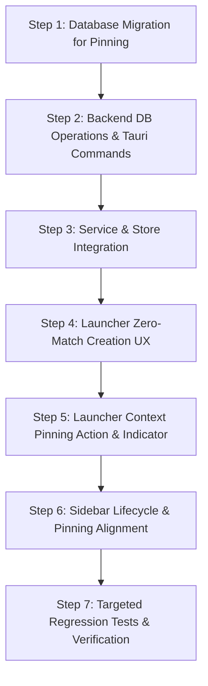

# Day 34 — Context Organization: Implementation Audit & Architecture Review

**Milestone:** Phase 2 — Context Organization (Step 1: Current State Audit & Gap Analysis)  
**Date:** October 20, 2026  
**Document:** [`docs/day-34-organization-audit.md`](file:///Users/deepanshukhatri/Library/CloudStorage/GoogleDrive-deepanshukhatri20061972@gmail.com/My%20Drive/Cloud%20Desktop/ContextSplit/docs/day-34-organization-audit.md)  
**Status:** **COMPLETE & VERIFIED**  

---

## Executive Summary

Phase 2, Day 34 focuses on **Context Organization** — how contexts (workspaces) are identified, categorized, prioritized, filtered, and managed across ContextSplit. Following the successful completion and verification of the Context Launcher Quick Actions on Day 33 ([`docs/day-33-report.md`](file:///Users/deepanshukhatri/Library/CloudStorage/GoogleDrive-deepanshukhatri20061972@gmail.com/My%20Drive/Cloud%20Desktop/ContextSplit/docs/day-33-report.md)), this audit provides a rigorous, code-grounded inspection of the existing workspace and context organization mechanisms.

### Key Audit Findings:
1. **Flat Identity Model:** Contexts possess immutable UUID identities with robust foreign-key integrity, but they exist in a completely flat hierarchy. There are no project containers, folders, or parent-child groupings.
2. **Minimal Database Schema:** The SQLite `workspaces` table possesses only 7 columns: `id`, `name`, `created_at`, `updated_at`, `lifecycle_state`, `last_activity_at`, and `archived_at`. Columns for `description`, `project_identifier`, `repository`, `color`, `icon`, `is_pinned`, `is_favorite`, or `sort_order` **do not exist**.
3. **Disconnected Metadata:** The Context Launcher view model ([`src/store/launcherStore.ts`](file:///Users/deepanshukhatri/Library/CloudStorage/GoogleDrive-deepanshukhatri20061972@gmail.com/My%20Drive/Cloud%20Desktop/ContextSplit/src/store/launcherStore.ts#L677-L680)) and search ranking engine reference `description`, `projectIdentifier`, and `repository`. However, because the database does not store these fields and the UI provides no input fields, these properties are either opportunistic transient heuristics from IDE window titles or permanently null.
4. **Lifecycle Segmentation Discrepancy:** The Launcher cleanly isolates contexts across 5 lifecycle tabs (`all`, `active`, `recent`, `paused`, `archived`). In contrast, the Main App Sidebar ([`src/components/layout/Sidebar.tsx`](file:///Users/deepanshukhatri/Library/CloudStorage/GoogleDrive-deepanshukhatri20061972@gmail.com/My%20Drive/Cloud%20Desktop/ContextSplit/src/components/layout/Sidebar.tsx#L155-L235)) renders all workspaces returned by `db.listWorkspaces()` in a single flat list, causing archived contexts to clutter the primary navigation.
5. **No Context Pinning / Favorites:** While individual working set *items* can be pinned in context memory (`item.mark_important`), *contexts themselves* have no pinning or favorite mechanisms anywhere in the application.

---

## 1. Capability Classification Matrix

Each capability is classified strictly according to actual implementation evidence in the repository:
- **`IMPLEMENTED`**: Fully wired from UI to backend with persistent logic.
- **`PARTIALLY_IMPLEMENTED`**: Exists in some surfaces or layers, but is incomplete, unpersisted, or disconnected.
- **`NOT_IMPLEMENTED`**: Absent across models, database, and UI.
- **`IMPLEMENTED_BUT_UNTESTED`**: Code exists but lacks targeted test coverage.
- **`BROKEN`**: Code exists but exhibits functional defects or contract violations.

| Capability | Classification | Source of Truth / Evidence | Notes |
|---|---|---|---|
| **Context UUID Identity & Integrity** | `IMPLEMENTED` | [`src-tauri/src/db/mod.rs:L41-L50`](file:///Users/deepanshukhatri/Library/CloudStorage/GoogleDrive-deepanshukhatri20061972@gmail.com/My%20Drive/Cloud%20Desktop/ContextSplit/src-tauri/src/db/mod.rs#L41-L50) | UUID primary keys, cascade deletions for items, memberships, snapshots. |
| **Context Creation (Sidebar)** | `IMPLEMENTED` | [`src/components/layout/Sidebar.tsx:L242`](file:///Users/deepanshukhatri/Library/CloudStorage/GoogleDrive-deepanshukhatri20061972@gmail.com/My%20Drive/Cloud%20Desktop/ContextSplit/src/components/layout/Sidebar.tsx#L242) | Creates "New Workspace" and selects it. |
| **Context Creation from Launcher Search** | `NOT_IMPLEMENTED` | [`src/components/launcher/ContextLauncher.tsx:L603-L606`](file:///Users/deepanshukhatri/Library/CloudStorage/GoogleDrive-deepanshukhatri20061972@gmail.com/My%20Drive/Cloud%20Desktop/ContextSplit/src/components/launcher/ContextLauncher.tsx#L603-L606) | Zero-match state renders static text; no shortcut to create context with query name. |
| **Context Inline Renaming (Sidebar)** | `IMPLEMENTED` | [`src/components/layout/Sidebar.tsx:L187-L200`](file:///Users/deepanshukhatri/Library/CloudStorage/GoogleDrive-deepanshukhatri20061972@gmail.com/My%20Drive/Cloud%20Desktop/ContextSplit/src/components/layout/Sidebar.tsx#L187-L200) | Pencil icon triggers inline text input, writes to SQLite `workspaces.name`. |
| **Context Renaming (Launcher Quick Actions)** | `NOT_IMPLEMENTED` | [`src/models/quickActions.ts`](file:///Users/deepanshukhatri/Library/CloudStorage/GoogleDrive-deepanshukhatri20061972@gmail.com/My%20Drive/Cloud%20Desktop/ContextSplit/src/models/quickActions.ts) | No rename action exposed in Launcher preview or secondary menu. |
| **Context Deletion (Sidebar)** | `IMPLEMENTED` | [`src/store/workspaceStore.ts:L263-L294`](file:///Users/deepanshukhatri/Library/CloudStorage/GoogleDrive-deepanshukhatri20061972@gmail.com/My%20Drive/Cloud%20Desktop/ContextSplit/src/store/workspaceStore.ts#L263-L294) | Dialog confirmation followed by cascading SQLite deletion. |
| **Context Descriptions & Notes** | `NOT_IMPLEMENTED` | [`src/services/db.ts:L3-L11`](file:///Users/deepanshukhatri/Library/CloudStorage/GoogleDrive-deepanshukhatri20061972@gmail.com/My%20Drive/Cloud%20Desktop/ContextSplit/src/services/db.ts#L3-L11) | No `description` column in DB; no UI input in Sidebar or Launcher. |
| **Context Metadata (Project / Repo / Tags)** | `PARTIALLY_IMPLEMENTED` | [`src/store/launcherStore.ts:L677-L680`](file:///Users/deepanshukhatri/Library/CloudStorage/GoogleDrive-deepanshukhatri20061972@gmail.com/My%20Drive/Cloud%20Desktop/ContextSplit/src/store/launcherStore.ts#L677-L680) | Launcher ranks/badges `projectIdentifier` from runtime signals, but unpersisted on workspace entity. |
| **Context Pinning / Favorites** | `NOT_IMPLEMENTED` | [`src-tauri/src/db/models.rs:L3-L12`](file:///Users/deepanshukhatri/Library/CloudStorage/GoogleDrive-deepanshukhatri20061972@gmail.com/My%20Drive/Cloud%20Desktop/ContextSplit/src-tauri/src/db/models.rs#L3-L12) | No `is_pinned` or `is_favorite` in SQLite, models, Sidebar, or Launcher. |
| **Item Memory Pinning (Working Set)** | `IMPLEMENTED` | [`src/components/launcher/ContextLauncher.tsx:L1560-L1600`](file:///Users/deepanshukhatri/Library/CloudStorage/GoogleDrive-deepanshukhatri20061972@gmail.com/My%20Drive/Cloud%20Desktop/ContextSplit/src/components/launcher/ContextLauncher.tsx#L1560-L1600) | `item.mark_important` delegates to `controlContextMemory` with amber star toggle. |
| **Context Lifecycle Segmentation (Launcher)** | `IMPLEMENTED` | [`src/store/launcherStore.ts:L114-L128`](file:///Users/deepanshukhatri/Library/CloudStorage/GoogleDrive-deepanshukhatri20061972@gmail.com/My%20Drive/Cloud%20Desktop/ContextSplit/src/store/launcherStore.ts#L114-L128) | Filter tabs (`all`, `active`, `recent`, `paused`, `archived`) via `matchesContextFilter()`. |
| **Context Lifecycle Segmentation (Sidebar)** | `BROKEN` | [`src/components/layout/Sidebar.tsx:L155-L235`](file:///Users/deepanshukhatri/Library/CloudStorage/GoogleDrive-deepanshukhatri20061972@gmail.com/My%20Drive/Cloud%20Desktop/ContextSplit/src/components/layout/Sidebar.tsx#L155-L235) | Sidebar ignores `lifecycle_state`; archived workspaces remain visible and active in sidebar. |
| **Context Lifecycle Persistence (DB)** | `PARTIALLY_IMPLEMENTED` | [`src-tauri/src/db/operations.rs:L88-L115`](file:///Users/deepanshukhatri/Library/CloudStorage/GoogleDrive-deepanshukhatri20061972@gmail.com/My%20Drive/Cloud%20Desktop/ContextSplit/src-tauri/src/db/operations.rs#L88-L115) | DB stores `active`, `dormant`, `archived`. In-memory `paused` maps to `dormant` in DB. |
| **Context Archival & Unarchival** | `IMPLEMENTED` | [`src-tauri/src/db/operations.rs:L112-L135`](file:///Users/deepanshukhatri/Library/CloudStorage/GoogleDrive-deepanshukhatri20061972@gmail.com/My%20Drive/Cloud%20Desktop/ContextSplit/src-tauri/src/db/operations.rs#L112-L135) | Dedicated commands `archive_workspace` and `unarchive_workspace` set timestamps and states. |
| **Context Search & Ranking** | `IMPLEMENTED` | [`src/store/launcherStore.ts:L140-L260`](file:///Users/deepanshukhatri/Library/CloudStorage/GoogleDrive-deepanshukhatri20061972@gmail.com/My%20Drive/Cloud%20Desktop/ContextSplit/src/store/launcherStore.ts#L140-L260) | 5-tier deterministic search ranking with multi-term filtering and recency tie-breaking. |
| **Context Manual Reordering / Sorting** | `NOT_IMPLEMENTED` | [`src-tauri/src/db/operations.rs:L47-L51`](file:///Users/deepanshukhatri/Library/CloudStorage/GoogleDrive-deepanshukhatri20061972@gmail.com/My%20Drive/Cloud%20Desktop/ContextSplit/src-tauri/src/db/operations.rs#L47-L51) | DB hardcodes `ORDER BY created_at DESC`; Sidebar and Launcher offer no custom sort. |
| **Temporal Context Transitions** | `IMPLEMENTED` | [`src-tauri/src/db/mod.rs:L400-L420`](file:///Users/deepanshukhatri/Library/CloudStorage/GoogleDrive-deepanshukhatri20061972@gmail.com/My%20Drive/Cloud%20Desktop/ContextSplit/src-tauri/src/db/mod.rs#L400-L420) | `context_transitions` logs timestamps and IDs when switching between contexts. |
| **Hierarchical / Relational Grouping** | `NOT_IMPLEMENTED` | Entire codebase | Zero parent-child or folder relationships exist between contexts. |

---

## 2. Detailed Technical Audit Findings

### 2.1 What Users Can Currently Do to Organize Contexts
Users currently have access to the following organization workflows:
1. **Creation & Naming:** Users can click `+ New Workspace` in the sidebar to spawn a workspace. They can rename any workspace using the hover pencil icon.
2. **Deletion:** Users can permanently delete a workspace via the sidebar trash icon, triggering a cascading deletion of items and memberships.
3. **Lifecycle Filtering in Launcher:** Users can filter their contexts into 5 views (`All`, `Active`, `Recent`, `Paused`, `Archived`) in the Context Launcher (`Cmd+K`).
4. **Search Discovery:** Users can search contexts by name, task, or state keywords. The launcher sorts matches into 5 ranking tiers and breaks ties using recency.
5. **Archiving & Pausing:** Users can pause an active context (`⌥M` $\rightarrow$ Pause) or archive an unused context (`⌥M` $\rightarrow$ Archive).
6. **Item Memory Organization:** Inside a context preview, users can star/pin critical memory items (`item.mark_important`) or remove irrelevant items (`item.remove_from_context`).
7. **Spatial Canvas Drag-and-Drop:** Users can drag captured items from the Inbox and drop them onto workspace targets in the sidebar.

### 2.2 Operations Supported by Real Backend Logic
The backend SQLite database and Context Engine kernel provide real support for:
- **`create_workspace(name)`**, **`update_workspace(id, name)`**, **`delete_workspace(id)`**: Full persistence in `workspaces`.
- **`update_workspace_lifecycle_state(id, state)`**: Validates state against `'active' | 'dormant' | 'archived'` and updates timestamps.
- **`archive_workspace(id)`** & **`unarchive_workspace(id)`**: Manages `lifecycle_state` and `archived_at` with database transactions.
- **`create_context_signal(workspace_id, ...)`**: Emits `user_action` events (`resume`, `pause`) into `context_signals`.
- **`context_transitions` Table:** Persists historical transitions between contexts with `from_context_id`, `to_context_id`, and `session_id`.
- **`context_memberships` Table:** Tracks item-to-context associations with confidence scores and user confirmation flags.
- **Context Workset Memory Retention:** Modifies episodic memory weightings in the Context Engine via `controlContextMemory`.

### 2.3 UI Features Missing or Disconnected
1. **Context Pinning / Favorites:** Completely missing. Users cannot star or pin a workspace to keep it at the top of their launcher or sidebar.
2. **Context Creation from Launcher:** Disconnected. When typing a search query that returns zero matches, the user is presented with a dead end rather than an option to press Enter or `Cmd+N` to create that context.
3. **Context Descriptions:** Disconnected. The launcher preview model contains a `description` field, but it is unpersisted in SQLite and has no editing UI.
4. **Project / Repo Metadata:** Disconnected. Badges in the launcher are derived opportunistically from ambient window titles. Users cannot edit, tag, or assign contexts to projects.
5. **Sidebar Lifecycle Awareness:** Inconsistent. The sidebar does not respect `lifecycle_state`. Archived workspaces are displayed alongside active ones without distinction.
6. **Manual Ordering:** Missing. Workspaces are strictly sorted by creation date or engine recency; users cannot drag or manually reorder them.

### 2.4 Context Identity and Relationship Preservation
- **Identity:** **Preserved.** Contexts have an immutable UUID (`id TEXT PRIMARY KEY`) that persists across application restarts. All foreign keys (`items`, `context_signals`, `context_memberships`, `task_candidates`, `context_snapshots`) maintain referential integrity with appropriate `ON DELETE CASCADE` or `SET NULL` actions.
- **Temporal Relationships:** **Preserved.** The `context_transitions` table logs switches between contexts, maintaining chronological continuity.
- **Structural / Relational Hierarchy:** **Not Preserved (Flat Model).** All contexts are completely flat peers. There is no concept of a parent project, workspace group, or folder.

---

## 3. Existing Test Coverage Analysis

| Test File | Layer | Scope & Status |
|---|---|---|
| [`src/components/launcher/quickActionsRegression.test.ts`](file:///Users/deepanshukhatri/Library/CloudStorage/GoogleDrive-deepanshukhatri20061972@gmail.com/My%20Drive/Cloud%20Desktop/ContextSplit/src/components/launcher/quickActionsRegression.test.ts) | Frontend Integration | 13 test suites covering Day 33 quick actions, concurrency, and lifecycle transitions. |
| [`src/services/quickActionsService.test.ts`](file:///Users/deepanshukhatri/Library/CloudStorage/GoogleDrive-deepanshukhatri20061972@gmail.com/My%20Drive/Cloud%20Desktop/ContextSplit/src/services/quickActionsService.test.ts) | Service Unit | Tests ID validation, unarchive-before-resume, lifecycle guards, and error outcomes. |
| [`src/components/launcher/contextDiscoveryQuality.test.ts`](file:///Users/deepanshukhatri/Library/CloudStorage/GoogleDrive-deepanshukhatri20061972@gmail.com/My%20Drive/Cloud%20Desktop/ContextSplit/src/components/launcher/contextDiscoveryQuality.test.ts) | Launcher Unit | Tests prefix matching, search ranking tiers 1–5, and recency tie-breaking. |
| [`src/components/launcher/searchPerformance.test.ts`](file:///Users/deepanshukhatri/Library/CloudStorage/GoogleDrive-deepanshukhatri20061972@gmail.com/My%20Drive/Cloud%20Desktop/ContextSplit/src/components/launcher/searchPerformance.test.ts) | Benchmark | Confirms sub-2ms render slice performance with 5,000+ simulated contexts. |
| [`src-tauri/src/context_engine/real_world_context_switching_tests.rs`](file:///Users/deepanshukhatri/Library/CloudStorage/GoogleDrive-deepanshukhatri20061972@gmail.com/My%20Drive/Cloud%20Desktop/ContextSplit/src-tauri/src/context_engine/real_world_context_switching_tests.rs) | Rust Backend | E2E tests verifying context transitions, working sets, and session boundaries. |
| [`src-tauri/src/context_engine/mac_restart_and_recovery_tests.rs`](file:///Users/deepanshukhatri/Library/CloudStorage/GoogleDrive-deepanshukhatri20061972@gmail.com/My%20Drive/Cloud%20Desktop/ContextSplit/src-tauri/src/context_engine/mac_restart_and_recovery_tests.rs) | Rust Backend | Verifies database integrity, foreign keys, and context recovery across simulated app restarts. |

> [!NOTE]
> **Test Gap Identified:** The Main App Sidebar (`src/components/layout/Sidebar.tsx`) currently lacks automated unit tests for workspace creation, renaming, deletion, and lifecycle filtering.

---

## 4. The Smallest Useful Improvements for Day 34

To make Context Organization significantly more powerful and polished without destabilizing existing contracts, Day 34 should implement four tightly scoped, non-breaking enhancements:

1. **Context Pinning / Favorites (`is_pinned`)**:
   - Enable users to pin/favorite their most essential contexts so they always appear pinned at the top of the Launcher list and Sidebar.
   - Requires adding a lightweight migration for `is_pinned INTEGER NOT NULL DEFAULT 0` on `workspaces` and exposing a toggle in the UI.
2. **Zero-Match Context Creation in Launcher**:
   - When a search query matches zero existing contexts, provide a 1-click / `↵ Enter` action: **"Create new context '[query]'"**.
   - Solves the primary UX dead-end in the launcher and enables fast context creation without leaving keyboard flow.
3. **Sidebar Lifecycle Hygiene (Collapsible Archived Section)**:
   - Filter out archived workspaces from the primary sidebar list.
   - Place archived workspaces in a clean, collapsible "Archived" section at the bottom of the sidebar, preventing clutter while keeping them restorable.
4. **Context Renaming from Launcher Quick Actions**:
   - Expose a "Rename Context" quick action in the launcher's secondary menu (`⌥M`), bringing parity with the sidebar.

---

## 5. Recommended Day 34 Implementation Sequence

### Phase 2, Day 34 Execution Plan:

#### Step 1: Database Migration for Context Pinning
- File: [`src-tauri/src/db/mod.rs`](file:///Users/deepanshukhatri/Library/CloudStorage/GoogleDrive-deepanshukhatri20061972@gmail.com/My%20Drive/Cloud%20Desktop/ContextSplit/src-tauri/src/db/mod.rs)
- Increment `user_version` to 26.
- Execute `ALTER TABLE workspaces ADD COLUMN is_pinned INTEGER NOT NULL DEFAULT 0;`
- Create index: `CREATE INDEX IF NOT EXISTS idx_workspaces_pinned ON workspaces(is_pinned, updated_at DESC);`

#### Step 2: Backend Operations & Tauri Commands
- Files: [`src-tauri/src/db/operations.rs`](file:///Users/deepanshukhatri/Library/CloudStorage/GoogleDrive-deepanshukhatri20061972@gmail.com/My%20Drive/Cloud%20Desktop/ContextSplit/src-tauri/src/db/operations.rs), [`src-tauri/src/db/models.rs`](file:///Users/deepanshukhatri/Library/CloudStorage/GoogleDrive-deepanshukhatri20061972@gmail.com/My%20Drive/Cloud%20Desktop/ContextSplit/src-tauri/src/db/models.rs), [`src-tauri/src/lib.rs`](file:///Users/deepanshukhatri/Library/CloudStorage/GoogleDrive-deepanshukhatri20061972@gmail.com/My%20Drive/Cloud%20Desktop/ContextSplit/src-tauri/src/lib.rs)
- Update `Workspace` struct with `pub is_pinned: bool`.
- Implement `toggle_workspace_pinned(conn, id) -> Result<Workspace>`.
- Expose Tauri command `toggle_workspace_pinned(id: String)`.

#### Step 3: Frontend DB Service & Store Integration
- Files: [`src/services/db.ts`](file:///Users/deepanshukhatri/Library/CloudStorage/GoogleDrive-deepanshukhatri20061972@gmail.com/My%20Drive/Cloud%20Desktop/ContextSplit/src/services/db.ts), [`src/store/launcherStore.ts`](file:///Users/deepanshukhatri/Library/CloudStorage/GoogleDrive-deepanshukhatri20061972@gmail.com/My%20Drive/Cloud%20Desktop/ContextSplit/src/store/launcherStore.ts), [`src/models/quickActions.ts`](file:///Users/deepanshukhatri/Library/CloudStorage/GoogleDrive-deepanshukhatri20061972@gmail.com/My%20Drive/Cloud%20Desktop/ContextSplit/src/models/quickActions.ts)
- Add `is_pinned: boolean` to `Workspace` and `LauncherContextItem`.
- Add `toggleWorkspacePinned(id: string)` method in `db.ts`.
- Register `context.toggle_pinned` action in `quickActions.ts` with hotkey `⌘P` / `Ctrl+P`.
- Integrate pinned status as top tie-breaker in `sortContextMatches()`.

#### Step 4: Launcher Zero-Match Context Creation UX
- File: [`src/components/launcher/ContextLauncher.tsx`](file:///Users/deepanshukhatri/Library/CloudStorage/GoogleDrive-deepanshukhatri20061972@gmail.com/My%20Drive/Cloud%20Desktop/ContextSplit/src/components/launcher/ContextLauncher.tsx)
- When `filteredList.length === 0` and `searchQuery.trim()` is non-empty:
  - Render an interactive creation row: `Create context "${searchQuery}"` with `<kbd>↵</kbd>`.
  - Pressing Enter or clicking calls `db.createWorkspace(searchQuery)`, selects it, and resumes/activates it.

#### Step 5: Launcher Context Pinning Action & Indicator
- Files: [`src/components/launcher/ContextLauncher.tsx`](file:///Users/deepanshukhatri/Library/CloudStorage/GoogleDrive-deepanshukhatri20061972@gmail.com/My%20Drive/Cloud%20Desktop/ContextSplit/src/components/launcher/ContextLauncher.tsx), [`src/services/quickActionsService.ts`](file:///Users/deepanshukhatri/Library/CloudStorage/GoogleDrive-deepanshukhatri20061972@gmail.com/My%20Drive/Cloud%20Desktop/ContextSplit/src/services/quickActionsService.ts)
- Add Pin/Unpin action to the context secondary menu (`⌥M`).
- Display a subtle pin icon next to pinned context names in the launcher list.

#### Step 6: Sidebar Alignment (Pinning & Lifecycle Hygiene)
- Files: [`src/components/layout/Sidebar.tsx`](file:///Users/deepanshukhatri/Library/CloudStorage/GoogleDrive-deepanshukhatri20061972@gmail.com/My%20Drive/Cloud%20Desktop/ContextSplit/src/components/layout/Sidebar.tsx), [`src/store/workspaceStore.ts`](file:///Users/deepanshukhatri/Library/CloudStorage/GoogleDrive-deepanshukhatri20061972@gmail.com/My%20Drive/Cloud%20Desktop/ContextSplit/src/store/workspaceStore.ts)
- Separate workspaces into Pinned, Active, and Archived sections.
- Keep the Archived section collapsed by default to eliminate visual clutter.

#### Step 7: Targeted Validation & Tests
- Execute targeted regression scripts via `node --experimental-strip-types` and `cargo test`.
- Verify pinning persistence across app restarts and database reloads.
- Verify zero-match creation flow with keyboard navigation.
