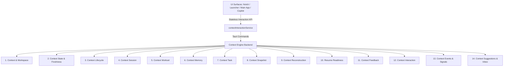

# ContextSplit Phase 1 — Context Engine API & Contracts Freeze

**Date:** September 29, 2026  
**Document:** `docs/phase-1-api-contract.md`  
**Status:** **FROZEN FOR PHASE 1**  
**Target Consumers:** Phase 2 Surfaces (Context Launcher, Notch, Windows Surface, Contextual Action Engine, Search, Copilot, Automation)  

---

## 1. Architectural Invariant & Contract Freeze Purpose

This document freezes the public interfaces and data contracts of the Context Engine. 

### Core Architectural Principle:
> **The Context Engine is the Single Source of Truth.**  
> External UI surfaces (Main Window, Mac Notch, Windows Edge, Quick Switcher, Copilot, and Automation Services) must consume these stable public contracts and the stateless `contextInteractionService` rather than composing raw SQL queries, modifying database models, or duplicating reasoning logic.

Internal engine implementation details (scoring weights, decay algorithms, indexing schemes, DB pragmas) may evolve in future phases, but the contracts defined below remain stable.

---

## 2. Master Contract Registry



---

## 3. Detailed Public Contracts

---

### Contract 1: Context (Workspace)
Represents a distinct project, work area, or cognitive workspace.

- **Inputs:**
  - Create: `name: string`, `metadata?: Record<string, unknown>`
  - Update: `id: string`, `name?: string`, `lifecycle_state?: LifecycleState`
  - Query: `id: string`
- **Outputs:**
  ```typescript
  interface Workspace {
    id: string;                    // UUID v4
    name: string;                  // User-defined or inferred title
    created_at: string;            // RFC 3339 UTC
    updated_at: string;            // RFC 3339 UTC
    lifecycle_state: 'active' | 'dormant' | 'archived';
    last_activity_at?: string;     // RFC 3339 UTC
    archived_at?: string;          // RFC 3339 UTC
  }
  ```
- **Error States:** `ContextNotFound`, `DuplicateWorkspaceName`, `DatabaseError`.
- **Lifecycle Expectations:** A context starts in `active`, transitions to `dormant` after inactivity, or is explicitly set to `archived`. Deleting a context cascades all child memberships, tasks, and snapshots.
- **Ownership:** Context Engine owns lifecycle state and metadata; User owns creation and naming.
- **Source of Truth:** SQLite `workspaces` table.

---

### Contract 2: Context State
Captures real-time contextual vitality, activity density, and focus state.

- **Inputs:** `context_id: string`
- **Outputs:**
  ```typescript
  interface ContextState {
    contextId: string;
    lifecycleState: 'active' | 'dormant' | 'archived';
    isActive: boolean;
    lastActiveAt: string | null;
    activeTask: string | null;
    taskConfidence: number;        // 0.0 - 1.0
    itemCount: number;
    activityScore: number;         // 0.0 - 1.0
    freshnessScore: number;        // 0.0 - 1.0
    isStale: boolean;
  }
  ```
- **Error States:** `ContextNotFound` (returns default empty state or error result).
- **Lifecycle Expectations:** Computed dynamically upon request; reflects current session activity, decaying exponential freshness, and active task assignment.
- **Ownership:** Context Engine Context State Evaluator.
- **Source of Truth:** Derived in-memory from `workspaces`, `sessions`, and `context_signals`.

---

### Contract 3: Context Lifecycle
Governs transitions across operational states (`active`, `dormant`, `archived`).

- **Inputs:**
  - Transition Request: `context_id: string`, `target_state: LifecycleState`, `reason: string`
- **Outputs:**
  ```typescript
  interface LifecycleTransitionResult {
    contextId: string;
    previousState: 'active' | 'dormant' | 'archived';
    newState: 'active' | 'dormant' | 'archived';
    transitionedAt: string;        // RFC 3339 UTC
    success: boolean;
  }
  ```
- **Error States:** `InvalidLifecycleTransition` (e.g. archiving an already archived context without change).
- **Lifecycle Expectations:** Only one context is considered primary foreground `active` at a time. Transitions emit `context-lifecycle-changed` system events.
- **Ownership:** Context Engine Lifecycle Manager.
- **Source of Truth:** SQLite `workspaces.lifecycle_state` column.

---

### Contract 4: Context Session
Represents an uninterrupted block of user engagement within a context.

- **Inputs:**
  - System event / User activity
- **Outputs:**
  ```typescript
  interface ContextSession {
    id: string;                    // UUID v4
    startedAt: string;             // RFC 3339 UTC
    lastActivityAt: string;        // RFC 3339 UTC
    endedAt: string | null;        // RFC 3339 UTC (null if active)
    status: 'active' | 'completed' | 'interrupted';
  }
  ```
- **Error States:** `OrphanedSessionReconciled` (auto-closed upon engine launch after unexpected termination).
- **Lifecycle Expectations:** Sessions close automatically after 15 minutes of inactivity or upon switching contexts.
- **Ownership:** Context Engine Session Manager.
- **Source of Truth:** SQLite `sessions` table.

---

### Contract 5: Context Workset
The refined set of active items, tabs, files, and references needed to resume immediate work.

- **Inputs:** `context_id: string`, `options?: { maxItems?: number, minConfidence?: number }`
- **Outputs:**
  ```typescript
  interface ContextWorkset {
    workspaceId: string;
    items: WorksetItem[];
    confidence: number;
    generatedAt: string;
  }

  interface WorksetItem {
    id: string;
    itemType: string;              // 'url' | 'file' | 'text' | 'image'
    content: string;
    title: string | null;
    metadata: Record<string, unknown>;
    relevanceScore: number;        // 0.0 - 1.0
    reason: string;
    isPinned: boolean;
  }
  ```
- **Error States:** `EmptyWorkset` (valid result when context has no items).
- **Lifecycle Expectations:** Worksets dynamically prune stale, generic, or accidental captures while retaining confirmed and pinned items.
- **Ownership:** Context Engine Workset Derivation Service.
- **Source of Truth:** Derived in-memory from `items`, `context_memberships`, and `context_signals`.

---

### Contract 6: Context Memory
Episodic and semantic project knowledge (key links, decisions, dependencies, notes).

- **Inputs:**
  - Create / Mark: `context_id: string`, `content: string`, `memory_type: string`, `is_pinned?: boolean`
  - Query: `context_id: string`
- **Outputs:**
  ```typescript
  interface ContextMemory {
    id: string;
    contextId: string;
    memoryType: 'anchor' | 'decision' | 'reference' | 'preference' | 'note';
    title: string;
    content: string;
    importanceScore: number;       // 0.0 - 1.0
    provenance: 'Confirmed' | 'Inferred' | 'Observed';
    isPinned: boolean;
    createdAt: string;
    updatedAt: string;
  }
  ```
- **Error States:** `MemoryNotFound`, `InvalidMemoryContent`.
- **Lifecycle Expectations:** Memories decay based on half-life unless pinned or reinforced by user feedback.
- **Ownership:** Context Engine Memory Subsystem.
- **Source of Truth:** SQLite `context_important_memories` table / `items` confirmed associations.

---

### Contract 7: Context Task
The inferred or user-confirmed active goal/subtask being pursued within a context.

- **Inputs:** `context_id: string`
- **Outputs:**
  ```typescript
  interface ContextTask {
    id: string;
    contextId: string;
    title: string;
    status: 'detected' | 'confirmed' | 'completed' | 'abandoned';
    confidence: number;            // 0.0 - 1.0
    firstDetectedAt: string;
    lastActiveAt: string;
  }
  ```
- **Error States:** `TaskUncertain` (confidence below 0.50 results in unassertive task display).
- **Lifecycle Expectations:** Evolves as active window titles, documents, and tool invocations change. Never fabricated when evidence is sparse.
- **Ownership:** Context Engine Task Understanding Service.
- **Source of Truth:** SQLite `task_candidates` table.

---

### Contract 8: Context Snapshot
A point-in-time state checkpoint capturing the working set, active task, and environment state.

- **Inputs:**
  - Save: `context_id: string`, `reason?: string`
  - Load: `snapshot_id: string` or `context_id: string` (latest)
- **Outputs:**
  ```typescript
  interface ContextSnapshot {
    id: string;
    contextId: string;
    contextName: string;
    taskId: string | null;
    taskTitle: string | null;
    createdAt: string;
    lastActivityAt: string | null;
    state: 'active' | 'paused' | 'dormant';
    snapshotConfidence: number;
    qualityRating: 'High' | 'Medium' | 'Low';
    snapshotJson: string;          // Serialized Workset + Task + Memory State
  }
  ```
- **Error States:** `SnapshotCorrupted` (falls back gracefully to live database reconstruction).
- **Lifecycle Expectations:** Automatically triggered upon context switch, sleep, or explicit save. Suppressed during noisy or rapid glance sequences.
- **Ownership:** Context Engine Snapshot Manager.
- **Source of Truth:** SQLite `context_snapshots` table.

---

### Contract 9: Context Reconstruction
The unified restore package used to recover a user's mental and digital work state.

- **Inputs:** `context_id: string`, `options?: { coldStart?: boolean }`
- **Outputs:**
  ```typescript
  interface ContextReconstruction {
    context: Workspace;
    activeTask: ContextTask | null;
    workset: ContextWorkset;
    memories: ContextMemory[];
    resumeReadiness: ResumeReadinessAssessment;
    reconstructedAt: string;
    source: 'snapshot' | 'live_synthesis';
  }
  ```
- **Error States:** `ReconstructionDegraded` (if partial items are deleted, returns best-effort valid state).
- **Lifecycle Expectations:** Target execution time $< 10\text{ ms}$ warm cache, $< 25\text{ ms}$ cold query.
- **Ownership:** Context Engine Reconstruction Service.
- **Source of Truth:** Integrated composition from SQLite and in-memory caches.

---

### Contract 10: Resume Readiness
Determines whether a context has sufficient structured state to offer a "One-Click Resume" flow.

- **Inputs:** `context_id: string`
- **Outputs:**
  ```typescript
  interface ContextResumeState {
    contextId: string;
    isReady: boolean;
    confidence: number;            // 0.0 - 1.0
    primaryTask: string | null;
    keyItemCount: number;
    formattedExplanation: string;  // Human-readable summary
    suggestedActions: string[];
  }
  ```
- **Error States:** `InsufficientData` (returns `isReady = false` with explanation).
- **Lifecycle Expectations:** Used by Notch, Quick Switcher, and Launcher to render actionable resume previews.
- **Ownership:** Context Engine Resume Readiness Evaluator.
- **Source of Truth:** In-memory assessment based on Snapshot and Workset quality metrics.

---

### Contract 11: Context Feedback
Captures user corrections (assignment, pinning, removal, dismissal) and updates heuristic weights.

- **Inputs:**
  ```typescript
  interface UserFeedback {
    itemId: string;
    workspaceId: string;
    action: 'confirm' | 'reject' | 'pin' | 'dismiss' | 'move';
    targetWorkspaceId?: string;
  }
  ```
- **Outputs:**
  ```typescript
  interface FeedbackResult {
    success: boolean;
    affectedItem: string;
    effectiveMembership: 'confirmed' | 'rejected' | 'inbox';
    timestamp: string;
  }
  ```
- **Error States:** `InvalidTargetContext`, `ItemNotFound`.
- **Lifecycle Expectations:** User feedback permanently overrides heuristic and semantic inferences for the target entity.
- **Ownership:** Context Engine Feedback Manager.
- **Source of Truth:** SQLite `context_memberships` and `context_feedback_events`.

---

### Contract 12: Context Interaction
Stateless cross-platform event contract between UI/Automation surfaces and the engine.

- **Event Request:**
  ```typescript
  interface ContextInteractionEvent {
    type: 'context.open' | 'context.resume' | 'context.pause' | 'context.capture' |
          'context.assign' | 'context.search' | 'context.preview' | 'context.mark_important';
    timestamp: string;
    sourceSurface: 'app' | 'launcher' | 'mac_notch' | 'windows_edge' | 'keyboard' | 'drag_drop' | 'future_automation';
    contextReference?: string;
    targetReference?: string;
    metadata?: Record<string, unknown>;
  }
  ```
- **Result Response:**
  ```typescript
  interface ContextInteractionResult {
    outcome: 'SUCCESS' | 'PENDING' | 'AMBIGUOUS' | 'REJECTED' | 'ERROR' | 'CANCELLED';
    message?: string;
    resolvedContextId?: string;
    suggestedContextIds?: string[];
    metadata?: Record<string, unknown>;
  }
  ```
- **Methods in `contextInteractionService.ts`:**
  1. `getActiveContext()`
  2. `getRecentContexts(limitDays?: number)`
  3. `getContextSummary(contextId: string)`
  4. `getContextWorkset(contextId: string)`
  5. `getContextState(contextId: string)`
  6. `getResumeReadiness(contextId: string)`
  7. `resumeContext(contextId: string)`
  8. `pauseContext(contextId: string)`
  9. `captureItem(item: CaptureRequest)`
  10. `assignItemToContext(itemId: string, contextId: string)`
  11. `searchContexts(query: string)`
  12. `getContextSuggestions(itemId: string)`
- **Ownership:** UI Surface $\leftrightarrow$ Tauri Backend Bridge.
- **Source of Truth:** Stateless proxy to Context Engine backend commands.

---

### Contract 13: Context Events & Signals
Real-time system events dispatched to UI surfaces and external listeners.

- **Standard Tauri Event Streams:**
  - `context-activated` $\rightarrow$ `{ contextId: string, timestamp: string }`
  - `context-paused` $\rightarrow$ `{ contextId: string, timestamp: string }`
  - `context-state-changed` $\rightarrow$ `ContextState`
  - `item-captured` $\rightarrow$ `{ itemId: string, contextId?: string, isAmbiguous: boolean }`
  - `workset-updated` $\rightarrow$ `{ contextId: string }`
  - `target-state-changed` $\rightarrow$ `{ activeSurface: string, isVisible: boolean }`
- **Ownership:** Context Engine Event Dispatcher.
- **Source of Truth:** Live runtime broadcast via `app_handle.emit()`.

---

### Contract 14: Context Suggestions & Inbox
Handles ambiguous, unassigned, or newly discovered items awaiting triage or automatic routing.

- **Inputs:**
  - Query: `itemId: string` or list unassigned items
  - Triage: `itemIds: string[]`, `action: 'assign' | 'dismiss' | 'archive'`, `targetWorkspaceId?: string`
- **Outputs:**
  ```typescript
  interface ContextSuggestion {
    contextId: string;
    contextName: string;
    confidence: number;            // 0.0 - 1.0
    reason: string;
    isPrimaryCandidate: boolean;
  }
  ```
- **Error States:** `AmbiguityUnresolved` (retains item in Inbox when confidence $< 0.35$ without asserting false assignment).
- **Ownership:** Context Engine Ambiguity & Discovery Manager.
- **Source of Truth:** SQLite `context_memberships` (with `membership_type = 'suggested'`) and `inbox_item_states`.

---

## 4. Contract Conformance & Verification Summary

| Contract Area | Stability Status | Verified Test Suite | Phase 2 Ready? |
| :--- | :---: | :--- | :---: |
| **1. Context** | **FROZEN** | `db::operations::test_context_workspace_lifecycle_states` | **YES** |
| **2. Context State** | **FROZEN** | `context_state_e2e_tests::test_full_system_state` | **YES** |
| **3. Context Lifecycle** | **FROZEN** | `lifecycle_explanation::tests` | **YES** |
| **4. Context Session** | **FROZEN** | `db::operations::test_session_lifecycle` | **YES** |
| **5. Context Workset** | **FROZEN** | `workset_e2e_tests::test_full_system_consistency` | **YES** |
| **6. Context Memory** | **FROZEN** | `memory_e2e_tests::test_full_memory_refinement` | **YES** |
| **7. Context Task** | **FROZEN** | `task_understanding_audit_tests` | **YES** |
| **8. Context Snapshot** | **FROZEN** | `snapshot_e2e_tests::test_scenario_1_standard` | **YES** |
| **9. Context Reconstruction** | **FROZEN** | `reconstruction_e2e_tests::test_scenario_1_normal_work` | **YES** |
| **10. Resume Readiness** | **FROZEN** | `real_world_resume_readiness_tests` | **YES** |
| **11. Context Feedback** | **FROZEN** | `feedback_simulation_tests` | **YES** |
| **12. Context Interaction** | **FROZEN** | `contextInteractionContract.test.ts` | **YES** |
| **13. Context Events** | **FROZEN** | `context_engine::interaction::tests` | **YES** |
| **14. Context Suggestions** | **FROZEN** | `ambiguity_manager_tests` | **YES** |

---

## 5. Conclusion

All 14 core Context Engine contract domains are formally specified and frozen for Phase 1. Future UI surfaces and automation layers can safely build against these contracts with guaranteed backward compatibility and strict separation of concerns.
