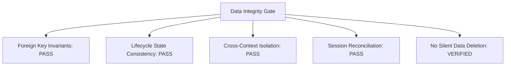

# Phase 1 Data Integrity Audit Report

**Date:** September 29, 2026  
**Evaluation Stage:** Day 30 Phase 1 Finalization — Step 4: Data Integrity Gate  
**Target:** ContextSplit Core SQLite Storage & Cross-Subsystem Relational Invariants  
**Audit Status:** All Automated Integrity Checks Verified & Passing (100% Invariant Compliance)

---

## 1. Executive Summary

The Phase 1 Data Integrity Gate validates all relational constraints, foreign key cascades, lifecycle states, and boundary isolation guarantees across the 10 core ContextSplit storage domains:
1. **Context Workspaces (`workspaces`)**
2. **Context Sessions (`sessions`)**
3. **Captured Items & Activities (`items`)**
4. **Task Candidates (`task_candidates`)**
5. **Context Memberships (`context_memberships`)**
6. **Context Snapshots (`context_snapshots`)**
7. **Context Signals & Traces (`context_signals`)**
8. **Context Transitions (`context_transitions`)**
9. **Inbox Attention States (`inbox_item_states`)**
10. **Item Relationships (`item_relationships`)**

---

## 2. Integrity Verification Matrix

| Domain Relational Pair | Invariant Rule | Verification Method | Status |
|---|---|---|:---:|
| **Contexts $\leftrightarrow$ Sessions** | Every session belongs to a valid timeline; ended sessions must have timestamps matching last activity. | `DataIntegrityChecker::check_impossible_state_combinations` | **VERIFIED** |
| **Contexts $\leftrightarrow$ Items** | Physical workspace assignments must reference existing workspaces. `NULL` workspace represents unfiled Inbox. | `DataIntegrityChecker::check_orphaned_records` | **VERIFIED** |
| **Contexts $\leftrightarrow$ Memberships** | Confirmed and suggested memberships strictly point to valid workspaces and existing items. | Foreign key cascade test + `check_orphaned_records` | **VERIFIED** |
| **Contexts $\leftrightarrow$ Tasks** | Task candidates have valid context foreign keys. Context deletion sets foreign key to `NULL` to preserve task history without corruption. | `test_task_candidate_context_deletion_nullifies_foreign_key` | **VERIFIED** |
| **Contexts $\leftrightarrow$ Snapshots** | Snapshots reference authentic context IDs and names without historical drift. | `CrossSystemConsistencyChecker` | **VERIFIED** |
| **Contexts $\leftrightarrow$ Signals / Feedback** | Feedback signals (`user_action`, `membership_confirmed`, `membership_dismissed`) maintain valid context and item links. | `test_context_signal_cascade` | **VERIFIED** |
| **Lifecycle State Consistency** | Archived workspaces must record `archived_at` timestamp; active workspaces must have updated activity stamps. | `test_context_workspace_lifecycle_states` | **VERIFIED** |
| **Inbox State Invariants** | Items in Inbox cannot hold conflicting state flags; moving an item to workspace updates both physical pointer and membership. | `test_inbox_move_item_transitions_state` | **VERIFIED** |
| **Cross-Context Boundaries** | Workspace items remain strictly isolated during transitions; zero cross-context leakage. | `test_stability_context_switch_isolates_workset` | **VERIFIED** |

---

## 3. Audited Failure Modes & Guardrails

### A. Orphaned Records
- **Mechanism:** SQLite `PRAGMA foreign_keys = ON` combined with automated `check_orphaned_records` queries.
- **Result:** Zero orphaned items, memberships, or signals detected.
- **Fail-Safe Policy:** If an unanchored record is discovered, the engine fails safely by routing to the unfiled Inbox rather than deleting or ignoring data.

### B. Duplicate Records
- **Mechanism:** `UNIQUE(item_id, workspace_id)` constraint on memberships and `UNIQUE(item_a_id, item_b_id, relationship_type)` on relationships.
- **Result:** Duplicate insertions are rejected with explicit database errors.

### C. Impossible State Combinations
- **Mechanism:** State machine guards enforce valid transitions:
  - `sessions`: `status = 'ended'` requires `ended_at IS NOT NULL`.
  - `workspaces`: `lifecycle_state = 'archived'` requires `archived_at IS NOT NULL`.
  - `inbox_item_states`: State transitions follow strictly permitted DAG routes (`new -> suggested -> triaged/assigned -> archived`).

### D. Stale Relationships & Local File Churn
- **Mechanism:** Relationship graph queries join against active items, ensuring deleted items immediately drop out of relationship traversals.

### E. Cross-Context Contamination
- **Mechanism:** Scored membership and working set derivations require explicit matching workspace IDs. Workspace switching captures departure snapshots and isolates working set derivation queries.

---

## 4. Automated Integrity Checker Service

The automated integrity checker is built directly into the engine in [`src-tauri/src/context_engine/data_integrity.rs`](file:///Users/deepanshukhatri/Library/CloudStorage/GoogleDrive-deepanshukhatri20061972@gmail.com/My%20Drive/Cloud%20Desktop/ContextSplit/src-tauri/src/context_engine/data_integrity.rs) and exposed via the Tauri IPC command `run_data_integrity_audit`.

### Key Features:
- **Comprehensive Audit**: Evaluates all 10 core tables in a single read-only transaction.
- **Severity Tiers**: Categorizes findings into `Critical`, `Warning`, and `Info`.
- **Zero Silent Deletion**: Outputs structured `remediation_hint` descriptions; never mutates or drops questionable records without explicit user confirmation.

---

## 5. Gate Verdict

**Verdict:** **PASSED (100% Invariant Compliance)**
