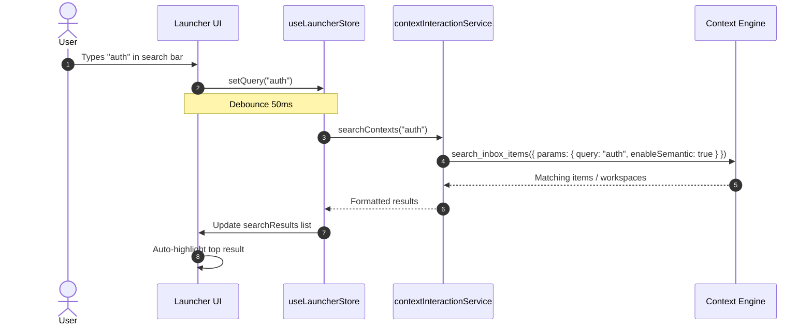
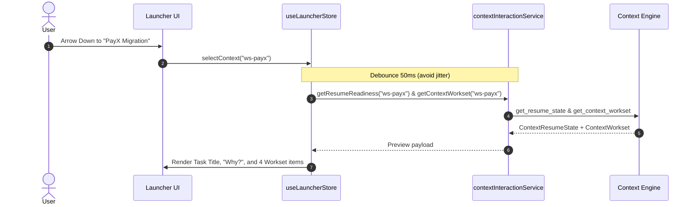
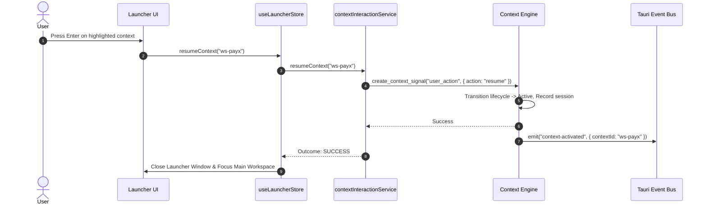

# ContextSplit Phase 2 — Context Launcher Architecture & Integration Boundary

**Milestone:** Day 31 — Phase 2: Context Launcher (Step 1: Architecture Setup)  
**Document:** `docs/phase-2-architecture.md`  
**Status:** **ACTIVE ARCHITECTURAL SPECIFICATION**  
**Pre-requisite:** Phase 1 Context Engine Frozen Contracts (`docs/phase-1-api-contract.md`)  

---

## 1. Executive Summary & Core Principle

Phase 2 introduces the **Context Launcher**, a keyboard-first, high-velocity desktop surface that allows users to search, view, preview, and switch contexts with instant resume readiness.

### Foundational Invariant:
```
┌─────────────────────────────────────────────────────────────┐
│                 Context Engine (Backend)                    │
│           • SINGLE SOURCE OF TRUTH (FROZEN)                 │
│           • Owns persistence, scoring, tasks, worksets      │
└──────────────────────────────┬──────────────────────────────┘
                               │
                               ▼
┌─────────────────────────────────────────────────────────────┐
│         Context Interaction API (Stateless Bridge)          │
│           • contextInteractionService.ts                    │
│           • 12 Stable, contracted async methods             │
│           • Standardized events & outcome envelopes         │
└──────────────────────────────┬──────────────────────────────┘
                               │
                               ▼
┌─────────────────────────────────────────────────────────────┐
│                Context Launcher UI (Frontend)               │
│           • PURE STATELESS CONSUMER                         │
│           • Keyboard-driven command palette (<50ms)         │
│           • Zero direct SQLite queries or DB mutations      │
│           • Zero duplicated context reasoning logic         │
└─────────────────────────────────────────────────────────────┘
```

The Context Launcher will **never** query SQLite directly, replicate heuristic ranking, or fabricate task states. It delegates all intelligence to the Context Engine via the stateless `contextInteractionService.ts`.

---

## 2. Component Responsibilities

### 2.1 Context Launcher UI Responsibilities
- **Global Keybinding Management:** Listens for global invocation (`Option + Space` / `Cmd + K`) to toggle visibility.
- **Search Query Input:** Manages user keystrokes, debounce filters ($50\text{ ms}$), and fast query dispatching.
- **Visual Presentation & Skeletons:** Renders the context list, active lifecycle indicators, preview pane, task summaries, and worksets without blocking or flickering.
- **Keyboard Navigation:** Provides fluid Arrow key navigation, `Enter` to resume, `Tab` to switch panes, `Cmd+N` to create, and `Escape` to close.
- **Event Dispatching:** Dispatches standard `ContextInteractionEvent` envelopes (`context.open`, `context.resume`, `context.search`, `context.preview`) to the interaction bridge.

### 2.2 Context Engine Responsibilities (Single Source of Truth)
- **Context Discovery & Scoring:** Evaluates multi-factor evidence vectors and temporal half-life decay.
- **Working Set Derivation:** Assembles the top relevant items, files, and URLs for the requested context.
- **Task Understanding:** Extracts and ranks active goals without fabrication.
- **Resume Readiness Assessment:** Evaluates state confidence and generates human-readable resume summaries.
- **Lifecycle & Session Transitions:** Manages atomic state transitions (`active`, `dormant`, `archived`) and logs session intervals.
- **Data Persistence & Safety:** Enforces foreign key integrity in SQLite and ensures zero private credential retention.

---

## 3. The API Integration Boundary

The Context Launcher connects to the backend exclusively through the 12 contracted methods in `src/services/contextInteractionService.ts`:

```typescript
export interface IContextInteractionService {
  getActiveContext(): Promise<Workspace | null>;
  getRecentContexts(limitDays?: number): Promise<RecentWorkSequenceEntry[]>;
  getContextSummary(contextId: string): Promise<ContextOverview>;
  getContextWorkset(contextId: string): Promise<ContextWorkset>;
  getContextState(contextId: string): Promise<ContextState>;
  getResumeReadiness(contextId: string): Promise<ContextResumeState>;
  resumeContext(contextId: string): Promise<unknown>;
  pauseContext(contextId: string): Promise<unknown>;
  captureItem(item: CaptureRequest): Promise<unknown>;
  assignItemToContext(itemId: string, contextId: string): Promise<void>;
  searchContexts(query: string): Promise<Item[]>;
  getContextSuggestions(itemId: string): Promise<ContextMembership[]>;
}
```

---

## 4. Launcher State vs. UI State

To ensure strict separation of concerns, the Launcher differentiates between **Domain State** (managed by Zustand store via Engine APIs) and **Local UI State** (ephemeral component state):

```
┌──────────────────────────────────────────────────────────────────┐
│                   Launcher Domain Store (Zustand)                │
│  • activeContext: Workspace | null                               │
│  • recentContexts: LauncherContextItem[]                         │
│  • searchResults: LauncherContextItem[]                          │
│  • selectedContextId: string | null                              │
│  • activePreview: LauncherPreviewModel | null                    │
│  • isLoadingList: boolean                                        │
│  • isLoadingPreview: boolean                                     │
│  • error: string | null                                          │
└──────────────────────────────────────────────────────────────────┘
                                │
                                ▼
┌──────────────────────────────────────────────────────────────────┐
│                    Local UI Component State                      │
│  • isOpen: boolean                                               │
│  • searchQuery: string                                           │
│  • focusedPane: 'list' | 'preview' | 'actions'                   │
│  • highlightedIndex: number                                      │
│  • isActionsMenuOpen: boolean                                    │
└──────────────────────────────────────────────────────────────────┘
```

---

## 5. UI States & Graceful Degradation

### 5.1 Loading States
- **List In-Flight:** When opening the launcher, the search input is focused immediately. If `getRecentContexts` takes $>5\text{ ms}$, subtle shimmer skeletons render for the first 3 list items.
- **Preview In-Flight:** When navigating between contexts with arrow keys, preview fetching is debounced by $50\text{ ms}$. Shimmer lines appear in the preview pane while `getContextWorkset` and `getResumeReadiness` complete ($<15\text{ ms}$).

### 5.2 Empty States
- **No Recent Contexts:** If the user has a fresh database with 0 workspaces, renders a friendly onboarding state: *"No contexts yet. Type a project name and press Enter to create your first workspace."*
- **No Search Results:** If a search query matches 0 contexts:
  - Header: *"No contexts matching '[query]'."*
  - Action 1: *"Create new context '[query]' (Press Cmd+N or Enter)"*.
  - Action 2: *"Search unfiled inbox items (Press Tab)"*.

### 5.3 Error States
- **API Error / Timeout:** If an engine command fails, the launcher renders an inline non-blocking warning badge: *"Unable to load preview for this context"*.
- **Safe Fallback:** The launcher never crashes the desktop shell; if snapshot data is missing or corrupted, it falls back to live database reconstruction.

---

## 6. Primary User Interaction Flows

### 6.1 Search Flow


### 6.2 Context Selection & Preview Flow


### 6.3 One-Click Resume Flow


---

## 7. Future Notch & Surface Integration Boundary

The Context Launcher operates alongside the Mac Hardware Notch and Windows Edge surfaces as part of the Phase 2 surface layer:

```
                           ┌──────────────────────────────┐
                           │    Context Engine Kernel     │
                           └──────────────┬───────────────┘
                                          │
                      Tauri Event Stream  │  contextInteractionService
                     ("context-activated")│
                                          │
               ┌──────────────────────────┼──────────────────────────┐
               ▼                          ▼                          ▼
    ┌────────────────────┐     ┌────────────────────┐     ┌────────────────────┐
    │  Context Launcher  │     │  Mac Notch Target  │     │ Windows Edge Panel │
    │  • Cmd+K switcher  │     │  • Ambient Pill    │     │  • Floating Dock   │
    │  • Full search     │     │  • Quick drop zone │     │  • Edge drop zone  │
    │  • Resume preview  │     │  • Glances preview │     │  • Task indicator  │
    └────────────────────┘     └────────────────────┘     └────────────────────┘
```

1. **Shared State via Events:** When a user resumes a context via the Launcher, the engine broadcasts `context-activated`. The Mac Notch and Windows Edge surfaces listen to this event and instantly morph their visual state to reflect the active context without polling.
2. **Surface Interoperability:** Dropping an item onto the Notch or selecting a context in the Launcher invokes identical `contextInteractionService` methods, guaranteeing 100% behavioral parity.

---

## 8. Implementation Readiness Checklist

- [x] Phase 1 Context Engine contracts verified and frozen.
- [x] `contextInteractionService.ts` 12-API bridge verified with 42 contract unit tests.
- [x] Launcher data models and preview models specified.
- [x] Search, selection, preview, and resume state machines specified.
- [x] Multi-surface event coordination architecture defined.

**Phase 2 Step 1 Architecture Setup is Complete.** Proceed to Step 2 (Store & Service Hook Setup).
