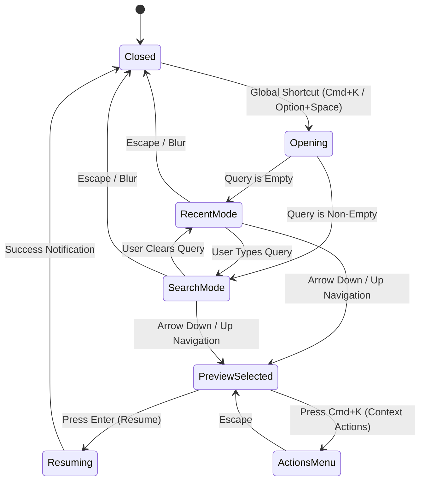
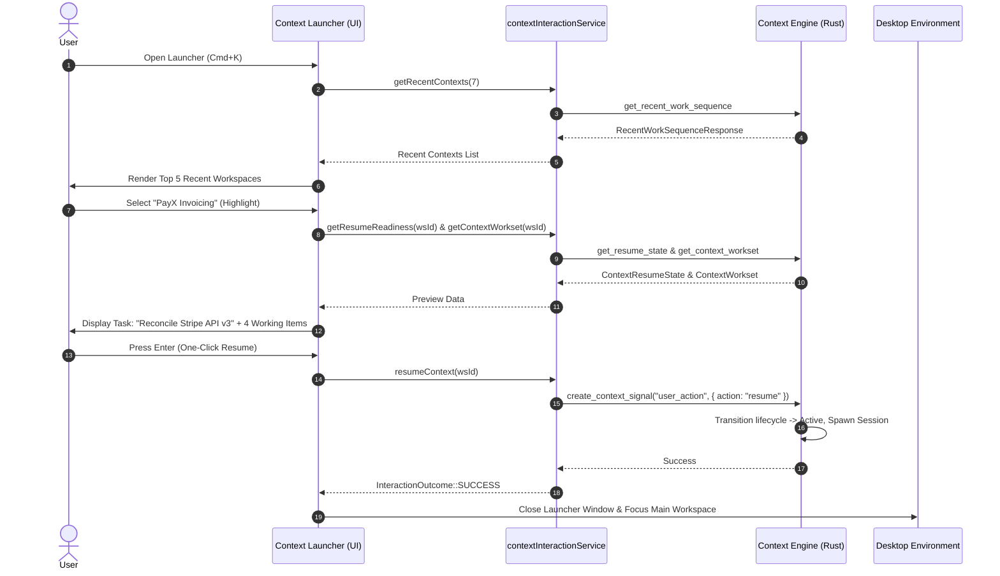

# ContextSplit — Phase 2 Context Launcher Requirements & Architecture

**Milestone:** Phase 2 Boundary Preparation  
**Document:** `docs/phase-2-launcher-requirements.md`  
**Date:** September 29, 2026  
**Status:** **SPECIFICATION ONLY (No implementation in Phase 1)**  
**Target Consumers:** Phase 2 Engineers, UI/UX Surface Developers  

---

## 1. Executive Summary & Vision

The **Context Launcher** is the primary keyboard-driven quick-switcher and context management surface for ContextSplit in Phase 2. Inspired by modern desktop command palettes (e.g., Spotlight, Raycast, Alfred), the Context Launcher enables users to seamlessly view, search, preview, switch, resume, and manage work contexts with zero mouse interaction and sub-50ms visual responsiveness.

### Core Architectural Principle:
> **The Context Launcher is a Stateless Consumer of Phase 1 Contracts.**  
> The Launcher contains zero independent contextual business logic, maintains no persistent database connection, and performs no heuristic scoring. It interacts with the Context Engine exclusively through `contextInteractionService.ts` and standard Tauri event streams.

---

## 2. Required Phase 1 APIs

The Launcher will consume the following 12 frozen methods from `contextInteractionService.ts`:

| Phase 1 API Method | Launcher Use Case | Expected Latency |
| :--- | :--- | :---: |
| `getActiveContext()` | Identifies the currently active foreground context to render the active status badge and focus ring. | $< 1\text{ ms}$ |
| `getRecentContexts(limitDays)` | Populates the initial default view with the user's chronological work sequence. | $< 5\text{ ms}$ |
| `searchContexts(query)` | Executes universal hybrid search (fuzzy text + local semantic similarity) as the user types in the search bar. | $< 15\text{ ms}$ |
| `getContextSummary(contextId)` | Retrieves high-level context metadata, item counts, and activity metrics for list item badges. | $< 5\text{ ms}$ |
| `getContextWorkset(contextId)` | Fetches the active working set (top 5 prioritized items) to render the preview pane. | $< 8\text{ ms}$ |
| `getContextState(contextId)` | Fetches live freshness score, activity density, and lifecycle state (`active`, `dormant`, `archived`). | $< 3\text{ ms}$ |
| `getResumeReadiness(contextId)` | Evaluates the readiness score and human-readable explanation (*"Where did I leave off?"*) for the preview header. | $< 5\text{ ms}$ |
| `resumeContext(contextId)` | Signals the Context Engine to transition the target workspace to foreground active upon Enter key press. | $< 10\text{ ms}$ |
| `pauseContext(contextId)` | Signals the Context Engine to pause tracking on the active context. | $< 5\text{ ms}$ |
| `captureItem(item)` | Enables direct quick-capture from the launcher prompt. | $< 20\text{ ms}$ |
| `assignItemToContext(itemId, wsId)` | Enables quick assignment of unfiled items to a highlighted workspace. | $< 10\text{ ms}$ |
| `getContextSuggestions(itemId)` | Shows context suggestions when managing ambiguous items in launcher mode. | $< 10\text{ ms}$ |

---

## 3. Launcher Data Model Requirements

The Launcher UI will map its view models directly from Phase 1 contracts:

```typescript
// Launcher List Item View Model
export interface LauncherContextItem {
  id: string;
  name: string;
  lifecycleState: 'active' | 'dormant' | 'archived';
  isActive: boolean;
  activeTaskTitle: string | null;
  lastActiveAt: string | null;
  freshnessDisplay: string;
  itemCount: number;
  matchScore?: number; // From search ranking
}

// Launcher Preview Pane View Model
export interface LauncherPreviewModel {
  contextId: string;
  contextName: string;
  lifecycleState: 'active' | 'dormant' | 'archived';
  resumeReadiness: {
    isReady: boolean;
    confidence: number;
    explanation: string;
    suggestedActions: string[];
  };
  activeTask: {
    title: string;
    confidence: number;
  } | null;
  worksetItems: Array<{
    id: string;
    title: string;
    itemType: string;
    appName: string | null;
    domain: string | null;
    relevance: 'primary' | 'supporting' | 'reference';
  }>;
  episodicMemories: Array<{
    id: string;
    title: string;
    memoryType: string;
    isPinned: boolean;
  }>;
}
```

---

## 4. Launcher State Machine

The Launcher operates as a modal overlay window with 4 distinct states:



---

## 5. Standardized Launcher Interaction Events

The Launcher produces standardized Phase 1 `ContextInteractionEvent` envelopes when interacting with the backend:

1. **Context Switch / Resume:**
   ```json
   {
     "type": "context.resume",
     "timestamp": "2026-09-29T12:00:00Z",
     "sourceSurface": "launcher",
     "contextReference": "ws-paris-vacation-2026",
     "metadata": { "trigger": "keyboard_enter", "query": "paris" }
   }
   ```
2. **Context Search:**
   ```json
   {
     "type": "context.search",
     "timestamp": "2026-09-29T12:00:00Z",
     "sourceSurface": "launcher",
     "metadata": { "query": "auth migration" }
   }
   ```
3. **Context Preview:**
   ```json
   {
     "type": "context.preview",
     "timestamp": "2026-09-29T12:00:00Z",
     "sourceSurface": "launcher",
     "contextReference": "ws-payx-invoice",
     "metadata": { "dwellTimeMs": 250 }
   }
   ```

---

## 6. One-Click Resume Flow



---

## 7. Error, Loading, and Empty States

### 7.1 Loading State:
- Search input retains responsive focus immediately.
- Skeleton pulse bars render for the preview pane while `getResumeReadiness` and `getContextWorkset` are in-flight ($< 15\text{ ms}$).
- Previous preview state is debounced ($50\text{ ms}$) during rapid arrow navigation to avoid UI flickering.

### 7.2 Empty Search State:
- When search query returns zero matching contexts:
  - Renders a clean empty card: *"No contexts matching '[query]'."*
  - Offers a primary action: *"Create new context '[query]' (Press Cmd+N)"*.
  - Offers secondary action: *"Search unfiled inbox items (Press Tab)"*.

### 7.3 Degraded / Recovery State:
- If a context has corrupted optional snapshots or missing referenced files, the launcher gracefully renders live fallback data with a subtle badge: *"Live state (no snapshot)"* without throwing fatal errors.

---

## 8. Keyboard Interaction Specification

The Launcher must be 100% operable via keyboard with zero mouse reliance:

| Key Binding | Action |
| :--- | :--- |
| `Option + Space` / `Cmd + K` | Toggle Launcher window open / close globally. |
| `↑` / `↓` (or `Ctrl+P` / `Ctrl+N`) | Navigate up/down through context list. |
| `Enter` | Resume / Switch to the highlighted context. |
| `Tab` | Toggle between Contexts List and Preview Details Pane. |
| `Cmd + Enter` | Open Context Overview in main application window. |
| `Cmd + N` | Create a new Context with the current search query as name. |
| `Cmd + Backspace` | Archive / Close the highlighted context. |
| `Cmd + C` | Copy context name / resume summary to clipboard. |
| `Escape` | Dismiss Launcher and return focus to previous foreground app. |

---

## 9. Future Relationship with Mac Hardware Notch & Windows Surface

The Context Launcher forms one vertex of ContextSplit's Phase 2 multi-surface interaction ecosystem:

```
                  ┌──────────────────────────────┐
                  │    Context Engine Kernel     │
                  │   (Single Source of Truth)   │
                  └──────────────┬───────────────┘
                                 │
           ┌─────────────────────┼─────────────────────┐
           ▼                     ▼                     ▼
┌────────────────────┐ ┌────────────────────┐ ┌────────────────────┐
│  Context Launcher  │ │  Mac Notch Target  │ │ Windows Edge Panel │
│  • Quick Switching │ │  • Drag & Drop     │ │  • Floating Dock   │
│  • Full Search     │ │  • Ambient Status  │ │  • Sidebar Anchor  │
│  • Resume Preview  │ │  • Micro-Glances   │ │  • Drop Target     │
└────────────────────┘ └────────────────────┘ └────────────────────┘
```

1. **Mac Hardware Notch Integration:**
   - The Mac Notch provides **ambient persistent awareness** (drop target + current project pill).
   - Clicking or dragging to the Notch can trigger the Context Launcher for deeper project switching.
2. **Windows Edge / Orb Surface Integration:**
   - On Windows, the edge target acts as the desktop anchor.
   - The Launcher provides the fast keyboard equivalent for Windows power users.
3. **Cross-Surface Synchronization:**
   - State changes triggered in the Launcher (e.g. `resumeContext`) broadcast Tauri system events (`context-activated`), instantly updating the Notch and Windows Edge indicators with zero lag.

---

## 10. Acceptance Checklist for Phase 2 Implementation

When Phase 2 development begins, the Context Launcher implementation will be validated against this specification:

- [ ] Consumes exclusively `contextInteractionService.ts` methods.
- [ ] Direct SQL queries and DB connections are completely absent from the launcher component.
- [ ] Sub-50ms cold launch and render latency.
- [ ] 100% keyboard navigable (Arrow keys, Enter, Escape, Cmd+K).
- [ ] Renders live task extraction and resume readiness explanation without fabrication.
- [ ] Respects user feedback rules and context isolation boundaries.

---

## 11. Conclusion

The Phase 2 Context Launcher specification is formally established. The interface boundary is clean, decoupled, and ready for immediate frontend construction when Phase 2 commences.
