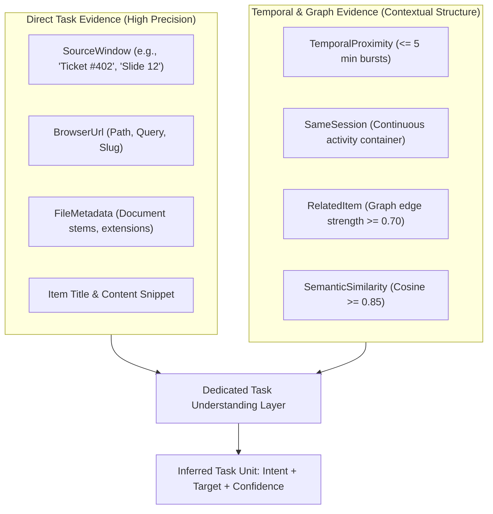
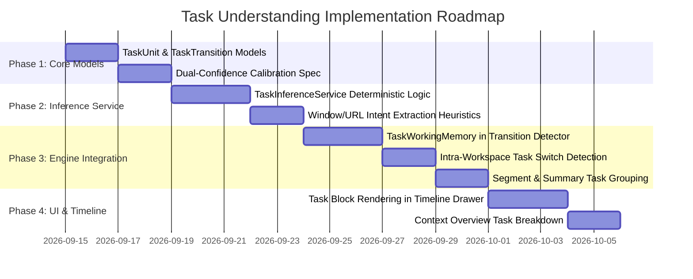

# Task Understanding & Contextual Activity Architecture Audit

**Status:** Completed  
**Date:** September 2026  
**Target Subsystems:** `context_engine` (`engine.rs`, `transitions.rs`, `segments.rs`, `summary.rs`, `timeline.rs`, `evidence.rs`, `relationships.rs`, `scoring.rs`, `discovery.rs`, `reasoning/`), `semantic/` (`builder.rs`, `similarity.rs`), `db` (`models.rs`, `operations.rs`), `src/components/` (`timeline/`, `workspace/`, `inbox/`, `discovery/`)  
**Purpose:** Pre-implementation architectural audit and design specification for a dedicated **Task Understanding Layer** in ContextSplit.  
**Commit Reference:** `docs: audit task understanding architecture`  

---

## 1. Executive Summary

ContextSplit has successfully implemented a robust **Context Engine** capable of multi-modal evidence collection, confidence calibration, candidate cluster discovery, temporal activity segmentation, and contextual transition detection (switches, returns, starts, ends, and ambiguous activity).

However, an architectural audit reveals a fundamental structural gap in how user activity is modeled:

```
┌────────────────────────────────────────────────────────────────────────────────────────┐
│                               THE MISSING MIDDLE LAYER                                 │
├────────────────────────────────────────────────────────────────────────────────────────┤
│                                                                                        │
│  [ Macro Layer ]        Workspaces & Context Candidates                                │
│                         (e.g., "College", "Work", "Personal", "ContextSplit")          │
│                                       ▲                                                │
│                                       │  ◀── [ GAP: No Task / Goal / Intent Layer ]    │
│                                       │                                                │
│  [ Meso Layer ]         Context Activity Segments & Transitions                        │
│                         (e.g., 25-minute continuous burst, Switched A -> B)            │
│                                       ▲                                                │
│                                       │                                                │
│  [ Micro / Atomic ]     Items, Window Titles, URLs, Context Signals                    │
│                         (e.g., "Lecture 5.pdf", "PR #142 Review", "Safari: Airbnb")    │
│                                                                                        │
└────────────────────────────────────────────────────────────────────────────────────────┘
```

### Core Audit Findings:
1. **The "Task" Concept is Implicit and Fragmented:** Rich task signals (window titles, document filenames, URL paths, GitHub PR numbers, and search queries) exist in raw item metadata, but are currently treated only as weak point-in-time features for predicting broad workspace affinities.
2. **Coupling to Workspace Names:** Task-like activities are forced into one of two extremes: either lumped into a broad workspace (causing semantic dilution and masking intra-workspace task switches), or flagged as new `ContextCandidates` (causing workspace proliferation and clutter).
3. **Conflated Confidence Metrics:** Task Confidence (e.g., *"How certain are we about what specific goal the user is pursuing?"*) is currently identical to and conflated with Workspace Confidence (e.g., *"Which high-level container does this belong to?"*).
4. **Duplication of Ad-Hoc Task Extraction:** Candidate discovery (`discovery.rs`), transition detection (`transitions.rs`), segment clustering (`segments.rs`), and AI reasoning prompts (`reasoning/builder.rs`) each independently attempt to parse, summarize, and cluster task-like entities without a shared service or model.

This audit inspects the existing implementation, answers the 7 core architectural questions, and recommends the **smallest, most modular architecture** for a dedicated **Task Understanding Layer**.

---

## 2. Comprehensive Subsystem Inspection

### 1. `TaskInferenceService`
- **Current Status:** **Does not exist**.
- **Inspection Finding:** There is currently no service, module, or struct named `TaskInferenceService` in either backend (`src-tauri/src/`) or frontend (`src/`). Tasks are referenced only informally in code comments (e.g., *"after a brief task detour"* in [`context_engine/transitions.rs:310`](file:///Users/deepanshukhatri/Desktop/ContextSplit/src-tauri/src/context_engine/transitions.rs#L310)).
- **Implication:** All semantic inference directly bypasses the concept of an active goal or task and attempts to map raw items immediately to top-level Workspaces.

### 2. `ContextMemory`
- **Current Status:** **Implemented in-memory within `ContextTransitionDetector`** ([`context_engine/transitions.rs:315-326`](file:///Users/deepanshukhatri/Desktop/ContextSplit/src-tauri/src/context_engine/transitions.rs#L315-L326)).
- **Inspection Finding:** Working memory is maintained via:
  - `current_context: Option<ContextSnapshot>`: Tracks active workspace/candidate ID, name, confidence, first/last seen timestamps, and continuous streak count.
  - `context_history: VecDeque<ContextSnapshot>`: Bounded FIFO history stack (depth 5) enabling `ContextReturn` detection within a configurable horizon (default 24 hours).
  - `pending_transition: Option<PendingTransition>`: Hysteresis buffer requiring $N$ consecutive observations (default 2) before confirming moderate transitions.
- **Task Gap:** `ContextSnapshot` records only `ContextReference` (workspace/candidate ID + name). It does **not** track the *active task* or *sub-goal* within that context.

### 3. `ContextActivitySegment`
- **Current Status:** **Fully implemented** ([`context_engine/segments.rs:26-41`](file:///Users/deepanshukhatri/Desktop/ContextSplit/src-tauri/src/context_engine/segments.rs#L26-L41)).
- **Inspection Finding:** Represents a continuous temporal burst of contextual work:
  ```rust
  pub struct ContextActivitySegment {
      pub id: String,
      pub context: Option<ContextReference>,
      pub started_at: String,
      pub ended_at: String,
      pub duration_seconds: i64,
      pub duration_formatted: String,
      pub confidence: f64,
      pub session_ids: Vec<String>,
      pub item_references: Vec<SegmentItemReference>,
      pub transition_in: Option<DetectedTransition>,
      pub transition_out: Option<DetectedTransition>,
      pub is_ambiguous: bool,
      pub item_count: usize,
      pub metadata: Value,
  }
  ```
- **Task Gap:** Segments group items by continuous workspace affinity, but cannot delineate when a user finishes "Task A" and begins "Task B" within the *same* continuous workspace segment.

### 4. `ContextTransition`
- **Current Status:** **Fully implemented in SQLite and Rust** ([`db/models.rs:562-588`](file:///Users/deepanshukhatri/Desktop/ContextSplit/src-tauri/src/db/models.rs#L562-L588), [`context_engine/transitions.rs`](file:///Users/deepanshukhatri/Desktop/ContextSplit/src-tauri/src/context_engine/transitions.rs)).
- **Inspection Finding:** Recognizes 5 first-class transition types:
  - `ContextStart`: Emergence of initial activity in a context.
  - `ContextSwitch`: Decisive movement from Context A $\to$ Context B.
  - `ContextReturn`: Resumption of Context A after a temporary excursion to Context B.
  - `ContextEnd`: Inactivity gap exceeding threshold (default 1800s).
  - `AmbiguousTransition`: Low-confidence or highly conflicting activity shifts.
- **Task Gap:** Transitions only fire when the *Workspace ID* changes. Switching between two completely distinct tasks within the same workspace produces a `TransitionEvaluationResult::Continuation`, completely obscuring the task boundary.

### 5. `Context Engine`
- **Current Status:** **Fully operational multi-stage pipeline** ([`context_engine/engine.rs`](file:///Users/deepanshukhatri/Desktop/ContextSplit/src-tauri/src/context_engine/engine.rs), [`scoring.rs`](file:///Users/deepanshukhatri/Desktop/ContextSplit/src-tauri/src/context_engine/scoring.rs)).
- **Inspection Finding:** Performs on-demand item evaluation by collecting evidence, computing multi-factor affinity scores against all workspaces, running contradiction analysis (`contradiction.rs`), evaluating margin over competitors (`competition.rs`), and calibrating confidence bands (`calibration.rs`).
- **Task Gap:** The engine evaluates items exclusively against `workspaces` table entries and `context_candidates`. There is no evaluation stage that asks: *"What is the user trying to accomplish right now?"*

### 6. `ContextEvidence`
- **Current Status:** **Standardized 15-category ontology** ([`context_engine/evidence.rs:8-39`](file:///Users/deepanshukhatri/Desktop/ContextSplit/src-tauri/src/context_engine/evidence.rs#L8-L39)).
- **Inspection Finding:** Distinguishes `Observed` empirical facts from `Inferred` relational metrics across categories: `SourceApp`, `SourceWindow`, `BrowserDomain`, `BrowserUrl`, `CaptureMethod`, `TemporalProximity`, `SameSession`, `RelatedItem`, `SemanticSimilarity`, `WorkspaceHistory`, `ConfirmedMembership`, `UserFeedback`, `FileMetadata`, `ContentType`.
- **Task Capability:** This evidence model is exceptionally rich and already contains all necessary raw signals to infer tasks (window titles, document stems, URLs, temporal bursts).

### 7. Semantic Relationships & Graph
- **Current Status:** **Graph edges + Vector embeddings** ([`context_engine/relationships.rs`](file:///Users/deepanshukhatri/Desktop/ContextSplit/src-tauri/src/context_engine/relationships.rs), [`semantic/builder.rs`](file:///Users/deepanshukhatri/Desktop/ContextSplit/src-tauri/src/semantic/builder.rs)).
- **Inspection Finding:** Generates weighted undirected edges (`item_relationships`) using multi-heuristic rules (`same_session` +0.4, `temporal_proximity` +0.2 within 300s, `same_source_app` +0.3, `same_domain` +0.3) and semantic cosine similarity ($\ge 0.85$ via `fastembed`).
- **Task Capability:** Strong local subgraphs ($\text{strength} \ge 0.70$) already naturally form task-level clusters.

### 8. `Context Timeline`
- **Current Status:** **Chronological aggregation engine** ([`context_engine/timeline.rs`](file:///Users/deepanshukhatri/Desktop/ContextSplit/src-tauri/src/context_engine/timeline.rs)).
- **Inspection Finding:** Synthesizes items (`item_captured`), temporal sessions (`session_started`/`ended`), user actions (`user_action`), graph links (`relationship_formed`), and transitions (`context_transition`) into a unified timeline.
- **Task Gap:** Events are displayed as individual items or generic session headers; there is no visual grouping by "Task Block".

### 9. Existing Task-Related UI
- **Current Status:** **Workspace-centric views** ([`src/components/timeline/ContextTimelineDrawer.tsx`](file:///Users/deepanshukhatri/Desktop/ContextSplit/src/components/timeline/ContextTimelineDrawer.tsx), [`ContextOverviewPanel.tsx`](file:///Users/deepanshukhatri/Desktop/ContextSplit/src/components/workspace/ContextOverviewPanel.tsx), [`InboxView.tsx`](file:///Users/deepanshukhatri/Desktop/ContextSplit/src/components/inbox/InboxView.tsx)).
- **Inspection Finding:** UI supports filtering by Transitions, Observed Items, Sessions, and Actions, showing confidence badges, evidence pill popovers, and duration elapsed.
- **Task Gap:** The user interface has zero components, cards, or badges representing tasks or goals.

---

## 3. Detailed Findings Against the 7 Core Questions

```
┌────────────────────────────────────────────────────────────────────────────────────────────────────────┐
│                              AUDIT MATRIX: 7 CORE QUESTIONS                                            │
├─────┬──────────────────────────────────────┬───────────────────────────────┬───────────────────────────┤
│ No. │ Dimension                            │ Current State                 │ Architectural Assessment  │
├─────┼──────────────────────────────────────┼───────────────────────────────┼───────────────────────────┤
│ 1   │ Existing Task-related Information    │ Present in metadata & signals │ High quality, unindexed   │
│ 2   │ Services Inferring Task Concepts     │ 4 fragmented services         │ Uncoordinated / ad-hoc    │
│ 3   │ Duplication of Task Inference        │ Substantial duplication       │ Redundant parsing & logic │
│ 4   │ Evidence Sources for Tasks           │ 7 primary evidence sources    │ Readily available         │
│ 5   │ Coupling to Workspace Names          │ Strictly 1:1 coupled          │ Major architectural flaw  │
│ 6   │ Task vs Context Confidence           │ Fully conflated               │ Needs dual-confidence     │
│ 7   │ Existing Test Coverage               │ 421+ passing tests            │ Strong regression safety  │
└─────┴──────────────────────────────────────┴───────────────────────────────┴───────────────────────────┘
```

### 1. What task-related information already exists?
Rich, granular task intent is already being captured across multiple database tables:
1. **Window Titles** (`context_signals.payload` & `items.metadata`):
   - Examples: `"Lecture 4 - Dynamic Programming.pdf - Preview"`, `"PR #142: Fix transition hysteresis - GitHub"`, `"Figma - Checkout Flow v2"`, `"StackOverflow - Rust borrow checker in async closure"`.
2. **Document & File Stems** (`items.title`, `items.metadata`):
   - File extensions, document basenames (`CS106B_Assignment_2.cpp`, `Quarterly_Report_Q3.xlsx`).
3. **URL Paths & Query Parameters** (`items.content`, `context_signals.payload`):
   - Specific paths containing issue numbers, ticket IDs, repository names, article slugs (`/jira/browse/ENG-402`, `/org/repo/pull/89`).
4. **Temporal Bursts** (`items.created_at`, `sessions.id`, `item_relationships`):
   - Clusters of 3–10 items created within a 5-to-15 minute window representing focused execution.
5. **Activity Durations & Inactivity Boundaries** (`ContextActivitySegment`):
   - Clean continuous duration metrics excluding idle gaps.

### 2. Which services currently infer task-like concepts?
Currently, four separate subsystems attempt to extract task-like concepts, each for a different narrow purpose:
1. **`ContextCandidateDiscovery`** ([`discovery.rs:1508-1640`](file:///Users/deepanshukhatri/Desktop/ContextSplit/src-tauri/src/context_engine/discovery.rs#L1508-L1640)):
   - Runs `generate_candidate_name()` which extracts keywords from window titles, URLs, and filenames using TF-IDF-like stop-word filtering. It essentially infers a **task name**, but incorrectly saves it as a **workspace candidate** (`ContextCandidate`).
2. **`ContextTransitionDetector`** ([`transitions.rs:302-326`](file:///Users/deepanshukhatri/Desktop/ContextSplit/src-tauri/src/context_engine/transitions.rs#L302-L326)):
   - Evaluates short-term excursions (Context A $\to$ Context B $\to$ Context A) using its history stack, tracking what is effectively a "task detour", but labels it only as a workspace return.
3. **`ContextActivitySegmenter`** ([`segments.rs:150-165`](file:///Users/deepanshukhatri/Desktop/ContextSplit/src-tauri/src/context_engine/segments.rs#L150-L165)):
   - Segments continuous work bursts, but treats the whole duration as a single opaque block without identifying the underlying task objective.
4. **`LLM Context Reasoner`** ([`reasoning/builder.rs`](file:///Users/deepanshukhatri/Desktop/ContextSplit/src-tauri/src/context_engine/reasoning/builder.rs)):
   - Constructs natural-language explanations (e.g., *"The user is researching flights to Paris for vacation"*), extracting task intent from snippets and signals, but formats the final decision solely as a workspace recommendation.

### 3. Whether task inference is duplicated?
**Yes, task inference is heavily duplicated and uncoordinated**:
- **Keyword Extraction & Tokenization:** Both `discovery.rs` and `reasoning/builder.rs` implement custom string cleaning, stop-word removal, and domain formatting routines.
- **Temporal Grouping:** `relationships.rs` (300s window), `engine.rs` (1800s session window), `discovery.rs` (7-day window), and `segments.rs` (transition boundaries) each implement independent temporal clustering algorithms.
- **Window Title Parsing:** `evidence.rs`, `discovery.rs`, and `providers.rs` each independently parse window titles (stripping application suffixes like ` - Google Chrome` or ` — Visual Studio Code`).

### 4. Which evidence sources can contribute to task inference?
The existing 15 `EvidenceCategory` types provide immediate, high-fidelity signals for task understanding:



1. **`SourceWindow`:** Primary source of task goal/action verb and subject.
2. **`BrowserUrl` / `BrowserDomain`:** Identifies specific web tasks (e.g., Pull Request review, payment checkout, flight search).
3. **`FileMetadata` & `ContentType`:** Differentiates task nature (e.g., code editing in `.rs` vs writing in `.docx` vs reading in `.pdf`).
4. **`TemporalProximity` & `SameSession`:** Defines the temporal envelope of the task.
5. **`SemanticSimilarity` & `RelatedItem`:** Groups items sharing the same specific semantic topic even across app switches.
6. **`UserFeedback` & `ConfirmedMembership`:** Authoritative user validation of task boundaries.

### 5. Whether task inference is incorrectly coupled to Workspace names?
**YES. This is the primary architectural deficiency of the current system.**

Currently, ContextSplit assumes a 1:1 identity between *Context* and *Workspace*:
- **Failure Mode 1 (Semantic Dilution):** A user has a long-lived workspace named `"College"`. Over a semester, they work on 15 different assignments, study for 4 exams, and write a thesis. Because all captures are assigned to `"College"`, the workspace's semantic profile becomes an amorphous blend of disparate topics. The system cannot distinguish whether the user is currently working on *CS106B Homework* or *Bio Lab 3*.
- **Failure Mode 2 (Intra-Workspace Task Blindness):** When a user switches from writing code for College Assignment A to researching College Assignment B, the transition detector outputs `Continuation` because the workspace ID hasn't changed. The transition between tasks is completely lost.
- **Failure Mode 3 (Candidate Proliferation):** If candidate discovery detects a tightly clustered group of 4 items about `"Quantum Physics Homework 1"`, it suggests creating a brand-new **Workspace**. This clutters the user's workspace sidebar with transient, short-lived tasks that should have been sub-tasks under `"College"`.

### 6. Whether task confidence is currently independent from context confidence?
**NO. Task confidence is completely conflated with context confidence.**

In the current implementation:
$$\text{Confidence} = \text{CalibratedConfidence}(\text{WorkspaceScore})$$

This creates critical analytical failures:
- **Case A: High Task Confidence, Low Context Confidence**
  - *Scenario:* The user is reading `"How to configure OAuth2 in Rust Actix-web"`.
  - *Task Certainty:* $98\%$ confident the user is solving an OAuth2 authentication bug.
  - *Workspace Certainty:* $40\%$ ambiguous — is this for the `"ContextSplit"` project, a `"Freelance Client"` project, or general `"Learning"`?
  - *Current System Behavior:* Flags the entire item as `Ambiguous` or `NoContext` ($\text{Confidence} < 0.50$), discarding the high-confidence task intent!
- **Case B: Low Task Confidence, High Context Confidence**
  - *Scenario:* The user opens a generic portal page on `canvas.stanford.edu`.
  - *Task Certainty:* $20\%$ (could be checking grades, reading announcements, or downloading slides).
  - *Workspace Certainty:* $95\%$ confident it belongs to the `"College"` workspace.
  - *Current System Behavior:* Claims $95\%$ confidence for the item, falsely implying deep understanding of what the user is doing.

### 7. What tests already exist?
ContextSplit has an extensive, robust test suite with over **421 passing unit and integration tests** in `src-tauri/src/context_engine/`:

| Test Suite File | Test Count | Key Areas Covered |
|---|---|---|
| `workflow_tests.rs` | 21+ | E2E multi-context transitions, noise resilience, return horizons, timeline reconstruction |
| `transitions.rs` | 30+ | State transitions, hysteresis, fast-tracking, return detection, anti-jitter filters |
| `segments.rs` | 15+ | Activity segment derivation, duration clamping, inactivity splitting |
| `summary.rs` | 10+ | Sequence formatting, percentage breakdowns, usage summaries |
| `timeline.rs` | 8+ | Timeline event synthesis, user actions, relationship and transition rendering |
| `scoring.rs`, `contradiction.rs`, `calibration.rs` | 50+ | Scoring algorithms, contradiction penalties, 5-tier confidence calibration |
| `discovery.rs` | 30+ | Graph clustering, candidate lifecycle, TF-IDF name generation |
| `evidence_pipeline_e2e_tests.rs` | 12+ | 15 evidence categories, provenance invariants, normalization |
| `reasoning/tests.rs` | 40+ | Bounded evidence packages, LLM output schema validation, caching |

**All 421+ tests currently pass cleanly**, providing a stable regression safety net for introducing a dedicated task understanding layer.

---

## 4. The Architectural Gap: Macro vs Micro Paradox

```
┌────────────────────────────────────────────────────────────────────────────────────────┐
│                              THE 3-TIER CONTEXT HIERARCHY                              │
├────────────────────────────────────────────────────────────────────────────────────────┤
│                                                                                        │
│  1. WORKSPACE (Macro Context)                                                          │
│     - Scope: Long-lived domain of life or project (months / years).                    │
│     - Examples: "ContextSplit App", "Stanford College", "Personal Finance".           │
│     - State: Confirmed by user; durable folder / workspace.                           │
│                                                                                        │
│  2. TASK UNIT (Meso Intent - THE MISSING LAYER)                                        │
│     - Scope: Specific goal, deliverable, or problem being solved (minutes / hours).    │
│     - Examples: "Fixing Transition Jitter", "Bio 101 Lab 3", "Booking Flight to SFO". │
│     - State: Inferred dynamically; can belong to a Workspace or be unassigned.         │
│     - Attributes: Verb + Object, Active Items, Task Confidence, Progress State.        │
│                                                                                        │
│  3. ACTIVITY SEGMENT & ITEMS (Micro / Atomic Execution)                                │
│     - Scope: Continuous temporal focus stream (seconds / minutes).                     │
│     - Examples: Captured URLs, notes, window title signals, graph links.               │
│                                                                                        │
└────────────────────────────────────────────────────────────────────────────────────────┘
```

Without the intermediate **Task Unit**:
1. Workspaces become noisy "junk drawers".
2. Intra-workspace task switches are invisible.
3. Returning to a specific task after an interruption cannot be detected.
4. Activity summaries can only state: *"User spent 4 hours in College"*, instead of the actionable: *"User spent 2.5h on CS106B HW2 and 1.5h on Bio Lab Report"*.

---

## 5. Recommended Smallest Architecture for Task Understanding Layer

### Design Principles:
1. **Zero Database Migrations Required Initially:** Tasks can be inferred dynamically on top of existing `items`, `context_signals`, and `item_relationships`, or represented in an optional lightweight in-memory/ephemeral cache.
2. **Decoupled from Workspaces:** A `TaskUnit` has its own identity, lifecycle, and confidence, with an optional loose binding (`Option<ContextReference>`) to a parent Workspace.
3. **Dual-Confidence Model:** Explicit separation between `task_confidence` (certainty of goal) and `context_affinity` (certainty of workspace container).
4. **Preserves Existing Pipeline Invariants:** Does not mutate item memberships or alter existing `ContextTransition` contracts; enhances `ContextActivitySegment` and `ContextTimeline`.

---

### Core Architectural Additions

```
┌────────────────────────────────────────────────────────────────────────────────────────┐
│                        PROPOSED TASK UNDERSTANDING ARCHITECTURE                        │
├────────────────────────────────────────────────────────────────────────────────────────┤
│                                                                                        │
│  1. TaskUnit (Pure Model)                                                              │
│     ├── id: String (UUID)                                                              │
│     ├── intent_label: String (e.g., "Debugging Transition Hysteresis")                 │
│     ├── action_verb: Option<String> (e.g., "Debugging", "Researching", "Drafting")     │
│     ├── target_subject: Option<String> (e.g., "Transition Hysteresis", "Paris Loft")   │
│     ├── workspace_ref: Option<ContextReference>                                        │
│     ├── task_confidence: f64 (Certainty of task goal [0.0 - 1.0])                      │
│     ├── workspace_confidence: f64 (Certainty of workspace placement [0.0 - 1.0])       │
│     ├── item_ids: Vec<String>                                                          │
│     ├── primary_evidence: Vec<TaskEvidenceFactor>                                      │
│     ├── started_at: String (ISO-8601 UTC)                                              │
│     ├── last_activity_at: String (ISO-8601 UTC)                                        │
│     └── duration_seconds: i64                                                          │
│                                                                                        │
│  2. TaskInferenceService (Pure Deterministic Service)                                  │
│     ├── infer_task_from_item(conn, item_id) -> InferredTask                            │
│     ├── infer_tasks_for_segment(conn, segment) -> Vec<TaskUnit>                        │
│     ├── cluster_items_into_tasks(items, relationships) -> Vec<TaskUnit>               │
│     └── extract_task_intent(titles, urls, filenames) -> (Verb, Subject, Label)         │
│                                                                                        │
│  3. TaskWorkingMemory (Integrated with ContextTransitionDetector)                      │
│     ├── active_task: Option<TaskUnit>                                                  │
│     ├── recent_tasks_stack: VecDeque<TaskUnit> (max 5)                                 │
│     └── evaluate_task_transition(new_item) -> TaskTransitionResult                     │
│         ├── TaskContinuation                                                           │
│         ├── TaskSwitch (same workspace or cross workspace)                             │
│         ├── TaskReturn (resuming previous task after detour)                           │
│         └── NewTaskStart                                                               │
│                                                                                        │
└────────────────────────────────────────────────────────────────────────────────────────┘
```

---

### Detailed Component Specifications

#### A. The `TaskUnit` Data Structure
```rust
#[derive(Debug, Clone, Serialize, Deserialize, PartialEq)]
pub struct TaskUnit {
    pub id: String,
    pub intent_label: String,
    pub action_verb: Option<String>,
    pub target_subject: Option<String>,
    pub workspace_ref: Option<ContextReference>,
    pub task_confidence: f64,
    pub workspace_confidence: f64,
    pub item_ids: Vec<String>,
    pub primary_evidence: Vec<String>,
    pub started_at: String,
    pub last_activity_at: String,
    pub duration_seconds: i64,
    pub is_active: bool,
}
```

#### B. The `TaskInferenceService`
A stateless, deterministic extraction service in `src-tauri/src/context_engine/task_inference.rs`:
- **Step 1: Clean and Normalize Metadata:** Strips OS noise and browser chrome suffixes from `window_title`, extracts normalized path slugs from URLs, and extracts filename stems.
- **Step 2: Action Verb & Target Subject Extraction:** Uses pattern-matching heuristics on window titles and URLs:
  - `"PR #142: Fix transition hysteresis"` $\to$ Verb: `"Reviewing/Fixing"`, Target: `"PR #142: Transition Hysteresis"`.
  - `"CS106B_Assignment_2.cpp"` $\to$ Verb: `"Coding"`, Target: `"CS106B Assignment 2"`.
  - `"Airbnb - Paris Loft Booking"` $\to$ Verb: `"Booking"`, Target: `"Paris Loft on Airbnb"`.
- **Step 3: Graph & Temporal Clustering:** Groups items connected by $\text{strength} \ge 0.60$ and $\Delta t \le 600\text{s}$ into cohesive `TaskUnit` clusters.
- **Step 4: Dual-Confidence Scoring:**
  - `task_confidence`: Calculated from evidence agreement count, title specificity, and relationship density.
  - `workspace_confidence`: Calculated independently via existing `ContextEvidenceScorer`.

#### C. Integration with `ContextActivitySegment` and `ContextTimeline`
- `ContextActivitySegment` can optionally contain `tasks: Vec<TaskUnit>`, mapping which tasks occurred during that continuous activity block.
- `ContextTimeline` can render hierarchical **Task Cards** under workspace feeds:
  $$\text{College Workspace} \longrightarrow \text{Task: CS106B HW2 (1h 15m)} \longrightarrow [3\text{ items}]$$
  $$\quad\quad\quad\quad\quad\quad\quad\quad\longrightarrow \text{Task: Bio Lab 3 (45m)} \longrightarrow [2\text{ items}]$$

---

## 6. Phased Implementation Roadmap



1. **Phase 1: Task Models & Dual Confidence (Backend)**
   - Create `src-tauri/src/context_engine/task_models.rs` defining `TaskUnit`, `TaskTransition`, and `TaskEvidenceFactor`.
   - Implement dual-confidence calibration (Task Confidence vs Workspace Confidence).

2. **Phase 2: `TaskInferenceService` (Backend)**
   - Implement `src-tauri/src/context_engine/task_inference.rs`.
   - Add deterministic verb/subject extractor from window titles, URLs, and filenames.
   - Add comprehensive unit tests for task extraction and intent clustering.

3. **Phase 3: Integration with Transitions & Segments (Backend)**
   - Extend `ContextTransitionDetector` to maintain active `TaskWorkingMemory`.
   - Detect both macro-transitions (Workspace A $\to$ Workspace B) and micro-transitions (Task 1 $\to$ Task 2 within Workspace A).
   - Enhance `ContextActivitySegment` and `ContextActivitySummary` with task breakdowns.

4. **Phase 4: Timeline & Overview UI (Frontend)**
   - Update `ContextTimelineDrawer.tsx` to display grouped Task Blocks with intent labels.
   - Update `ContextOverviewPanel.tsx` to show top tasks completed within the context.

---

## 7. Conclusion

ContextSplit has all the foundational telemetry, signals, and mathematical scoring needed to power intelligent context management. By introducing a lightweight, decoupled **Task Understanding Layer**, ContextSplit can bridge the gap between low-level items and high-level workspaces, eliminating candidate clutter, enabling intra-workspace task switch detection, and providing users with clear, actionable insights into what they actually accomplished.
